<div align="center">

# Cloud-Native AI/ML Batch & Inference Scheduling on GKE
### Hands-On Workshop with Kueue (`v1beta2`), JobSet, LeaderWorkerSet, TAS & Atomic Provisioning

[](https://cloud.google.com/kubernetes-engine)
[-326CE5?logo=kubernetes&logoColor=white)](https://kueue.sigs.k8s.io/)
[](https://jobset.sigs.k8s.io/)
[](https://lws.sigs.k8s.io/)
[-EE4C2C?logo=pytorch&logoColor=white)](https://pytorch.org/)
[](https://www.terraform.io/)
[-2EA44F)](#architecture-overview)

[**Quickstart**](#-quickstart) • [**9 Hands-On Labs**](#-the-9-hands-on-labs) • [**Documentation**](#-documentation-index-docs) • [**Speaker Runbook**](docs/05-speaker-demo-cheatsheet.md)

</div>

---

## Overview

A production-grade, end-to-end reference architecture and hands-on workshop demonstrating **Cloud-Native AI/ML Distributed Training and Multi-Pod Inference Scheduling on Google Kubernetes Engine (GKE)**.

Normally, testing features like **Topology Aware Scheduling (TAS)**, **Dynamic Workload Scheduler (`ProvisioningRequest`)**, **Multi-Team Cohort Reclamation**, and **Multi-Host Inference** requires expensive, quota-constrained GPU/TPU clusters. This repository lets you experience the **exact same control-plane mechanics and distributed PyTorch workflows on standard CPU nodes (`e2-standard-4`) for ~$0.40/hour**.

### Why This Repository?
- **Zero GPU Quota Required:** Runs real PyTorch `DistributedDataParallel (DDP)` training and 2-shard Tensor-Parallel (`AllReduce`) HTTP inference over the CPU-native `gloo` backend.
- **Zero Container Build Latency:** Uses the official 548 MB `pytorch/torchserve:0.12.0-cpu` image with `ConfigMap` script injection no Docker builds or multi-gigabyte CUDA pulls.
- **Strict Infra vs. K8s Separation:** Cloud infrastructure is provisioned **100% via Terraform (`hashicorp/google`)**, while Kubernetes operators and workloads are managed declaratively via **Helm OCI** and **Kustomize**.
- **Automated Verification Suite:** Includes a 15-second **14-point Pre-Flight Checker (`make preflight`)** and an automated **9-Lab End-to-End Smoke Test Suite (`make test-all`)** verified on GKE `v1.36`.

---

## 📚 Documentation Index

Start here for deep-dive architectural guides, capacity engineering math, live GKE `v1.36` field notes, and speaker runbooks:

| Guide | What You Will Learn |
| :--- | :--- |
| **[01: Concepts & Architecture](docs/01-concepts-and-architecture.md)** | Why default Kubernetes scheduling fails for distributed AI/ML; deep dive into Kueue `v1beta2`, Multi-Team Cohorts, `JobSet`, `LeaderWorkerSet`, Topology Aware Scheduling (TAS), Atomic `ProvisioningRequest`, Checkpointing, CEL Governance, and Observability. |
| **[02: Infrastructure & Capacity Math](docs/02-infrastructure-and-capacity-math.md)** | Two-layer Terraform vs. K8s boundary, declarative `workshop.ai/topology-*` labels, `ai-org-cohort` borrowing/reclamation math, and real `e2-standard-4` allocatable CPU math (`3292m–3494m` net free per node). |
| **[03: Step-by-Step Labs Guide (Labs 1–9)](docs/03-labs-step-by-step-guide.md)** | Complete walkthroughs for all 9 labs, including YAML breakdowns, Mermaid sequence diagrams, verification commands, and live GKE `v1.36.4-gke.1391002` terminal outputs. |
| **[04: Production Gotchas & Troubleshooting](docs/04-production-gotchas-and-troubleshooting.md)** | 10 real-world lessons from live GKE testing (`best-effort-atomic-scale-up.autoscaling.x-k8s.io`, TAS spillover rules, `v1beta2` `cohortName`, `JobSet` webhook immutability, LWS `podset-group-name`, PID 1 `exec torchrun` `SIGTERM`, and Prometheus RBAC). |
| **[05: Speaker Demo Cheat Sheet](docs/05-speaker-demo-cheatsheet.md)** | Two-Terminal Split-Screen Runbook (`watch` observer + command driver), pre-talk checklist, and speaker talking points for live conference demos. |

---

## 🏗️ Architecture Overview

```mermaid
flowchart TB
    subgraph GCP["GCP Project: enes-turan-demo (europe-west1-b)"]
        subgraph GKE["GKE Standard Cluster: gke-kueue-workshop"]
            subgraph SYS["Node Pool: system-pool (1x e2-standard-2)"]
                KUEUE["Kueue Operator (v0.16.2)\n+ Visibility API + Prometheus :8443"]
                JOBSET["JobSet Operator (v0.10.1)"]
                LWS["LWS Operator (v0.11.1)"]
                CA["GKE Cluster Autoscaler"]
            end

            subgraph BLOCK1["Topology Block: workshop.ai/topology-block = block-1 (On-Demand)"]
                RACK1["Node Pool: on-demand-rack-1\n1x e2-standard-4 (4 vCPU, 16GB)\ntier=on-demand\nworkshop.ai/topology-rack=rack-1"]
                RACK2["Node Pool: on-demand-rack-2\n1x e2-standard-4 (4 vCPU, 16GB)\ntier=on-demand\nworkshop.ai/topology-rack=rack-2"]
            end

            subgraph SPOT["Node Pool: spot-atomic-pool (Autoscaled 0 -> 3x e2-standard-4)"]
                SPOTNODES["Spot VMs (tier=spot)\nTaint: spot-only=true:NoSchedule\nbest-effort-atomic-scale-up.autoscaling.x-k8s.io"]
            end
        end
    end

    USER["AI/ML Engineers\n(team-a & team-b)"] -->|"JobSet / LeaderWorkerSet"| CEL["CEL ValidatingAdmissionPolicy\nrequire-kueue-queue-name"]
    CEL -->|"Verified queue-name"| LQ["LocalQueues:\nteam-a-queue & team-b-queue"]
    LQ --> CQ["Cohort: ai-org-cohort\nteam-a-cq (3 vCPU nom / +3 borrow | 9 vCPU Spot)\nteam-b-cq (3 vCPU nom / +3 borrow)"]
    CQ -->|"1. On-Demand Quota + Cohort Borrowing\n+ TAS Hierarchy + Stateful Checkpointing"| BLOCK1
    CQ -->|"2. Spills over to spot-flavor\nTriggers AdmissionCheck"| AC["AdmissionCheck: spot-atomic-check\nProvisioningRequestConfig"]
    AC -->|"Creates ProvisioningRequest"| CA
    CA -->|"Atomically provisions 3 Spot Nodes"| SPOT
```



### Cluster Node Pools & Quota Blueprint

| Node Pool | Machine Type & Scaling | Labels & Taints | Role in Workshop |
| :--- | :--- | :--- | :--- |
| **`system-pool`** | `1x e2-standard-2` (Fixed) | `workload=system` | Isolates `kueue`, `jobset`, and `lws` controllers so worker nodes retain 100% predictable CPU capacity. |
| **`on-demand-rack-1`** | `1x e2-standard-4` (Fixed, `~3.45 vCPU` free) | `tier=on-demand`<br>`workshop.ai/topology-block=block-1`<br>`workshop.ai/topology-rack=rack-1` | Simulates Data Center **Rack 1** for `on-demand-flavor` (`team-a-cq` & `team-b-cq` share `6 vCPU` across the cohort). |
| **`on-demand-rack-2`** | `1x e2-standard-4` (Fixed, `~3.33 vCPU` free) | `tier=on-demand`<br>`workshop.ai/topology-block=block-1`<br>`workshop.ai/topology-rack=rack-2` | Simulates Data Center **Rack 2** for multi-rack DDP training and TAS placement tests. |
| **`spot-atomic-pool`** | `0 -> 3x e2-standard-4` (Spot Autoscaled) | `tier=spot`<br>Taint: `spot-only=true:NoSchedule` | Starts at **0 nodes ($0 cost)**. Scales `0 -> 3` atomically via GKE `ProvisioningRequest` (`Lab 3`). |

---

## 🧪 The 9 Hands-On Labs

Each lab is self-contained and can be triggered via `make lab<N>`. See **[`docs/03-labs-step-by-step-guide.md`](docs/03-labs-step-by-step-guide.md)** for sequence diagrams and expected outputs:

| Lab | Command | Manifest | Core Feature | What Happens Live on GKE |
| :--- | :--- | :--- | :--- | :--- |
| **Lab 1** | `make lab1` | [`lab1-gang-scheduling.yaml`](k8s/labs/lab1-gang-scheduling.yaml) | **Gang Scheduling (`JobSet`)** | Submits two `4 vCPU` (`2 × 2 vCPU`) PyTorch DDP jobs against a `6 vCPU` effective On-Demand quota. Job 1 admits all `2/2` Pods; Job 2 stays suspended until Job 1 finishes preventing partial-scheduling deadlock. |
| **Lab 2** | `make lab2` | [`lab2-tas-rack.yaml`](k8s/labs/lab2-tas-rack.yaml) | **Topology Aware Scheduling (TAS)** | Uses `podset-required-topology: "workshop.ai/topology-rack"` to force both distributed PyTorch workers (`2 × 1200m`) onto the **exact same physical rack node**. |
| **Lab 3** | `make lab3` | [`lab3-spot-atomic.yaml`](k8s/labs/lab3-spot-atomic.yaml) | **Atomic Spot Scale-Up (DWS Sim)** | Submits a `7.5 vCPU` (`3 × 2500m`) job that exceeds On-Demand quota, spills over to `spot-flavor`, triggers `best-effort-atomic-scale-up.autoscaling.x-k8s.io`, and scales `spot-atomic-pool` from `0 -> 3` nodes atomically. |
| **Lab 4** | `make lab4` | [`lab4-preemption.yaml`](k8s/labs/lab4-preemption.yaml) | **Priority Preemption** | Starts a low-priority research job (`priority=100`), then submits a high-priority prod job (`priority=1000`) which immediately evicts (`Reason: Preempted`) the research job and takes over the nodes. |
| **Lab 5** | `make lab5` | [`lab5-cohort-borrowing.yaml`](k8s/labs/lab5-cohort-borrowing.yaml) | **Cohort Borrowing & Reclamation** | `team-a` borrows `2 vCPU` from `team-b-cq` to run a `5 vCPU` job (`priority=1000`). When `team-b` submits a low-priority job (`priority=100`), `team-b-cq` reclaims its nominal quota (`InCohortReclamation`), preempting `team-a`. |
| **Lab 6** | `make lab6` | [`lab6-lws-inference-tas.yaml`](k8s/labs/lab6-lws-inference-tas.yaml) | **LeaderWorkerSet + Cross-PodSet TAS** | Deploys a 2-Pod (`1` Leader + `1` Worker) Tensor-Parallel `LeaderWorkerSet` inference server using `podset-group-name: "lws-rack-group"` to co-locate both PodSets on the same rack and serve `/infer` (`~3.7ms` `AllReduce`). |
| **Lab 7** | `make lab7` | [`lab7-checkpoint-resume.yaml`](k8s/labs/lab7-checkpoint-resume.yaml) | **Stateful DDP Checkpointing ("Goodput")** | `resumable-research-job` saves atomic PyTorch checkpoints after Epochs 1–4, gets preempted by an urgent job, and automatically resumes directly from **Epoch 5/8** (`Zero Goodput Lost!`) upon re-admission. |
| **Lab 8** | `make lab8` | [`lab8-governance-and-max-exec.yaml`](k8s/labs/lab8-governance-and-max-exec.yaml) | **CEL Governance & SLA Timeout** | Blocks an unlabeled rogue `JobSet` via native Kubernetes `ValidatingAdmissionPolicy` (`require-kueue-queue-name`), then auto-deactivates a runaway job after 20s via `max-exec-time-seconds: "20"`. |
| **Lab 9** | `make lab9` | [`lab9-visibility-and-metrics.yaml`](k8s/labs/lab9-visibility-and-metrics.yaml) | **Visibility API & Prometheus** | Queries Kueue's `v1beta2` `PendingWorkloadsSummary` API to prove a high-priority job jumps to queue Position `0`, and scrapes live `ClusterQueue` metrics from `:8443/metrics`. |

---

## 🚀 Quickstart

### Prerequisites
- [`gcloud` CLI](https://cloud.google.com/sdk/docs/install) + `gke-gcloud-auth-plugin`
- [`terraform`](https://developer.hashicorp.com/terraform/install) (`>= 1.6.0`)
- [`kubectl`](https://kubernetes.io/docs/tasks/tools/) (`>= 1.30`)
- [`helm`](https://helm.sh/docs/intro/install/) (`>= 3.14` or `4.x` with OCI support)

### 1. Provision GKE & Install Control Plane (~9 mins)
```bash
make infra-init        # Initialize Terraform (hashicorp/google ~> 6.0)
make infra-up          # Provision VPC, Subnet, IAM SA, GKE cluster, and 4 node pools
make kubeconfig        # Fetch GKE cluster credentials into ~/.kube/config
make operators-install # Install JobSet (v0.10.1), LWS (v0.11.1) & Kueue (v0.16.2) on system-pool
make base-apply        # Apply Namespaces, PyTorch ConfigMaps, CEL Policy, and Kueue v1beta2 objects
```

### 2. Verify Health & Run Labs
```bash
make preflight         # Run 15-second 14-point health check across nodes, webhooks, queues & metrics
make lab1              # Run any individual lab (make lab1 through make lab9)
make labs-clean        # Clean up active workloads between labs
make test-all          # Run the automated 9-Lab End-to-End Smoke Test Suite (~4.5 mins)
```

### 3. Teardown (Zero Cloud Cost)
```bash
make labs-clean        # Remove all JobSet and LeaderWorkerSet workloads
make infra-down        # Destroy all 12 GCP/GKE resources via Terraform
```
