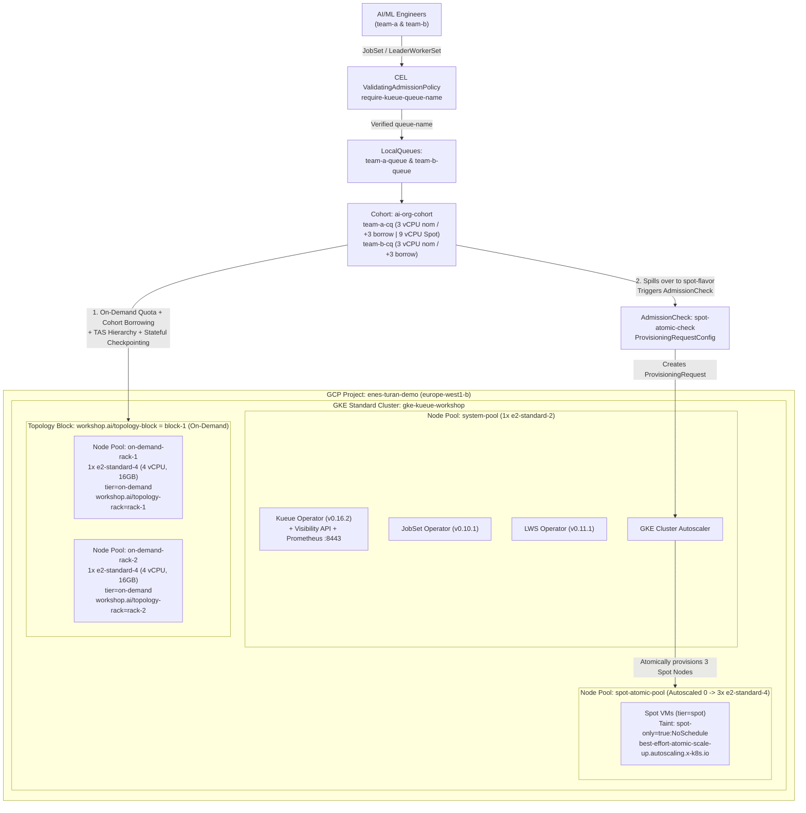

# Cloud-Native AI/ML Batch & Inference Scheduling on GKE with Kueue, JobSet & LeaderWorkerSet

Production-grade, hands-on workshop demonstrating **Cloud-Native AI/ML Batch Training & Multi-Pod Inference Scheduling on Google Kubernetes Engine (GKE)** using **Kueue (`v1beta2`)**, **JobSet (`v1alpha2`)**, **LeaderWorkerSet (`v1`)**, **Topology Aware Scheduling (TAS)**, **Multi-Team Cohorts**, **Stateful Checkpointing**, **CEL Admission Governance**, **SLA Timeouts**, and **Atomic `ProvisioningRequest` (Dynamic Workload Scheduler simulation)** — running 100% on low-cost **CPU-only GKE nodes** using **PyTorch `DistributedDataParallel (DDP)` and Tensor-Parallel `AllReduce` over the `gloo` backend**.

---

## Documentation Index (`docs/`)

Start here for deep-dive architectural guides, capacity engineering math, live GKE `v1.36` field notes, and speaker runbooks:

| Guide | Description |
| :--- | :--- |
| **[01 — Concepts & Architecture](docs/01-concepts-and-architecture.md)** | Why default Kubernetes fails for distributed AI/ML; deep dive into Kueue `v1beta2`, Multi-Team Cohorts, `JobSet` `v1alpha2`, `LeaderWorkerSet` `v1`, PyTorch DDP/TP (`gloo`), Topology Aware Scheduling (TAS), GKE Atomic `ProvisioningRequest`, Stateful Checkpointing, CEL Governance, and Kueue Observability. |
| **[02 — Infrastructure & Capacity Math](docs/02-infrastructure-and-capacity-math.md)** | Strict separation of Terraform (`hashicorp/google`) vs. K8s, custom `workshop.ai/topology-*` labels, `ai-org-cohort` borrowing/reclamation math, and real `e2-standard-4` allocatable CPU math (`3292m–3494m` free per node) across all 9 labs. |
| **[03 — Step-by-Step Labs Guide (Labs 1–9)](docs/03-labs-step-by-step-guide.md)** | Manifest breakdowns, Mermaid sequence diagrams, verification commands, and real terminal outputs from GKE `v1.36.4-gke.1391002` across all 9 labs. |
| **[04 — Production Gotchas & Troubleshooting](docs/04-production-gotchas-and-troubleshooting.md)** | Ten critical engineering lessons from live GKE testing (`best-effort-atomic-scale-up.autoscaling.x-k8s.io`, TAS spillover rules, `v1beta2` `cohortName`, `JobSet` webhook immutability, LWS Cross-PodSet TAS `podset-group-name`, `reclaimWithinCohort`, PID 1 `exec torchrun` `SIGTERM` checkpointing, CEL governance, and `enableClusterQueueResources` Prometheus scraping). |
| **[05 — Speaker Demo Cheat Sheet](docs/05-speaker-demo-cheatsheet.md)** | Two-Terminal Split-Screen Runbook (`watch` observer + command driver) with speaker talking points for all 9 live demos. |

---

## Architecture Overview

### Strict Two-Layer Separation of Concerns
1. **Layer 1 — Cloud Infrastructure ([`terraform/`](terraform/)):**
   - Managed **100% via Terraform** using **only** `hashicorp/google` (`~> 6.0`). Zero `kubernetes`, `helm`, or `kubectl` providers are mixed into the infrastructure state.
   - Provisions a custom VPC, secondary Pod/Service CIDR subnets, a least-privilege Node Service Account, a Zonal GKE Standard Cluster (`europe-west1-b`), and **4 specialized Node Pools**.
   - **Declarative Topology Labels:** Because the GKE API restricts user-defined labels under `cloud.google.com/`, custom topology labels (`workshop.ai/topology-block` and `workshop.ai/topology-rack`) are declaratively injected at the Terraform node pool level.

2. **Layer 2 — Kubernetes & Batch/Inference Orchestration ([`k8s/`](k8s/) & [`Makefile`](Makefile)):**
   - **Helm OCI Charts:** Installs upstream **JobSet** (`v0.10.1`), **LeaderWorkerSet** (`v0.11.1`), and **Kueue** (`v0.16.2`), pinned to `system-pool` (`workload=system`).
   - **Kustomize ([`k8s/base/`](k8s/base/)):** Configures multi-team namespaces (`team-a`, `team-b` labeled `kueue-governance: "enforced"`), zero-build PyTorch `gloo` DDP training, stateful checkpointing, and LWS Tensor-Parallel inference scripts (`ConfigMap`), native Kubernetes CEL `ValidatingAdmissionPolicy` (`require-kueue-queue-name`), and Kueue `v1beta2` objects (`Topology`, `ResourceFlavor`, `ProvisioningRequestConfig`, `AdmissionCheck`, `WorkloadPriorityClass`, `ClusterQueue`s `team-a-cq` & `team-b-cq` in `ai-org-cohort`, and `LocalQueue`s).
   - **Declarative Lab Scenarios ([`k8s/labs/`](k8s/labs/)):** Nine progressive hands-on labs using the official 548 MB `pytorch/torchserve:0.12.0-cpu` (`PyTorch 2.4.0+cpu`) image.



---

## Quickstart

### Prerequisites
- [`gcloud` CLI](https://cloud.google.com/sdk/docs/install) + `gke-gcloud-auth-plugin`
- [`terraform`](https://developer.hashicorp.com/terraform/install) (`>= 1.6.0`)
- [`kubectl`](https://kubernetes.io/docs/tasks/tools/) (`>= 1.30`)
- [`helm`](https://helm.sh/docs/intro/install/) (`>= 3.14` / `4.x` with OCI support)

### 1. Provision Infrastructure & Configure Cluster
```bash
make infra-init        # Initialize Terraform providers
make infra-up          # Provision VPC, GKE cluster, and 4 node pools (~9 mins)
make kubeconfig        # Configure local ~/.kube/config
make operators-install # Install JobSet (v0.10.1), LWS (v0.11.1) & Kueue (v0.16.2) on system-pool
make base-apply        # Apply Namespaces, PyTorch ConfigMaps, CEL Governance, and Kueue v1beta2 setup
make preflight         # Run 15-second 14-point pre-flight health check across nodes, operators & queues
make status            # Inspect Nodes, Topology labels, Queues, and AdmissionChecks
```

### 2. Run the 9 Hands-On Labs (Individually or Automated E2E Suite)
See **[`docs/03-labs-step-by-step-guide.md`](docs/03-labs-step-by-step-guide.md)** for full walkthroughs and verified outputs:

| Target | Lab Scenario | Key Capability Demonstrated |
| :--- | :--- | :--- |
| **`make preflight`** | **Pre-Flight Check** | Runs [`scripts/preflight-check.sh`](scripts/preflight-check.sh) to verify node topology labels, free allocatable CPU ($\ge 3000\text{m}$), operator webhooks, Kueue `v1beta2` queues, CEL policies, and observability endpoints. |
| **`make test-all`** | **9-Lab E2E Smoke Suite** | Runs [`scripts/smoke-test-all.sh`](scripts/smoke-test-all.sh) to execute and assert all 9 hands-on labs end-to-end with a pass/fail summary table. |
| **`make lab1`** | **Gang Scheduling** | Submits $2 \times 4\text{ vCPU}$ PyTorch DDP `JobSet`s against a $6\text{ vCPU}$ effective On-Demand quota; admits JobSet 1 ($2/2$ Pods) and holds JobSet 2 suspended until JobSet 1 finishes. |
| **`make lab2`** | **Topology Aware Scheduling (TAS)** | Uses `kueue.x-k8s.io/podset-required-topology: "workshop.ai/topology-rack"` to force both worker Pods ($2 \times 1200\text{m}$) onto the **exact same rack node**. |
| **`make lab3`** | **Atomic Spot Scale-Up (DWS Sim)** | Submits a $7.5\text{ vCPU}$ ($3 \times 2500\text{m}$) `JobSet` that spills over to `spot-flavor`, triggers a GKE `ProvisioningRequest` (`best-effort-atomic-scale-up.autoscaling.x-k8s.io`), and scales `spot-atomic-pool` from `0 -> 3` Spot nodes atomically. |
| **`make lab4`** | **Priority Preemption** | Starts a low-priority `research-long-training` job (`priority=100`), then submits `urgent-prod-training` (`priority=1000`) which immediately preempts (`Evicted=True`) the research job, completes 4 epochs, and allows automatic re-admission. |
| **`make lab5`** | **Multi-Team Cohort Reclamation** | `team-a` borrows $2\text{ vCPUs}$ from `team-b-cq` to run a `5 vCPU` high-priority job (`priority=1000`). When `team-b` submits a low-priority job (`priority=100`), `team-b-cq` reclaims its nominal quota (`reclaimWithinCohort: Any`), preempting `team-a` (`reason: InCohortReclamation`). |
| **`make lab6`** | **LeaderWorkerSet + Cross-PodSet TAS** | Deploys a 2-Pod (`1` Leader + `1` Worker) Tensor-Parallel `LeaderWorkerSet` inference server using `podset-group-name: "lws-rack-group"` to co-locate both PodSets on the **exact same rack node** and serve `/infer` over `gloo`. |
| **`make lab7`** | **Stateful Checkpointing & Resume** | `resumable-research-job` saves atomic PyTorch DDP checkpoints after Epochs 1–4, gets preempted by `urgent-checkpoint-preemptor`, and automatically resumes from **Epoch 5/8** (`Zero Goodput Lost!`) upon re-admission. |
| **`make lab8`** | **CEL Governance & Max-Exec-Time SLA** | Blocks an unlabeled rogue `JobSet` via Kubernetes `ValidatingAdmissionPolicy` (`require-kueue-queue-name`), then auto-evicts and deactivates a runaway job after its 20-second SLA (`kueue.x-k8s.io/max-exec-time-seconds: "20"`). |
| **`make lab9`** | **Visibility API & Prometheus Metrics** | Queries Kueue's `v1beta2` `PendingWorkloadsSummary` API to prove a high-priority job jumps to Position `0` ahead of an earlier low-priority job, and scrapes live `ClusterQueue` metrics from `:8443/metrics`. |
| **`make labs-clean`** | **Cleanup Workloads** | Deletes all `JobSet` and `LeaderWorkerSet` resources across `team-a` and `team-b`. |

### 3. Teardown
```bash
make labs-clean
make infra-down
```
