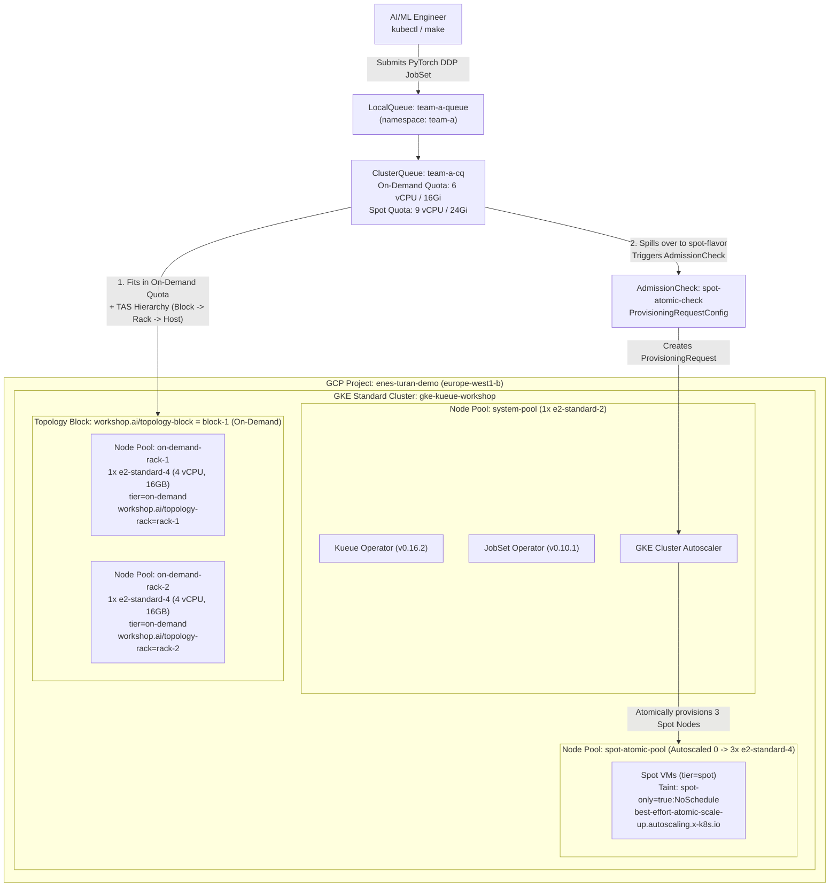

# Cloud-Native AI/ML Batch Scheduling on GKE with Kueue & JobSet

Production-grade, hands-on workshop demonstrating **Cloud-Native AI/ML Batch Scheduling on Google Kubernetes Engine (GKE)** using **Kueue (`v1beta2`)**, **JobSet (`v1alpha2`)**, **Topology Aware Scheduling (TAS)**, and **Atomic `ProvisioningRequest` (Dynamic Workload Scheduler simulation)** — running 100% on low-cost **CPU-only GKE nodes** using **PyTorch `DistributedDataParallel (DDP)` with the `gloo` backend**.

---

## Documentation Index (`docs/`)

Start here for deep-dive architectural guides, capacity engineering math, live GKE `v1.36` field notes, and speaker runbooks:

| Guide | Description |
| :--- | :--- |
| **[01 — Concepts & Architecture](docs/01-concepts-and-architecture.md)** | Why default Kubernetes fails for distributed AI/ML; deep dive into Kueue `v1beta2`, `JobSet` `v1alpha2`, PyTorch DDP (`gloo`), Topology Aware Scheduling (TAS), and GKE Atomic `ProvisioningRequest`. |
| **[02 — Infrastructure & Capacity Math](docs/02-infrastructure-and-capacity-math.md)** | Strict separation of Terraform (`hashicorp/google`) vs. K8s, custom `workshop.ai/topology-*` labels, and real `e2-standard-4` allocatable CPU math (`3292m–3494m` free per node). |
| **[03 — Step-by-Step Labs Guide (Labs 1–4)](docs/03-labs-step-by-step-guide.md)** | Manifest breakdowns, Mermaid sequence diagrams, verification commands, and real terminal outputs from GKE `v1.36.4-gke.1391002`. |
| **[04 — Production Gotchas & Troubleshooting](docs/04-production-gotchas-and-troubleshooting.md)** | Five critical engineering lessons from live GKE testing (`best-effort-atomic-scale-up.autoscaling.x-k8s.io`, TAS spillover rules, `v1beta2` `cohortName`, `JobSet` webhook immutability, and lightweight CPU PyTorch images). |
| **[05 — Speaker Demo Cheat Sheet](docs/05-speaker-demo-cheatsheet.md)** | Two-Terminal Split-Screen Runbook (`watch` observer + command driver) with speaker talking points for live talks. |

---

## Architecture Overview

### Strict Two-Layer Separation of Concerns
1. **Layer 1 — Cloud Infrastructure ([`terraform/`](terraform/)):**
   - Managed **100% via Terraform** using **only** `hashicorp/google` (`~> 6.0`). Zero `kubernetes`, `helm`, or `kubectl` providers are mixed into the infrastructure state.
   - Provisions a custom VPC, secondary Pod/Service CIDR subnets, a least-privilege Node Service Account, a Zonal GKE Standard Cluster (`europe-west1-b`), and **4 specialized Node Pools**.
   - **Declarative Topology Labels:** Because the GKE API restricts user-defined labels under `cloud.google.com/`, custom topology labels (`workshop.ai/topology-block` and `workshop.ai/topology-rack`) are declaratively injected at the Terraform node pool level.

2. **Layer 2 — Kubernetes & Batch Orchestration ([`k8s/`](k8s/) & [`Makefile`](Makefile)):**
   - **Helm OCI Charts:** Installs upstream **JobSet** (`v0.10.1`) and **Kueue** (`v0.16.2`), pinned to `system-pool` (`workload=system`).
   - **Kustomize ([`k8s/base/`](k8s/base/)):** Configures multi-team namespaces (`team-a`, `team-b`), a zero-build PyTorch `gloo` DDP training script (`ConfigMap`), and Kueue `v1beta2` objects (`Topology`, `ResourceFlavor`, `ProvisioningRequestConfig`, `AdmissionCheck`, `WorkloadPriorityClass`, `ClusterQueue`, `LocalQueue`).
   - **Declarative Lab Scenarios ([`k8s/labs/`](k8s/labs/)):** Four progressive hands-on labs using the official 548 MB `pytorch/torchserve:0.12.0-cpu` (`PyTorch 2.4.0+cpu`) image.



---

## Repository Structure

```text
gke-kueue-ai-workshop/
├── .gitignore
├── LICENSE
├── Makefile                                            # Self-documenting workflow orchestration
├── README.md                                           # Workshop overview & quickstart
├── docs/                                               # Zero-to-advanced documentation suite
│   ├── 01-concepts-and-architecture.md
│   ├── 02-infrastructure-and-capacity-math.md
│   ├── 03-labs-step-by-step-guide.md
│   ├── 04-production-gotchas-and-troubleshooting.md
│   └── 05-speaker-demo-cheatsheet.md
├── terraform/                                          # LAYER 1: Pure GCP Cloud Infrastructure
│   ├── versions.tf                                     # hashicorp/google (~> 6.0) only
│   ├── variables.tf                                    # Project, Region, Zone, Cluster variables
│   ├── network_iam.tf                                  # GCP APIs, Custom VPC, Subnet, Node SA
│   ├── gke.tf                                          # Zonal GKE Cluster + 4 Node Pools
│   └── outputs.tf                                      # Cluster info & gcloud kubeconfig command
└── k8s/                                                # LAYER 2: Operators, Kustomize & Labs
    ├── base/
    │   ├── kustomization.yaml                          # Unified entrypoint for base K8s resources
    │   ├── namespaces.yaml                             # team-a and team-b namespaces
    │   ├── pytorch-ddp-configmap.yaml                  # Zero-build PyTorch DDP (gloo) script
    │   └── kueue-setup.yaml                            # Kueue v1beta2 Topology, Flavors, Queues, DWS
    └── labs/
        ├── lab1-gang-scheduling.yaml                   # Lab 1: All-or-Nothing Gang Admission
        ├── lab2-tas-rack.yaml                          # Lab 2: Topology Aware Scheduling (Same Rack)
        ├── lab3-spot-atomic.yaml                       # Lab 3: Spot Spillover & Atomic Scale-Up
        └── lab4-preemption.yaml                        # Lab 4: Priority-Based Workload Preemption
```

---

## Quickstart

### Prerequisites
- [`gcloud` CLI](https://cloud.google.com/sdk/docs/install) + `gke-gcloud-auth-plugin`
- [`terraform`](https://developer.hashicorp.com/terraform/install) (`>= 1.6.0`)
- [`kubectl`](https://kubernetes.io/docs/tasks/tools/) (`>= 1.30`)
- [`helm`](https://helm.sh/docs/intro/install/) (`>= 3.14` / `4.x` with OCI support)

### 1. Provision Infrastructure & Configure Cluster
```bash
make infra-init        # Initialize Terraform providers
make infra-up          # Provision VPC, GKE cluster, and 4 node pools (~9 mins)
make kubeconfig        # Configure local ~/.kube/config
make operators-install # Install JobSet (v0.10.1) & Kueue (v0.16.2) on system-pool
make base-apply        # Apply Namespaces, PyTorch ConfigMap, and Kueue v1beta2 setup
make status            # Inspect Nodes, Topology labels, Queues, and AdmissionChecks
```

### 2. Run the 4 Hands-On Labs
See **[`docs/03-labs-step-by-step-guide.md`](docs/03-labs-step-by-step-guide.md)** for full walkthroughs and expected outputs:

| Target | Lab Scenario | Key Capability Demonstrated |
| :--- | :--- | :--- |
| **`make lab1`** | **Gang Scheduling** | Submits $2 \times 4\text{ vCPU}$ PyTorch DDP `JobSet`s against a $6\text{ vCPU}$ On-Demand quota; admits JobSet 1 ($2/2$ Pods) and holds JobSet 2 suspended until JobSet 1 finishes. |
| **`make lab2`** | **Topology Aware Scheduling (TAS)** | Uses `kueue.x-k8s.io/podset-required-topology: "workshop.ai/topology-rack"` to force both worker Pods ($2 \times 1200\text{m}$) onto the **exact same rack node**. |
| **`make lab3`** | **Atomic Spot Scale-Up (DWS Sim)** | Submits a $7.5\text{ vCPU}$ ($3 \times 2500\text{m}$) `JobSet` that spills over to `spot-flavor`, triggers a GKE `ProvisioningRequest` (`best-effort-atomic-scale-up.autoscaling.x-k8s.io`), and scales `spot-atomic-pool` from `0 -> 3` Spot nodes atomically. |
| **`make lab4`** | **Priority Preemption** | Starts a low-priority `research-long-training` job (`priority=100`), then submits `urgent-prod-training` (`priority=1000`) which immediately preempts (`Evicted=True`) the research job, completes 4 epochs, and allows automatic re-admission. |
| **`make labs-clean`** | **Cleanup Workloads** | Deletes all lab `JobSet` resources in namespace `team-a`. |

### 3. Teardown
```bash
make labs-clean
make infra-down
```
