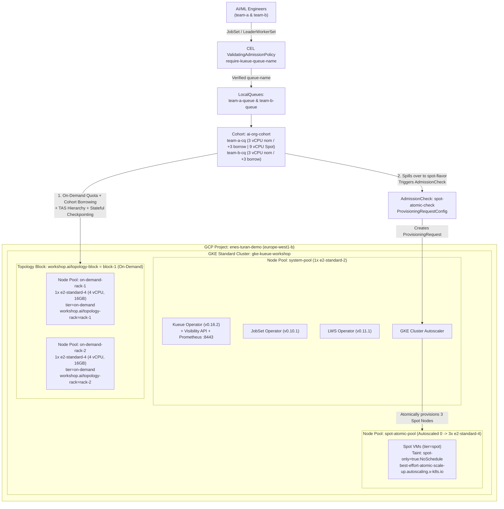

<div align="center">

# Cloud-Native AI/ML Batch & Inference Scheduling on GKE

**Production-Grade Distributed Training & Multi-Pod Inference Orchestration with Kueue (`v1beta2`), JobSet (`v1alpha2`), LeaderWorkerSet (`v1`), Topology Aware Scheduling (TAS) & Dynamic Workload Scheduler (DWS)**

[](https://github.com/devenes/gke-kueue-ai-workshop/actions/workflows/ci.yml)
[](https://cloud.google.com/kubernetes-engine)
[-326CE5?logo=kubernetes&logoColor=white)](https://kueue.sigs.k8s.io/)
[](https://jobset.sigs.k8s.io/)
[](https://lws.sigs.k8s.io/)
[-EE4C2C?logo=pytorch&logoColor=white)](https://pytorch.org/)
[](https://www.terraform.io/)
[-2EA44F)](#architecture-overview)

[**Quickstart**](#quickstart) · [**Architecture**](#architecture-overview) · [**9 Hands-On Labs**](#9-hands-on-labs) · [**Documentation (`docs/`)**](#documentation-index-docs) · [**Speaker Runbook**](docs/05-speaker-demo-cheatsheet.md)

</div>

---

## Why This Repository?

Most distributed AI/ML scheduling tutorials require expensive H100/L4 GPU reservations or stop at trivial `sleep` pods. This repository provides a **100% reproducible, production-faithful AI/ML platform blueprint** that runs on standard CPU-only GKE nodes (`~$0.40/hr` total):

- **Zero GPU Quota Required:** Runs real multi-node **PyTorch `DistributedDataParallel (DDP)`** (`torchrun`) and **2-Shard Tensor-Parallel `AllReduce` HTTP Inference** over the `gloo` CPU backend—exhibiting the exact same gang-scheduling barriers, collective rendezvous, and `SIGTERM` checkpoint semantics as 1,000-GPU clusters.
- **Zero Container Build Latency:** Uses the official 548 MB `pytorch/torchserve:0.12.0-cpu` (`PyTorch 2.4.0+cpu`) image with training and inference scripts injected dynamically via Kubernetes `ConfigMap`s.
- **Strict Infra vs. K8s Separation:** Layer 1 (`terraform/`) uses **only** `hashicorp/google` (`~> 6.0`) with zero `kubernetes`/`helm` state coupling. Layer 2 (`k8s/` + `Makefile`) manages OCI Helm operators, Kustomize base policies, and 9 progressive lab manifests.
- **Automated Verification & CI Suite:** Includes a 15-second **14-point Pre-Flight Check** ([`scripts/preflight-check.sh`](scripts/preflight-check.sh)), a **9-Lab E2E Smoke Test Suite** ([`scripts/smoke-test-all.sh`](scripts/smoke-test-all.sh)), and a zero-credential **GitHub Actions Static Analysis CI Pipeline** ([`.github/workflows/ci.yml`](.github/workflows/ci.yml)).

---

## Quickstart

### Prerequisites
- [`gcloud` CLI](https://cloud.google.com/sdk/docs/install) + `gke-gcloud-auth-plugin`
- [`terraform`](https://developer.hashicorp.com/terraform/install) (`>= 1.6.0`)
- [`kubectl`](https://kubernetes.io/docs/tasks/tools/) (`>= 1.30`)
- [`helm`](https://helm.sh/docs/intro/install/) (`>= 3.14` / `4.x` with OCI support)

### 1. Provision Infrastructure & Configure Cluster
```bash
make lint              # Run local static analysis (Terraform fmt/validate, Kustomize, Python AST, ShellCheck)
make infra-init        # Initialize Terraform providers
make infra-up          # Provision VPC, GKE cluster, and 4 node pools (~9 mins)
make kubeconfig        # Configure local ~/.kube/config
make operators-install # Install JobSet (v0.10.1), LWS (v0.11.1) & Kueue (v0.16.2) on system-pool
make base-apply        # Apply Namespaces, PyTorch ConfigMaps, CEL Governance, and Kueue v1beta2 setup
make preflight         # Run 15-second 14-point pre-flight health check across nodes, operators & queues
make status            # Inspect Nodes, Topology labels, Queues, and AdmissionChecks
```

### 2. Run Automated Smoke Suite or Individual Labs
```bash
make test-all          # Run end-to-end automated regression suite across all 9 labs
make lab1              # Or run any individual lab (lab1 through lab9)
make labs-clean        # Clean up all JobSets and LeaderWorkerSets between labs
```

### 3. Teardown
```bash
make labs-clean
make infra-down        # Destroy GKE cluster, Node Pools, VPC, and IAM resources
```

---

## 9 Hands-On Labs

See **[`docs/03-labs-step-by-step-guide.md`](docs/03-labs-step-by-step-guide.md)** for architectural walkthroughs, Mermaid sequence diagrams, and verified outputs from GKE `v1.36.4-gke.1391002`:

| Target | Lab Scenario | Manifest | Key Capability Demonstrated |
| :--- | :--- | :--- | :--- |
| **`make lab1`** | **1. Gang Scheduling** | [`lab1-gang-scheduling.yaml`](k8s/labs/lab1-gang-scheduling.yaml) | Submits two `4 vCPU` (`2 × 2000m`) PyTorch DDP `JobSet`s against a `6 vCPU` effective On-Demand quota; admits JobSet 1 (`2/2` Pods) and holds JobSet 2 suspended until JobSet 1 finishes. |
| **`make lab2`** | **2. Topology Aware Scheduling (TAS)** | [`lab2-tas-rack.yaml`](k8s/labs/lab2-tas-rack.yaml) | Uses `kueue.x-k8s.io/podset-required-topology: "workshop.ai/topology-rack"` to force both DDP worker Pods (`2 × 1200m`) onto the **exact same rack node** for ultra-low `AllReduce` latency. |
| **`make lab3`** | **3. Atomic Spot Scale-Up (DWS Sim)** | [`lab3-spot-atomic.yaml`](k8s/labs/lab3-spot-atomic.yaml) | Submits a `7.5 vCPU` (`3 × 2500m`) `JobSet` that spills over to `spot-flavor`, triggers a GKE `ProvisioningRequest` (`best-effort-atomic-scale-up.autoscaling.x-k8s.io`), and scales `spot-atomic-pool` from `0 -> 3` Spot nodes atomically. |
| **`make lab4`** | **4. Intra-Queue Priority Preemption** | [`lab4-preemption.yaml`](k8s/labs/lab4-preemption.yaml) | Starts a low-priority `research-long-training` job (`priority=100`), then submits `urgent-prod-training` (`priority=1000`) which immediately preempts (`Evicted=True`) the research job, completes 4 epochs, and allows automatic re-admission. |
| **`make lab5`** | **5. Multi-Team Cohort Reclamation** | [`lab5-cohort-borrowing.yaml`](k8s/labs/lab5-cohort-borrowing.yaml) | `team-a` borrows `2 vCPUs` from `team-b-cq` in `ai-org-cohort` to run a `5 vCPU` high-priority job (`priority=1000`). When `team-b` submits a low-priority job (`priority=100`), `team-b-cq` reclaims its nominal quota (`reclaimWithinCohort: Any`), preempting `team-a` (`reason: InCohortReclamation`). |
| **`make lab6`** | **6. LeaderWorkerSet + Cross-PodSet TAS** | [`lab6-lws-inference-tas.yaml`](k8s/labs/lab6-lws-inference-tas.yaml) | Deploys a 2-Pod (`1` Leader + `1` Worker) Tensor-Parallel `LeaderWorkerSet` inference server using `podset-group-name: "lws-rack-group"` to co-locate both PodSets on the **exact same rack node** and serve `/infer` over `gloo`. |
| **`make lab7`** | **7. Stateful Checkpointing & Resume** | [`lab7-checkpoint-resume.yaml`](k8s/labs/lab7-checkpoint-resume.yaml) | `resumable-research-job` saves atomic PyTorch DDP checkpoints after Epochs 1–4, traps `SIGTERM` via `exec torchrun` when preempted by `urgent-checkpoint-preemptor`, and automatically resumes from **Epoch 5/8** (`Zero Goodput Lost!`) upon re-admission. |
| **`make lab8`** | **8. CEL Governance & Max-Exec-Time SLA** | [`lab8-governance-and-max-exec.yaml`](k8s/labs/lab8-governance-and-max-exec.yaml) | Blocks an unlabeled rogue `JobSet` at the API server via Kubernetes `ValidatingAdmissionPolicy` (`require-kueue-queue-name`), then auto-evicts and deactivates a runaway job after its 20-second SLA (`kueue.x-k8s.io/max-exec-time-seconds: "20"`). |
| **`make lab9`** | **9. Visibility API & Prometheus Metrics** | [`lab9-visibility-and-metrics.yaml`](k8s/labs/lab9-visibility-and-metrics.yaml) | Queries Kueue's `v1beta2` `PendingWorkloadsSummary` API to prove a high-priority job jumps to `positionInClusterQueue: 0` ahead of an earlier low-priority job, and scrapes live `ClusterQueue` metrics from `:8443/metrics`. |

---

## Architecture Overview

### Strict Two-Layer Separation of Concerns
1. **Layer 1 — Cloud Infrastructure ([`terraform/`](terraform/)):**
   - Managed **100% via Terraform** using **only** `hashicorp/google` (`~> 6.0`). Zero `kubernetes`, `helm`, or `kubectl` providers are mixed into the infrastructure state.
   - Provisions a custom VPC, secondary Pod/Service CIDR subnets, a least-privilege Node Service Account, a Zonal GKE Standard Cluster (`europe-west1-b`), and **4 specialized Node Pools**.
   - **Declarative Topology Labels:** Because the GKE API restricts user-defined labels under `cloud.google.com/`, custom topology labels (`workshop.ai/topology-block` and `workshop.ai/topology-rack`) are declaratively injected at the Terraform node pool level.

2. **Layer 2 — Kubernetes & Batch/Inference Orchestration ([`k8s/`](k8s/) & [`Makefile`](Makefile)):**
   - **Helm OCI Charts:** Installs upstream **JobSet** (`v0.10.1`), **LeaderWorkerSet** (`v0.11.1`), and **Kueue** (`v0.16.2`), pinned to `system-pool` (`workload=system`).
   - **Kustomize ([`k8s/base/`](k8s/base/)):** Configures multi-team namespaces (`team-a`, `team-b` labeled `kueue-governance: "enforced"`), zero-build PyTorch `gloo` DDP training, stateful checkpointing, and LWS Tensor-Parallel inference scripts (`ConfigMap`), native Kubernetes CEL `ValidatingAdmissionPolicy` (`require-kueue-queue-name`), and Kueue `v1beta2` objects (`Topology`, `ResourceFlavor`, `ProvisioningRequestConfig`, `AdmissionCheck`, `WorkloadPriorityClass`, `ClusterQueue`s `team-a-cq` & `team-b-cq` in `ai-org-cohort`, and `LocalQueue`s).



### Cluster Node Pools & Quota Blueprint

| Node Pool | Machine Type | Scaling | Node Labels & Taints | Kueue Flavor / Role |
| :--- | :--- | :--- | :--- | :--- |
| **`system-pool`** | `e2-standard-2` (`2 vCPU`, `8 GB`) | Static `1` node | `workload=system` | Hosts `kueue`, `jobset`, and `lws` operators in isolation |
| **`on-demand-rack-1`** | `e2-standard-4` (`4 vCPU`, `16 GB`) | Static `1` node | `tier=on-demand`, `workshop.ai/topology-block=block-1`, `workshop.ai/topology-rack=rack-1` | `on-demand-flavor` (`~3484m` free allocatable CPU) |
| **`on-demand-rack-2`** | `e2-standard-4` (`4 vCPU`, `16 GB`) | Static `1` node | `tier=on-demand`, `workshop.ai/topology-block=block-1`, `workshop.ai/topology-rack=rack-2` | `on-demand-flavor` (`~3292m` free allocatable CPU) |
| **`spot-atomic-pool`** | `e2-standard-4` (`4 vCPU`, `16 GB`, Spot) | Autoscaled `0 -> 3` | `tier=spot`, Taint: `spot-only=true:NoSchedule` | `spot-flavor` via `ProvisioningRequest` (`9 vCPU` quota) |

---

## Documentation Index (`docs/`)

Start here for deep-dive architectural guides, capacity engineering math, live GKE `v1.36` field notes, and speaker runbooks:

| Guide | Description |
| :--- | :--- |
| **[01 — Concepts & Architecture](docs/01-concepts-and-architecture.md)** | Why default Kubernetes fails for distributed AI/ML; deep dive into Kueue `v1beta2`, Multi-Team Cohorts, `JobSet` `v1alpha2`, `LeaderWorkerSet` `v1`, PyTorch DDP/TP (`gloo`), Topology Aware Scheduling (TAS), GKE Atomic `ProvisioningRequest`, Stateful Checkpointing, CEL Governance, and Kueue Observability. |
| **[02 — Infrastructure & Capacity Math](docs/02-infrastructure-and-capacity-math.md)** | Strict separation of Terraform (`hashicorp/google`) vs. K8s, custom `workshop.ai/topology-*` labels, `ai-org-cohort` borrowing/reclamation math, and real `e2-standard-4` allocatable CPU math (`3292m–3494m` free per node) across all 9 labs. |
| **[03 — Step-by-Step Labs Guide (Labs 1–9)](docs/03-labs-step-by-step-guide.md)** | Manifest breakdowns, Mermaid sequence diagrams, verification commands, and real terminal outputs from GKE `v1.36.4-gke.1391002` across all 9 labs. |
| **[04 — Production Gotchas & Troubleshooting](docs/04-production-gotchas-and-troubleshooting.md)** | Ten critical engineering lessons from live GKE testing (`best-effort-atomic-scale-up.autoscaling.x-k8s.io`, TAS spillover rules, `v1beta2` `cohortName`, `JobSet` webhook immutability, LWS Cross-PodSet TAS `podset-group-name`, `reclaimWithinCohort`, PID 1 `exec torchrun` `SIGTERM` checkpointing, CEL governance, and `enableClusterQueueResources` Prometheus scraping). |
| **[05 — Speaker Demo Cheat Sheet](docs/05-speaker-demo-cheatsheet.md)** | Two-Terminal Split-Screen Runbook (`watch` observer + command driver) with speaker talking points for all 9 live demos. |

---

## Repository Structure

```text
gke-kueue-ai-workshop/
├── .github/
│   └── workflows/
│       └── ci.yml                                      # GitHub Actions CI (Terraform, Kustomize, kubeconform, AST, ShellCheck)
├── .gitignore
├── .yamllint.yaml                                      # YAML lint rules for K8s manifests & GitHub Actions
├── LICENSE
├── Makefile                                            # Self-documenting workflow orchestration (including `make lint`)
├── README.md                                           # Workshop overview, architecture & quickstart
├── docs/                                               # Zero-to-advanced documentation suite
│   ├── 01-concepts-and-architecture.md
│   ├── 02-infrastructure-and-capacity-math.md
│   ├── 03-labs-step-by-step-guide.md
│   ├── 04-production-gotchas-and-troubleshooting.md
│   └── 05-speaker-demo-cheatsheet.md
├── scripts/                                            # Automated pre-flight & E2E verification suite
│   ├── preflight-check.sh                              # 15-second 14-point cluster readiness check
│   └── smoke-test-all.sh                               # Automated 9-lab end-to-end regression suite
├── terraform/                                          # LAYER 1: Pure GCP Cloud Infrastructure
│   ├── versions.tf                                     # hashicorp/google (~> 6.0) only
│   ├── variables.tf                                    # Project, Region, Zone, Cluster variables
│   ├── network_iam.tf                                  # GCP APIs, Custom VPC, Subnet, Node SA
│   ├── gke.tf                                          # Zonal GKE Cluster + 4 Node Pools
│   └── outputs.tf                                      # Cluster info & gcloud kubeconfig command
└── k8s/                                                # LAYER 2: Operators, Kustomize & Labs
    ├── base/
    │   ├── kustomization.yaml                          # Unified entrypoint for base K8s resources
    │   ├── namespaces.yaml                             # team-a & team-b (kueue-governance=enforced)
    │   ├── pytorch-ddp-configmap.yaml                  # PyTorch DDP, Checkpointing & LWS TP scripts
    │   ├── kueue-setup.yaml                            # Kueue v1beta2 Topology, Flavors, Cohort Queues, DWS
    │   └── governance-policy.yaml                      # CEL ValidatingAdmissionPolicy & Metrics RBAC
    └── labs/
        ├── lab1-gang-scheduling.yaml                   # Lab 1: All-or-Nothing Gang Admission
        ├── lab2-tas-rack.yaml                          # Lab 2: Topology Aware Scheduling (Same Rack)
        ├── lab3-spot-atomic.yaml                       # Lab 3: Spot Spillover & Atomic Scale-Up
        ├── lab4-preemption.yaml                        # Lab 4: Intra-Queue Priority Preemption
        ├── lab5-cohort-borrowing.yaml                  # Lab 5: Multi-Team Cohort Borrowing & Reclamation
        ├── lab6-lws-inference-tas.yaml                 # Lab 6: LeaderWorkerSet Inference & Cross-PodSet TAS
        ├── lab7-checkpoint-resume.yaml                 # Lab 7: Stateful DDP Checkpointing & Preemption Resume
        ├── lab8-governance-and-max-exec.yaml           # Lab 8: CEL Admission Governance & Max-Exec-Time SLA
        └── lab9-visibility-and-metrics.yaml            # Lab 9: Kueue Visibility API & Prometheus Metrics
```
