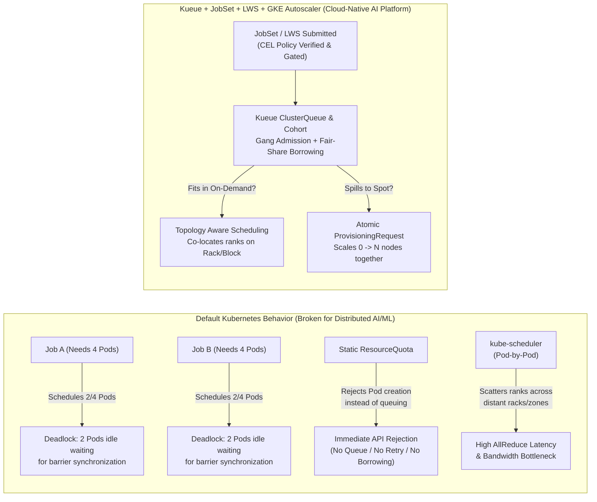
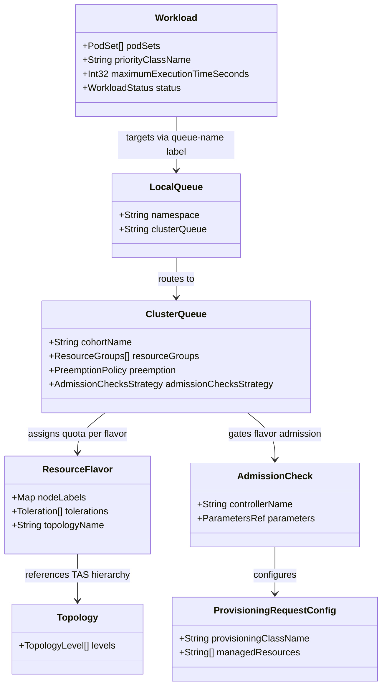
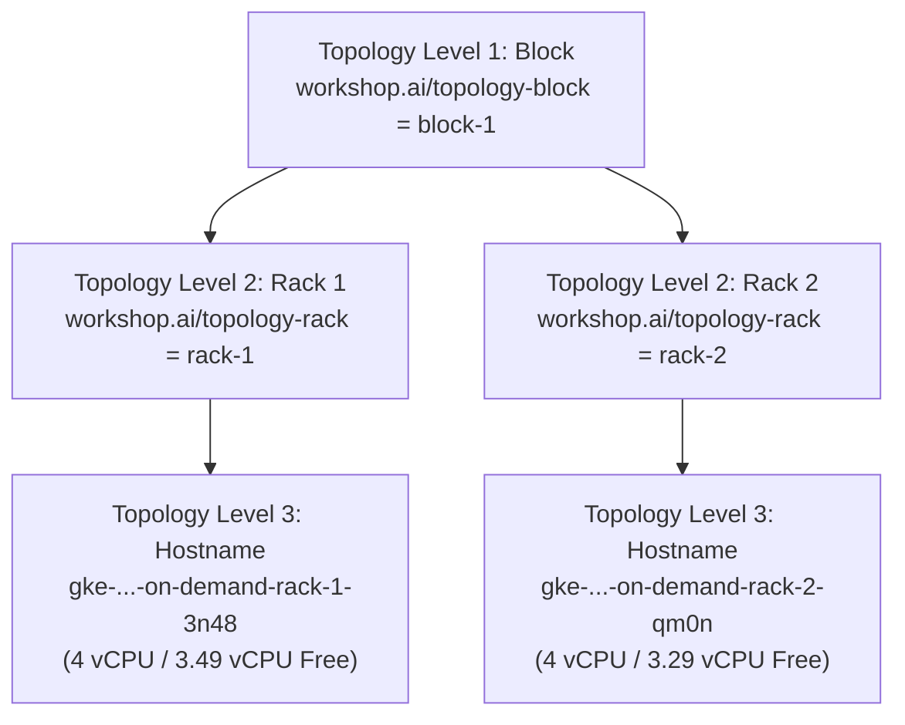
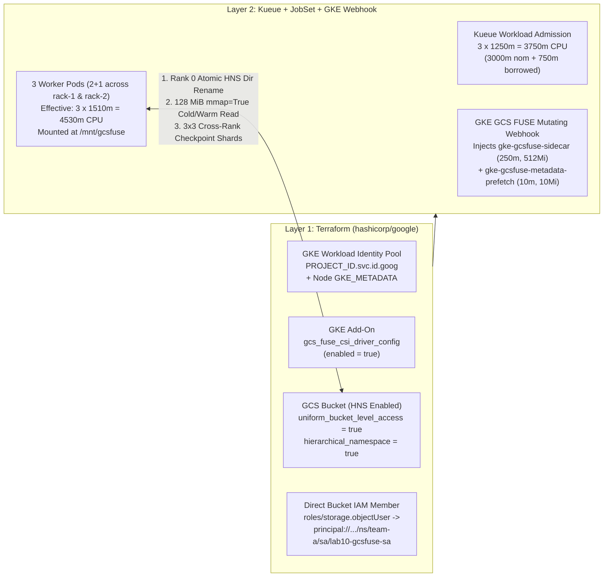

# 01 — Concepts & Architecture: Cloud-Native AI/ML Batch & Inference Scheduling on GKE

This guide covers the theoretical and architectural foundations of distributed AI/ML batch training, multi-pod inference scheduling, and cloud-native AI storage on Kubernetes using **Kueue (`v1beta2`)**, **JobSet (`v1alpha2`)**, **LeaderWorkerSet (`v1`)**, **Topology Aware Scheduling (TAS)**, **Multi-Team Cohorts**, **GKE Atomic `ProvisioningRequest`**, **Stateful Checkpointing**, **CEL Admission Governance**, **Kueue Observability**, and **GKE Cloud Storage FUSE CSI with Hierarchical Namespace (HNS)**.


---

## 1. The Kubernetes Batch & AI/ML Scheduling Gap

Standard Kubernetes controllers (`kube-scheduler`, `batch/v1 Job`, and native `ResourceQuota`) were originally designed for stateless, independently scalable microservices. When applied directly to tightly coupled distributed AI/ML training or multi-pod LLM inference workloads, four critical failure modes emerge:



### Why Default Primitives Fail
1. **Partial Scheduling Deadlocks (Lack of Gang Admission):**
   In PyTorch `DistributedDataParallel (DDP)` and Tensor-Parallel LLM inference, `torch.distributed.init_process_group()` blocks until **every rank** (`0 .. WORLD_SIZE-1`) connects to the `MASTER_ADDR` rendezvous barrier. Because `kube-scheduler` places Pods one by one, two competing 4-Pod jobs on a 4-node cluster can each receive 2 Pods. Both jobs hang indefinitely while hoarding 100% of cluster capacity.
2. **Static `ResourceQuota` Rejects Instead of Queuing or Sharing:**
   Native Kubernetes `ResourceQuota` is an admission blocker, not a queue, and cannot lend idle capacity across namespaces.
3. **Autoscaler Thrashing & Partial Scale-Up:**
   Standard Cluster Autoscaler reacts to Pending Pods individually. If a multi-node job is submitted when only partial Spot VMs are available, the autoscaler provisions partial VMs that sit idle billing money.
4. **Topology Blindness:**
   `kube-scheduler` scores nodes individually without understanding group compactness across hierarchical data-center network tiers (`Block -> Rack -> Host`).

---

## 2. Kueue Core API (`kueue.x-k8s.io/v1beta2`) & Multi-Team Cohorts

**Kueue** is a Kubernetes-native job-level queue manager that decides **when** a workload should be admitted and **where** its resources should be allocated.



### Multi-Team Cohort Quota Borrowing & Reclamation (`ai-org-cohort`)
In [`k8s/base/kueue-setup.yaml`](../k8s/base/kueue-setup.yaml), two `ClusterQueue`s (`team-a-cq` and `team-b-cq`) belong to the same cohort (`cohortName: "ai-org-cohort"`):
- **Nominal Quota vs. Borrowing Limit:** Each team owns `nominalQuota: "3"` vCPUs on `on-demand-flavor`, with `borrowingLimit: "3"`. When `team-b` is idle, `team-a-cq` can seamlessly borrow up to `3` unused vCPUs from `team-b-cq`, reaching `6` vCPUs total.
- **Fair-Share Cohort Reclamation (`reclaimWithinCohort: Any`):** If `team-a` is currently borrowing `team-b`'s quota (even with a high-priority workload, `priority=1000`) and `team-b` submits a new workload into `team-b-queue` (even with a low priority, `priority=100`), Kueue immediately **preempts** the borrowing workload in `team-a-cq` (`reason: InCohortReclamation`) so `team-b-cq` can reclaim its guaranteed nominal quota (**Lab 5**).

---

## 3. Distributed Training (`JobSet`) & Multi-Pod Inference (`LeaderWorkerSet`)

### Batch Training with `JobSet` (`jobset.x-k8s.io/v1alpha2`)
**JobSet** models a distributed batch training workload as a unified gang of `replicatedJobs`:
- Automatically creates a headless Kubernetes `Service` (`<jobset-name>`) providing stable Pod FQDNs (`<jobset-name>-workers-0-0.<jobset-name>`) for `torchrun` rendezvous.
- Supports coordinated gang suspension (`spec.suspend: true`) managed by Kueue.

### Multi-Pod Distributed Inference with `LeaderWorkerSet` (`leaderworkerset.x-k8s.io/v1`)
While `JobSet` targets batch jobs that run to completion, **LeaderWorkerSet (LWS)** is purpose-built for long-running, multi-pod distributed AI inference serving (e.g., sharded Tensor-Parallel / Pipeline-Parallel LLMs across multiple nodes or sockets):
- **Super-Pod Semantics:** Each replica is a tightly coupled group consisting of **1 Leader Pod** (`lws-tas-infer-0`, exposing the HTTP `/infer` ingress endpoint) and **$N-1$ Worker Pods** (`lws-tas-infer-0-1`, holding model tensor shards).
- **Automatic `LWS_LEADER_ADDRESS` Injection:** LWS automatically injects `LWS_LEADER_ADDRESS` into both Leader and Worker Pods so `torch.distributed.init_process_group(backend="gloo")` connects all tensor-parallel shards immediately on startup.
- **Cross-PodSet TAS Co-Location (`podset-group-name`):** Because an LWS replica generates **two distinct PodSets** in the Kueue `Workload` (`leader` and `worker`), annotating both templates with:
  ```yaml
  kueue.x-k8s.io/podset-required-topology: "workshop.ai/topology-rack"
  kueue.x-k8s.io/podset-group-name: "lws-rack-group"
  ```
  instructs Kueue's TAS solver to co-locate **both the Leader PodSet and the Worker PodSet onto the exact same physical rack** (**Lab 6**).

---

## 4. Topology Aware Scheduling (TAS) Hierarchy



- **`kueue.x-k8s.io/podset-required-topology`:** Strict constraint forcing all Pods (or grouped PodSets via `podset-group-name`) into a single topology domain (`workshop.ai/topology-rack` in **Lab 2** and **Lab 6**).
- **`kueue.x-k8s.io/podset-preferred-topology`:** Best-effort packing that spans across racks within `workshop.ai/topology-block` when a single rack cannot fit the entire gang (**Lab 1**, **Lab 4**, **Lab 5**, **Lab 7**, **Lab 9**).

---

## 5. GKE Dynamic Workload Scheduler (DWS) & Atomic `ProvisioningRequest`

| Environment | `ProvisioningRequestConfig.spec.provisioningClassName` | Underlying GKE Mechanism |
| :--- | :--- | :--- |
| **GPU / TPU Clusters** | `queued-provisioning.gke.io` | GKE **Dynamic Workload Scheduler (DWS)** flex-start queuing for scarce accelerators. |
| **CPU Workshop Cluster** | `best-effort-atomic-scale-up.autoscaling.x-k8s.io` | GKE **Cluster Autoscaler Atomic Scale-Up** (`autoscaling.x-k8s.io/v1`), providing the exact same `Kueue -> AdmissionCheck -> ProvisioningRequest -> Atomic Node Provisioning` lifecycle on CPU Spot VMs (**Lab 3**). |

---

## 6. Production Operations: Checkpointing, Governance & Observability (Labs 7–9)

### Stateful DDP Checkpointing & Zero-Goodput-Loss Resume (**Lab 7**)
Preemption (**Lab 4** & **Lab 5**) and Spot reclamation are only acceptable in production AI platforms if preempted training jobs **preserve their training progress ("Goodput")**. In [`k8s/base/pytorch-ddp-configmap.yaml`](../k8s/base/pytorch-ddp-configmap.yaml) (`train_checkpoint.py`), our distributed training loop implements:
- **PID 1 Signal Propagation (`exec torchrun`):** Ensures Kubernetes `SIGTERM` during Kueue eviction reaches `torchrun` and its worker ranks immediately.
- **Atomic Checkpoint Persistence (`os.replace`):** Persists `epoch`, `model_state_dict`, and `optimizer_state_dict` on all ranks after every epoch and upon `SIGTERM`.
- **Cross-Rank Epoch Synchronization (`dist.all_reduce(..., ReduceOp.MAX)`):** On re-admission, workers synchronize the highest persisted epoch across nodes and resume directly from `synced_epoch + 1`.

### Zero-Trust Queue Governance & Time-Bounded SLA Leases (**Lab 8**)
1. **CEL `ValidatingAdmissionPolicy` (`require-kueue-queue-name`):** Without admission enforcement, a user could omit `kueue.x-k8s.io/queue-name` on a `JobSet` or `LeaderWorkerSet` and bypass Kueue's quota gates entirely. Our native Kubernetes `ValidatingAdmissionPolicy` in [`k8s/base/governance-policy.yaml`](../k8s/base/governance-policy.yaml) enforces at the API server level that every `JobSet` and `LeaderWorkerSet` in namespaces labeled `kueue-governance: "enforced"` must declare a non-empty `kueue.x-k8s.io/queue-name` label.
2. **Maximum Execution Time SLA (`kueue.x-k8s.io/max-exec-time-seconds`):** Prevents zombie or runaway jobs from hoarding cluster capacity indefinitely. When a workload's cumulative admitted runtime exceeds `spec.maximumExecutionTimeSeconds`, Kueue automatically evicts and deactivates (`spec.active: false`) the workload with `reason: DeactivatedDueToMaximumExecutionTimeExceeded`.

### Queue Visibility API & Prometheus Metrics (**Lab 9**)
- **On-Demand Visibility API (`visibility.kueue.x-k8s.io/v1beta2`):** Exposes `/apis/visibility.kueue.x-k8s.io/v1beta2/namespaces/<ns>/localqueues/<lq>/pendingworkloads` and `/clusterqueues/<cq>/pendingworkloads` so tenants and platform dashboards can inspect exact queue positions (`positionInClusterQueue`, `positionInLocalQueue`) in real time.
- **Prometheus Metrics (`:8443/metrics`):** With `enableClusterQueueResources: true` enabled in `kueue-manager-config`, Kueue exports `kueue_pending_workloads`, `kueue_admitted_workloads_total`, `kueue_evicted_workloads_total`, `kueue_cluster_queue_nominal_quota`, and `kueue_cluster_queue_resource_usage`.

---

## 7. Cloud-Native AI Storage: GCS FUSE CSI, Hierarchical Namespace (HNS), Per-Pod File Cache & Distributed Checkpointing (**Lab 10**)

In **Lab 7**, stateful checkpoints were written to node-local `hostPath` storage (`/var/tmp/kueue-checkpoints`), which only works if re-admitted Pods land on the exact same physical nodes and cannot share a single model publication or multi-rank sharded checkpoint directory across nodes without synchronizing over the network. Production distributed training and multi-node LLM serving on GKE require **shared, high-throughput, POSIX-like cloud storage** accessible simultaneously from every rank across racks and zones.



### Division of Responsibilities Across Layers

| Component | Architectural Responsibility in Lab 10 |
| :--- | :--- |
| **Terraform (`terraform/`)** | Enables `storage.googleapis.com`, configures cluster `workload_identity_config` and `gcs_fuse_csi_driver_config`, sets `GKE_METADATA` on node pools, provisions the HNS-enabled GCS bucket (`force_destroy = false`), and binds `roles/storage.objectUser` directly to the Kubernetes `ServiceAccount` via its `principal://` federated identity. |
| **Direct Workload Identity Federation** | Authenticates the `lab10-gcsfuse-sa` Kubernetes `ServiceAccount` directly to Google Cloud IAM (`principal://iam.googleapis.com/projects/PROJECT_NUMBER/locations/global/workloadIdentityPools/PROJECT_ID.svc.id.goog/subject/ns/team-a/sa/lab10-gcsfuse-sa`) with **zero GCP project-specific annotations** in Kubernetes YAML and zero service-account keys. |
| **Cloud Storage Hierarchical Namespace (HNS)** | Provides a true logical directory tree in Cloud Storage (`storage.folders.*`), enabling **atomic $O(1)$ directory renames** (`os.rename(staging_dir, published_dir)`) so Rank 0 can stage a multi-hundred-megabyte model checkpoint and publish it atomically without partial-read race conditions or expensive $O(N)$ object copy+delete loops. |
| **GKE Cloud Storage FUSE CSI Driver (`gcsfuse.csi.storage.gke.io`)** | Injects native `initContainers` (`restartPolicy: Always`)—`gke-gcsfuse-sidecar` (`250m` CPU, `512Mi` memory) and `gke-gcsfuse-metadata-prefetch` (`10m` CPU, `10Mi` memory)—into each worker Pod and mounts the bucket at `/mnt/gcsfuse` with local file caching (`fileCacheCapacity: "512Mi"`) and parallel downloads enabled. |
| **Kueue vs. `kube-scheduler` Accounting** | Kueue evaluates the `JobSet` Pod template **before** Pod creation (`3 × 1250m = 3750m` CPU), whereas GKE's mutating webhook injects the FUSE sidecars **when Pods are created** (`3 × 1510m = 4530m` CPU, a **`+780m` CPU / `+1566Mi` memory sidecar tax**). Capacity engineering must account for both Kueue's cohort quota (`3750m` = `3000m` nominal + `750m` borrowed) and physical node allocatable capacity (`2 × 1510m = 3020m` on `rack-1` and `1 × 1510m = 1510m` on `rack-2`). |
| **Distributed PyTorch Worker (`gcsfuse_bench.py`)** | Coordinates via `gloo` barriers: Rank 0 writes a deterministic `128 MiB` (`134,217,728` tensor payload bytes) model to `staging_v1/model.pt` and atomically renames `staging_v1` $\rightarrow$ `published_v1`; all 3 ranks open `published_v1/model.pt` with `torch.load(..., mmap=True, weights_only=True)`, touch every memory-mapped page to compute a cryptographic `SHA-256` digest across cold and repeated (warm) passes, write rank-specific checkpoint shards (`rank_0.pt`, `rank_1.pt`, `rank_2.pt`), and verify all $3 \times 3 = 9$ cross-rank shard reads across nodes. |

### Verified Live GKE Benchmark Summary (`gke-kueue-workshop`, `v1.36.4-gke.1391002`, `gcsfuse/3.11.2-gke.0`)

| Metric | Run 1 (`run_20261019_200043_ad58cb19`) | Run 2 (`run_20261019_202022_3334db8a`) | Key Takeaway |
| :--- | :--- | :--- | :--- |
| **Kueue Admitted Workload Quota** | `3750m` CPU / `4608Mi` Mem | `3750m` CPU / `4608Mi` Mem | `3000m` nominal (`team-a-cq`) + `750m` borrowed (`team-b-cq`) |
| **Post-Webhook Effective Pod Requests** | `4530m` CPU / `6174Mi` Mem | `4530m` CPU / `6174Mi` Mem | `+780m` CPU / `+1566Mi` Mem injected by `gke-gcsfuse-sidecar` & `metadata-prefetch` |
| **Rank 0 `128 MiB` Model Write (`staging_v1/model.pt`)** | `1828.48 ms` (`134,220,352` B) | `1393.19 ms` (`134,220,352` B) | Full `8 × (2048 × 2048)` `float32` tensor dict (`134,217,728` payload B) flushed to GCS |
| **Rank 0 HNS Atomic Directory Rename (`staging_v1` $\rightarrow$ `published_v1`)** | **`142.43 ms`** | **`136.04 ms`** | $O(1)$ server-side `MoveFolder` metadata operation via `gcsfuse` HNS mode |
| **Rank 0 (`rack-1`) Pass 1 Cold $\rightarrow$ Pass 2 Warm (`mmap=True`)** | `1512.97 ms` $\rightarrow$ `292.08 ms` (**`5.18x`**) | `1190.60 ms` $\rightarrow$ `252.48 ms` (**`4.72x`**) | Served from Pod-local `512Mi` `emptyDir` FUSE file cache on Pass 2 |
| **Rank 1 (`rack-1`, co-located) Pass 1 Cold $\rightarrow$ Pass 2 Warm** | `1784.02 ms` $\rightarrow$ `248.48 ms` (**`7.18x`**) | `1228.30 ms` $\rightarrow$ `264.05 ms` (**`4.65x`**) | Co-located Rank 1 still performs a cold GCS fetch on Pass 1 because file caches are per-Pod |
| **Rank 2 (`rack-2`, remote rack) Pass 1 Cold $\rightarrow$ Pass 2 Warm** | `1305.66 ms` $\rightarrow$ `234.80 ms` (**`5.56x`**) | `1161.93 ms` $\rightarrow$ `242.16 ms` (**`4.80x`**) | Identical `SHA-256` (`b95e5d8f...5bdbe9`) & `numeric_sig` (`8474.860089`) across all 3 ranks |
| **Cross-Rank Checkpoint Shards (`checkpoints/epoch_001/rank_{0..2}.pt`)** | `9/9` `VALID` (`263,772` B/shard) | `9/9` `VALID` (`263,772` B/shard) | `100%` cross-rank `SHA-256` & `optimizer_step` verification across both rack nodes |


