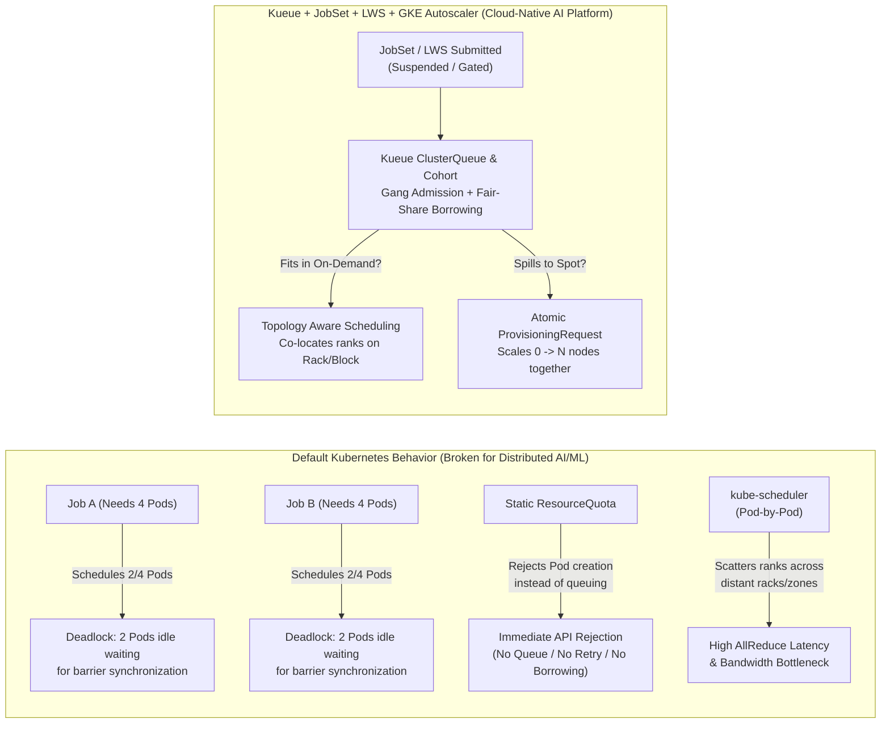
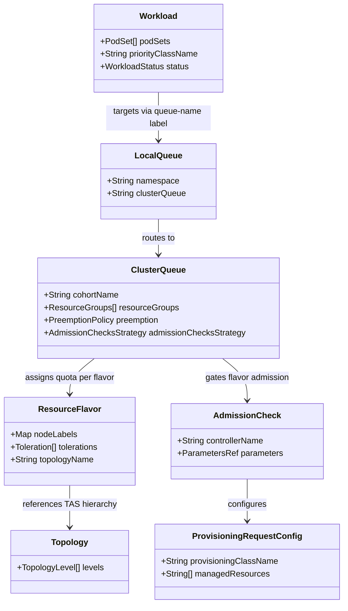
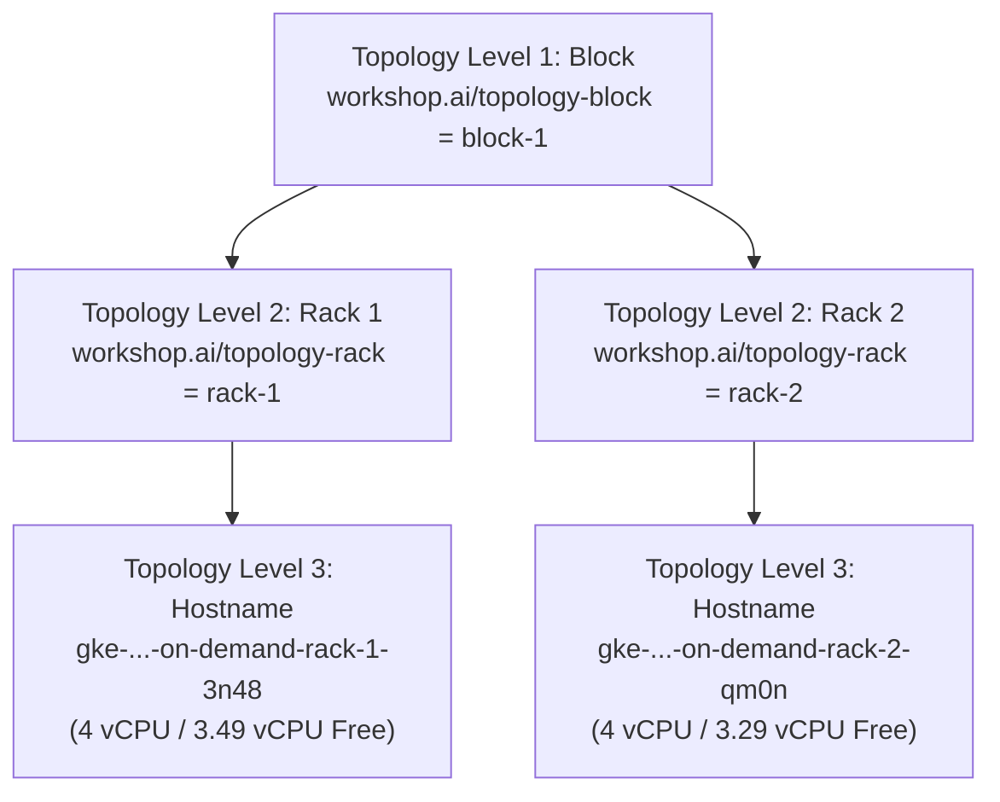

# 01 — Concepts & Architecture: Cloud-Native AI/ML Batch & Inference Scheduling on GKE

This guide covers the theoretical and architectural foundations of distributed AI/ML batch training and multi-pod inference scheduling on Kubernetes using **Kueue (`v1beta2`)**, **JobSet (`v1alpha2`)**, **LeaderWorkerSet (`v1`)**, **Topology Aware Scheduling (TAS)**, **Multi-Team Cohorts**, and **GKE Atomic `ProvisioningRequest`**.

---

## 1. The Kubernetes Batch & AI/ML Scheduling Gap

Standard Kubernetes controllers (`kube-scheduler`, `batch/v1 Job`, and native `ResourceQuota`) were originally designed for stateless, independently scalable microservices. When applied directly to tightly coupled distributed AI/ML training or multi-pod LLM inference workloads, four critical failure modes emerge:



### Why Default Primitives Fail
1. **Partial Scheduling Deadlocks (Lack of Gang Admission):**
   In PyTorch `DistributedDataParallel (DDP)` and Tensor-Parallel LLM inference, `torch.distributed.init_process_group()` blocks until **every rank** (`0 .. WORLD_SIZE-1`) connects to the `MASTER_ADDR` rendezvous barrier. Because `kube-scheduler` places Pods one by one, two competing 4-Pod jobs on a 4-node cluster can each receive 2 Pods. Both jobs hang indefinitely while hoarding 100% of cluster capacity.
2. **Static `ResourceQuota` Rejects Instead of Queuing or Sharing:**
   Native Kubernetes `ResourceQuota` is an admission blocker, not a queue, and cannot lend idle capacity across namespaces.
3. **Autoscaler Thrashing & Partial Scale-Up:**
   Standard Cluster Autoscaler reacts to Pending Pods individually. If a multi-node job is submitted when only partial Spot VMs are available, the autoscaler provisions partial VMs that sit idle billing money.
4. **Topology Blindness:**
   `kube-scheduler` scores nodes individually without understanding group compactness across hierarchical data-center network tiers (`Block -> Rack -> Host`).

---

## 2. Kueue Core API (`kueue.x-k8s.io/v1beta2`) & Multi-Team Cohorts

**Kueue** is a Kubernetes-native job-level queue manager that decides **when** a workload should be admitted and **where** its resources should be allocated.



### Multi-Team Cohort Quota Borrowing & Reclamation (`ai-org-cohort`)
In [`k8s/base/kueue-setup.yaml`](../k8s/base/kueue-setup.yaml), two `ClusterQueue`s (`team-a-cq` and `team-b-cq`) belong to the same cohort (`cohortName: "ai-org-cohort"`):
- **Nominal Quota vs. Borrowing Limit:** Each team owns `nominalQuota: "3"` vCPUs on `on-demand-flavor`, with `borrowingLimit: "3"`. When `team-b` is idle, `team-a-cq` can seamlessly borrow up to `3` unused vCPUs from `team-b-cq`, reaching `6` vCPUs total.
- **Fair-Share Cohort Reclamation (`reclaimWithinCohort: Any`):** If `team-a` is currently borrowing `team-b`'s quota (even with a high-priority workload, `priority=1000`) and `team-b` submits a new workload into `team-b-queue` (even with a low priority, `priority=100`), Kueue immediately **preempts** the borrowing workload in `team-a-cq` (`reason: InCohortReclamation`) so `team-b-cq` can reclaim its guaranteed nominal quota (**Lab 5**).

---

## 3. Distributed Training (`JobSet`) & Multi-Pod Inference (`LeaderWorkerSet`)

### Batch Training with `JobSet` (`jobset.x-k8s.io/v1alpha2`)
**JobSet** models a distributed batch training workload as a unified gang of `replicatedJobs`:
- Automatically creates a headless Kubernetes `Service` (`<jobset-name>`) providing stable Pod FQDNs (`<jobset-name>-workers-0-0.<jobset-name>`) for `torchrun` rendezvous.
- Supports coordinated gang suspension (`spec.suspend: true`) managed by Kueue.

### Multi-Pod Distributed Inference with `LeaderWorkerSet` (`leaderworkerset.x-k8s.io/v1`)
While `JobSet` targets batch jobs that run to completion, **LeaderWorkerSet (LWS)** is purpose-built for long-running, multi-pod distributed AI inference serving (e.g., sharded Tensor-Parallel / Pipeline-Parallel LLMs across multiple nodes or sockets):
- **Super-Pod Semantics:** Each replica is a tightly coupled group consisting of **1 Leader Pod** (`lws-tas-infer-0`, exposing the HTTP `/infer` ingress endpoint) and **$N-1$ Worker Pods** (`lws-tas-infer-0-1`, holding model tensor shards).
- **Automatic `LWS_LEADER_ADDRESS` Injection:** LWS automatically injects `LWS_LEADER_ADDRESS` into both Leader and Worker Pods so `torch.distributed.init_process_group(backend="gloo")` connects all tensor-parallel shards immediately on startup.
- **Cross-PodSet TAS Co-Location (`podset-group-name`):** Because an LWS replica generates **two distinct PodSets** in the Kueue `Workload` (`leader` and `worker`), annotating both templates with:
  ```yaml
  kueue.x-k8s.io/podset-required-topology: "workshop.ai/topology-rack"
  kueue.x-k8s.io/podset-group-name: "lws-rack-group"
  ```
  instructs Kueue's TAS solver to co-locate **both the Leader PodSet and the Worker PodSet onto the exact same physical rack** (**Lab 6**).

---

## 4. Topology Aware Scheduling (TAS) Hierarchy



- **`kueue.x-k8s.io/podset-required-topology`:** Strict constraint forcing all Pods (or grouped PodSets via `podset-group-name`) into a single topology domain (`workshop.ai/topology-rack` in **Lab 2** and **Lab 6**).
- **`kueue.x-k8s.io/podset-preferred-topology`:** Best-effort packing that spans across racks within `workshop.ai/topology-block` when a single rack cannot fit the entire gang (**Lab 1**, **Lab 4**, **Lab 5**).

---

## 5. GKE Dynamic Workload Scheduler (DWS) & Atomic `ProvisioningRequest`

| Environment | `ProvisioningRequestConfig.spec.provisioningClassName` | Underlying GKE Mechanism |
| :--- | :--- | :--- |
| **GPU / TPU Clusters** | `queued-provisioning.gke.io` | GKE **Dynamic Workload Scheduler (DWS)** flex-start queuing for scarce accelerators. |
| **CPU Workshop Cluster** | `best-effort-atomic-scale-up.autoscaling.x-k8s.io` | GKE **Cluster Autoscaler Atomic Scale-Up** (`autoscaling.x-k8s.io/v1`), providing the exact same `Kueue -> AdmissionCheck -> ProvisioningRequest -> Atomic Node Provisioning` lifecycle on CPU Spot VMs (**Lab 3**). |
