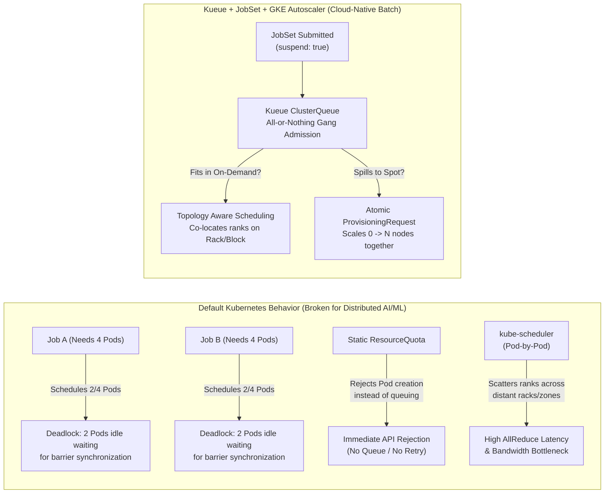
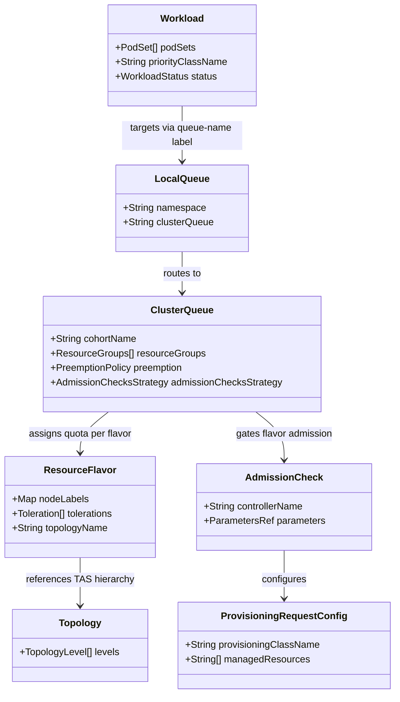
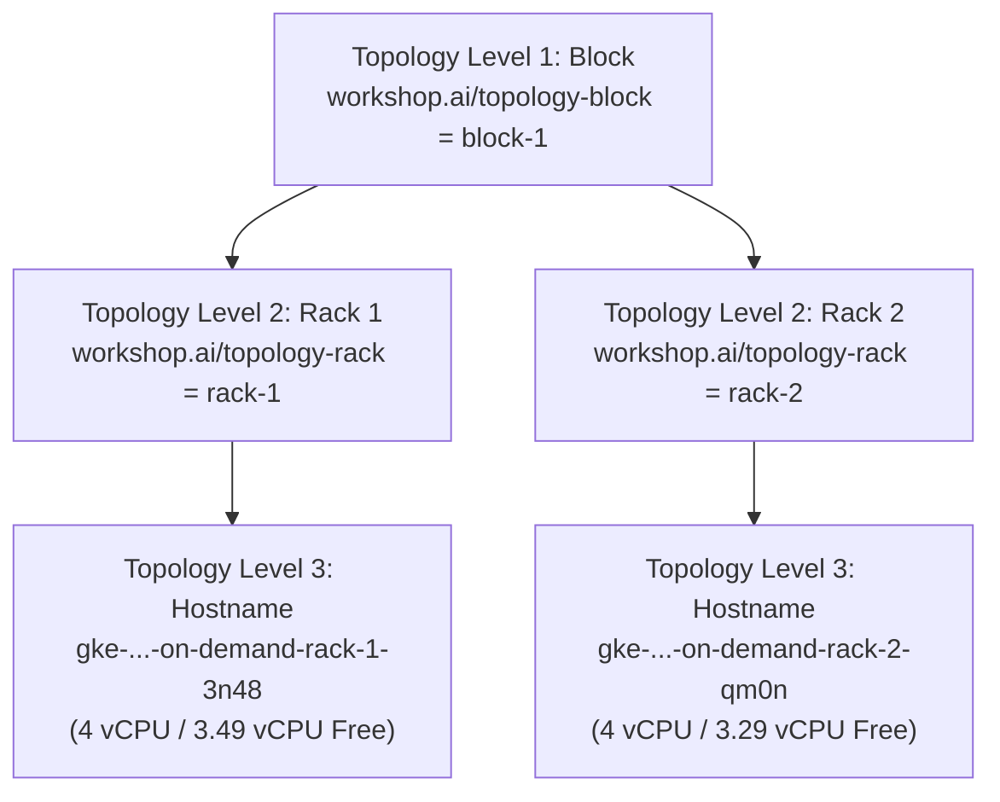

# 01 — Concepts & Architecture: Cloud-Native AI/ML Batch Scheduling on GKE

This guide covers the theoretical and architectural foundations of distributed AI/ML batch scheduling on Kubernetes using **Kueue (`v1beta2`)**, **JobSet (`v1alpha2`)**, **Topology Aware Scheduling (TAS)**, and **GKE Atomic `ProvisioningRequest`**.

---

## 1. The Kubernetes Batch & AI/ML Scheduling Gap

Standard Kubernetes controllers (`kube-scheduler`, `batch/v1 Job`, and native `ResourceQuota`) were originally designed for stateless, independently scalable microservices. When applied directly to tightly coupled distributed AI/ML training workloads, four critical failure modes emerge:



### Why Default Primitives Fail
1. **Partial Scheduling Deadlocks (Lack of Gang Admission):**
   In PyTorch `DistributedDataParallel (DDP)`, `torch.distributed.init_process_group()` blocks until **every rank** (`0 .. WORLD_SIZE-1`) connects to the `MASTER_ADDR` rendezvous barrier. Because `kube-scheduler` places Pods one by one, two competing 4-Pod jobs on a 4-node cluster can each receive 2 Pods. Both jobs hang indefinitely while hoarding 100% of cluster capacity.
2. **Static `ResourceQuota` Rejects Instead of Queuing:**
   Native Kubernetes `ResourceQuota` is an admission blocker, not a queue. If a namespace exceeds its quota, the API server rejects new Pods with `403 Forbidden`, forcing data scientists to build external polling loops.
3. **Autoscaler Thrashing & Partial Scale-Up:**
   Standard Cluster Autoscaler reacts to Pending Pods individually. If a 32-node job is submitted when only 20 Spot VMs are available in the zone, the autoscaler provisions 20 VMs that sit completely idle billing money while waiting for the remaining 12 VMs.
4. **Topology Blindness:**
   `kube-scheduler` scores nodes individually without understanding group compactness across hierarchical data-center network tiers (`Block -> Rack -> Host`), scattering tightly coupled workers across high-latency network hops.

---

## 2. Kueue Core API (`kueue.x-k8s.io/v1beta2`) Deep Dive

**Kueue** is a Kubernetes-native job-level queue manager that decides **when** a workload should be admitted (unsuspended to create Pods) and **where** its resources should come from.



### Key `v1beta2` Resources in [`k8s/base/kueue-setup.yaml`](../k8s/base/kueue-setup.yaml)

| Resource Kind | Name in Workshop | Role & Responsibilities |
| :--- | :--- | :--- |
| **`Topology`** | `gke-dc-topology` | Defines the hierarchical network levels on nodes: `workshop.ai/topology-block` $\rightarrow$ `workshop.ai/topology-rack` $\rightarrow$ `kubernetes.io/hostname`. |
| **`ResourceFlavor`** | `on-demand-flavor`<br>`spot-flavor` | Represents concrete node pool variants. `on-demand-flavor` binds to `tier: on-demand` and enables TAS (`topologyName: gke-dc-topology`). `spot-flavor` binds to `tier: spot` and injects the `spot-only=true:NoSchedule` toleration. |
| **`ClusterQueue`** | `team-a-cq` | Cluster-scoped pool of quotas (`6 vCPU` On-Demand, `9 vCPU` Spot), preemption policies (`withinClusterQueue: LowerPriority`), cohort membership (`cohortName: ai-org-cohort`), and admission check strategies. |
| **`LocalQueue`** | `team-a-queue` | Namespaced (`team-a`) entrypoint pointing to `team-a-cq`. Data scientists target this queue via `kueue.x-k8s.io/queue-name: team-a-queue`. |
| **`WorkloadPriorityClass`** | `high-prod-priority` (`1000`)<br>`low-research-priority` (`100`) | Decouples queue scheduling priority from Pod-level `PriorityClass` to govern workload ordering and preemption inside Kueue. |
| **`AdmissionCheck` & `ProvisioningRequestConfig`** | `spot-atomic-check`<br>`gke-atomic-cpu-config` | Gates admission on `spot-flavor` until GKE Cluster Autoscaler atomically provisions the underlying Spot VMs. |

---

## 3. Distributed Training with `JobSet` (`v1alpha2`) & PyTorch DDP (`gloo`)

### Why `JobSet` (`jobset.x-k8s.io/v1alpha2`)?
A standard Kubernetes `Job` represents a homogeneous set of Pods without built-in group lifecycle management or automatic headless service creation for multi-node discovery. **JobSet** models a distributed training workload as a unified gang of `replicatedJobs`:
1. **Automatic Headless Service & Deterministic DNS:** JobSet automatically creates a headless Kubernetes `Service` named `<jobset-name>`, assigning every Pod a deterministic FQDN:
   ```text
   <jobset-name>-<replicatedJobName>-<jobIndex>-<podIndex>.<jobset-name>.<namespace>.svc.cluster.local
   ```
   Rank 0 (`<jobset-name>-workers-0-0.<jobset-name>`) acts as the deterministic `MASTER_ADDR` for `torchrun`.
2. **Coordinated Suspension:** When a `JobSet` is created with `kueue.x-k8s.io/queue-name`, Kueue's mutating webhook sets `spec.suspend: true` on the `JobSet`. Zero child Jobs or Pods are created until Kueue admits the entire `Workload`.

### PyTorch `DistributedDataParallel (DDP)` over the `gloo` Backend
In [`k8s/base/pytorch-ddp-configmap.yaml`](../k8s/base/pytorch-ddp-configmap.yaml), each worker runs `torchrun` with `dist.init_process_group(backend="gloo")`:
- **`nccl` vs. `gloo`:** While `nccl` is optimized for NVIDIA GPUs (NVLink/GPUDirect RDMA), `gloo` is PyTorch's native collective communication backend for CPU tensors over TCP/IP.
- **Identical Distributed Semantics:** During `loss.backward()`, `DDP` hooks into PyTorch's autograd engine and executes a ring-`AllReduce` across all ranks (`WORLD_SIZE`), averaging gradients identically to a multi-node GPU cluster—allowing us to test every distributed scheduling primitive at $<1\%$ of GPU infrastructure cost.

---

## 4. Topology Aware Scheduling (TAS)

In distributed training, `AllReduce` latency is bounded by the slowest network link between any two ranks:



Kueue's **Topology Aware Scheduling (TAS)** inspects node capacity across the `Topology` hierarchy before unsuspending a job and injects exact `kubernetes.io/hostname` `nodeSelector` assignments into the admitted Pod templates:
- **`kueue.x-k8s.io/podset-required-topology`:** Strict constraint. Every Pod in the PodSet **must** fit within a single domain of the specified topology level (e.g., `workshop.ai/topology-rack` in **Lab 2** forces both workers onto the same rack).
- **`kueue.x-k8s.io/podset-preferred-topology`:** Best-effort compactness. Kueue tries to pack the PodSet into the narrowest domain first, but will span across domains (e.g., `rack-1` + `rack-2` within `block-1` in **Lab 1**) if a single rack lacks sufficient free capacity.

---

## 5. GKE Dynamic Workload Scheduler (DWS) & Atomic `ProvisioningRequest`

When a workload spills over to `spot-flavor` (`spot-atomic-pool`, which scales from `0` to `3` nodes), we want **all 3 Spot VMs** provisioned atomically before any Pod starts.

| Environment | `ProvisioningRequestConfig.spec.provisioningClassName` | Underlying GKE Mechanism |
| :--- | :--- | :--- |
| **GPU / TPU Clusters** | `queued-provisioning.gke.io` | GKE **Dynamic Workload Scheduler (DWS)** flex-start queuing for scarce accelerators. |
| **CPU Workshop Cluster** | `best-effort-atomic-scale-up.autoscaling.x-k8s.io` | GKE **Cluster Autoscaler Atomic Scale-Up** (`autoscaling.x-k8s.io/v1`), providing the exact same `Kueue -> AdmissionCheck -> ProvisioningRequest -> Atomic Node Provisioning` lifecycle on CPU Spot VMs. |
