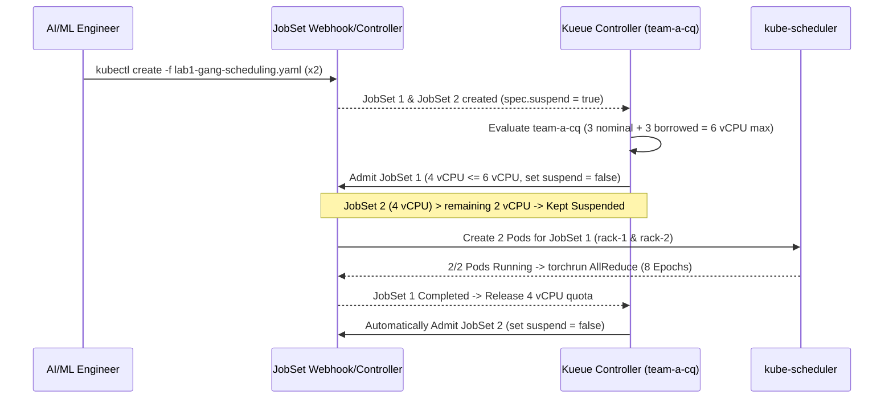
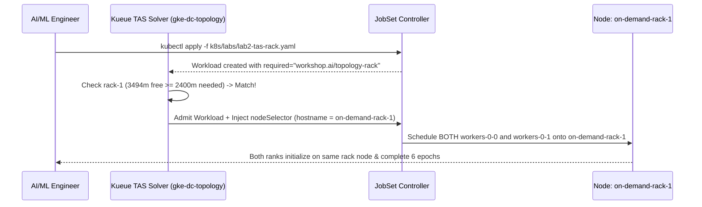
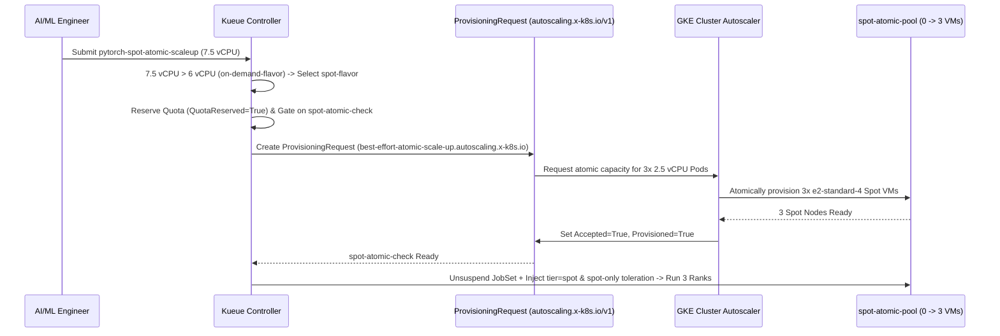
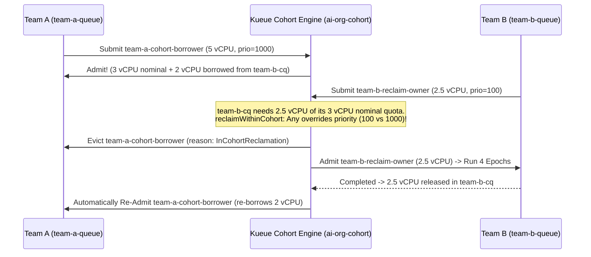
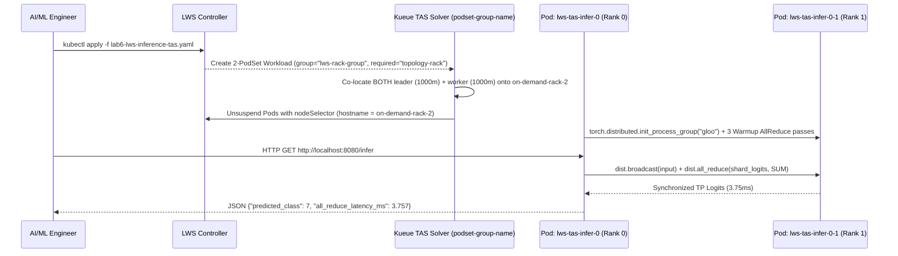

# 03 — Step-by-Step Labs Guide (Labs 1–6)

This guide walks through each of the six hands-on labs in [`k8s/labs/`](../k8s/labs/), explaining the manifest design, internal control-plane flow, execution commands, and verified terminal outputs from GKE `v1.36.4-gke.1391002`.

---

## Lab 1: All-or-Nothing Gang Scheduling ([`k8s/labs/lab1-gang-scheduling.yaml`](../k8s/labs/lab1-gang-scheduling.yaml))

### 1. Scenario & Objective
Distributed PyTorch `torchrun` jobs require every rank (`0 .. WORLD_SIZE-1`) to initialize simultaneously. If two 2-Pod jobs (`4 vCPUs` each) are submitted against a `6 vCPU` effective On-Demand quota (`3 vCPU` nominal + `3 vCPU` borrowed in `ai-org-cohort`), default Kubernetes would partially schedule Pods and deadlock. Kueue guarantees **all-or-nothing gang admission**: Job 1 receives `2/2` Pods immediately, while Job 2 waits in `team-a-queue` with `SUSPENDED=true` (zero Pods created) until Job 1 completes.

### 2. Manifest Breakdown
- `generateName: pytorch-ddp-gang-`: Allows submitting multiple instances via `kubectl create -f`.
- `labels.kueue.x-k8s.io/queue-name: team-a-queue`: Routes the JobSet to `team-a-cq`.
- `annotations.kueue.x-k8s.io/podset-preferred-topology: "workshop.ai/topology-block"`: Targets the TAS-enabled `on-demand-flavor` (`block-1`), allowing the 2 Pods (`2 vCPU` each = `4 vCPU` total) to span across `on-demand-rack-1` and `on-demand-rack-2`.
- Dynamic `MASTER_ADDR` resolution for `generateName`:
  ```bash
  MASTER_ADDR="$(hostname | sed 's/-[0-9]*$/-0/').$(hostname -d)"
  ```

### 3. Under-the-Hood Sequence Diagram



### 4. Execution & Verification Commands
```bash
make lab1
kubectl get jobsets,workloads,pods -n team-a -o wide
kubectl logs -n team-a -l jobset.sigs.k8s.io/jobset-name --tail=50 -f
make labs-clean
```

### 5. Verified Live GKE Output
```text
NAME                                            TERMINALSTATE   RESTARTS   COMPLETED   SUSPENDED   AGE
jobset.jobset.x-k8s.io/pytorch-ddp-gang-n5bcl                   0                      false       16s
jobset.jobset.x-k8s.io/pytorch-ddp-gang-qcjpv                   0                      true        16s

NAME                                                          QUEUE          RESERVED IN   ADMITTED   FINISHED   AGE
workload.kueue.x-k8s.io/jobset-pytorch-ddp-gang-n5bcl-93343   team-a-queue   team-a-cq     True                  16s
workload.kueue.x-k8s.io/jobset-pytorch-ddp-gang-qcjpv-71d3d   team-a-queue                                       16s

[Rank 0/2] Initialized on Node: gke-gke-kueue-worksh-on-demand-rack-1-37786744-3n48
[Rank 1/2] Initialized on Node: gke-gke-kueue-worksh-on-demand-rack-2-c183e097-qm0n
Epoch [1/8] | World Size: 2 | Loss: 2.3555
...
Epoch [8/8] | World Size: 2 | Loss: 2.2805
Distributed Training Completed Successfully!

# Immediately after JobSet 1 finishes, JobSet 2 is automatically admitted:
NAME                                                          QUEUE          RESERVED IN   ADMITTED   FINISHED   AGE
workload.kueue.x-k8s.io/jobset-pytorch-ddp-gang-n5bcl-93343   team-a-queue   team-a-cq     True       True       96s
workload.kueue.x-k8s.io/jobset-pytorch-ddp-gang-qcjpv-71d3d   team-a-queue   team-a-cq     True                  96s
```

---

## Lab 2: Topology Aware Scheduling (TAS) — Same Rack ([`k8s/labs/lab2-tas-rack.yaml`](../k8s/labs/lab2-tas-rack.yaml))

### 1. Scenario & Objective
To minimize network hops during gradient `AllReduce`, we want both distributed PyTorch workers co-located on the **exact same rack** (`workshop.ai/topology-rack`), rather than split across `rack-1` and `rack-2`.

### 2. Manifest Breakdown
- `annotations.kueue.x-k8s.io/podset-required-topology: "workshop.ai/topology-rack"`: Instructs Kueue's TAS solver that all Pods in the PodSet **must** be placed within a single `workshop.ai/topology-rack` domain.
- `resources.requests.cpu: "1200m"` per Pod ($2 \times 1200\text{m} = 2400\text{m}$ total): Sized below a single `e2-standard-4` node's free allocatable CPU (`~3292m–3494m`) so both Pods fit onto one rack node.

### 3. Under-the-Hood Sequence Diagram



### 4. Execution & Verification Commands
```bash
make lab2
kubectl get pods -n team-a -o wide
kubectl logs -n team-a -l jobset.sigs.k8s.io/jobset-name=pytorch-tas-same-rack --prefix=true -f
make labs-clean
```

### 5. Verified Live GKE Output
```text
NAME                                      READY   STATUS      RESTARTS   AGE   IP           NODE
pytorch-tas-same-rack-workers-0-0-6xj5v   0/1     Completed   0          42s   10.20.2.9    gke-gke-kueue-worksh-on-demand-rack-1-37786744-3n48
pytorch-tas-same-rack-workers-0-1-bs9rg   0/1     Completed   0          42s   10.20.2.10   gke-gke-kueue-worksh-on-demand-rack-1-37786744-3n48

[pod/pytorch-tas-same-rack-workers-0-1-bs9rg/pytorch] [Rank 1/2] Initialized on Node: gke-gke-kueue-worksh-on-demand-rack-1-37786744-3n48
[pod/pytorch-tas-same-rack-workers-0-0-6xj5v/pytorch] [Rank 0/2] Initialized on Node: gke-gke-kueue-worksh-on-demand-rack-1-37786744-3n48
[pod/pytorch-tas-same-rack-workers-0-0-6xj5v/pytorch] Epoch [1/6] | World Size: 2 | Loss: 2.3051
...
[pod/pytorch-tas-same-rack-workers-0-0-6xj5v/pytorch] Epoch [6/6] | World Size: 2 | Loss: 2.3340
[pod/pytorch-tas-same-rack-workers-0-0-6xj5v/pytorch] Distributed Training Completed Successfully!
```

---

## Lab 3: Spot Spillover & Atomic `ProvisioningRequest` ([`k8s/labs/lab3-spot-atomic.yaml`](../k8s/labs/lab3-spot-atomic.yaml))

### 1. Scenario & Objective
When a 3-node training job (`3 Pods x 2.5 vCPU = 7.5 vCPU`) exceeds the `on-demand-flavor` max quota (`6 vCPU`), Kueue spills the workload over to `spot-flavor` (`9 vCPU` quota). Because `spot-atomic-pool` starts at `0` nodes, Kueue's `spot-atomic-check` `AdmissionCheck` creates a GKE `ProvisioningRequest` (`best-effort-atomic-scale-up.autoscaling.x-k8s.io`). GKE Cluster Autoscaler atomically scales `spot-atomic-pool` from `0 -> 3` Spot VMs before Kueue unsuspends the `JobSet`.

### 2. Manifest Breakdown
- `parallelism: 3`, `completions: 3`, `cpu: "2500m"` per Pod (`7500m` total $> 6000\text{m}$ `on-demand-flavor` quota).
- **No TAS annotations on Pod template:** Allows Kueue to skip TAS-only `on-demand-flavor` and route cleanly to non-TAS `spot-flavor`.
- Automatic taint toleration injection: `spot-flavor` injects `tier: spot` `nodeSelector` and `spot-only=true:NoSchedule` toleration upon admission.

### 3. Under-the-Hood Sequence Diagram



### 4. Execution & Verification Commands
```bash
make lab3
kubectl get provisioningrequests,workloads -n team-a -w
kubectl get nodes -L workload,tier -w
kubectl logs -n team-a -l jobset.sigs.k8s.io/jobset-name=pytorch-spot-atomic-scaleup --prefix=true -f
make labs-clean
```

### 5. Verified Live GKE Output
```text
NAME                                                                                                    ACCEPTED   PROVISIONED   FAILED   AGE
provisioningrequest.autoscaling.x-k8s.io/jobset-pytorch-spot-atomic-scaleup-6c1c9-spot-atomic-check-1   True       True                   13s

NAME                                                  STATUS   ROLES    AGE   VERSION               WORKLOAD   TIER        TOPOLOGY-BLOCK   TOPOLOGY-RACK
gke-gke-kueue-worksh-on-demand-rack-1-37786744-3n48   Ready    <none>   27m   v1.36.4-gke.1391002              on-demand   block-1          rack-1
gke-gke-kueue-worksh-on-demand-rack-2-c183e097-qm0n   Ready    <none>   27m   v1.36.4-gke.1391002              on-demand   block-1          rack-2
gke-gke-kueue-worksh-spot-atomic-pool-1101bc94-74j5   Ready    <none>   80s   v1.36.4-gke.1391002              spot                         
gke-gke-kueue-worksh-spot-atomic-pool-1101bc94-7gz5   Ready    <none>   78s   v1.36.4-gke.1391002              spot                         
gke-gke-kueue-worksh-spot-atomic-pool-1101bc94-km4r   Ready    <none>   77s   v1.36.4-gke.1391002              spot                         
gke-gke-kueue-workshop-system-pool-be3c118f-6cgc      Ready    <none>   27m   v1.36.4-gke.1391002   system                                  

[pod/pytorch-spot-atomic-scaleup-workers-0-0-ht4l6/pytorch] [Rank 0/3] Initialized on Node: gke-gke-kueue-worksh-spot-atomic-pool-1101bc94-74j5
[pod/pytorch-spot-atomic-scaleup-workers-0-1-wpz7r/pytorch] [Rank 1/3] Initialized on Node: gke-gke-kueue-worksh-spot-atomic-pool-1101bc94-7gz5
[pod/pytorch-spot-atomic-scaleup-workers-0-2-2xzwq/pytorch] [Rank 2/3] Initialized on Node: gke-gke-kueue-worksh-spot-atomic-pool-1101bc94-km4r
[pod/pytorch-spot-atomic-scaleup-workers-0-0-ht4l6/pytorch] Epoch [1/6] | World Size: 3 | Loss: 2.3637
...
[pod/pytorch-spot-atomic-scaleup-workers-0-0-ht4l6/pytorch] Epoch [6/6] | World Size: 3 | Loss: 2.3533
[pod/pytorch-spot-atomic-scaleup-workers-0-0-ht4l6/pytorch] Distributed Training Completed Successfully!
```

---

## Lab 4: Priority-Based Intra-Queue Preemption ([`k8s/labs/lab4-preemption.yaml`](../k8s/labs/lab4-preemption.yaml))

### 1. Scenario & Objective
When a long-running exploratory job (`research-long-training`, `low-research-priority: 100`, `5 vCPU`) is actively running in `team-a-cq` and an urgent production job (`urgent-prod-training`, `high-prod-priority: 1000`, `5 vCPU`) arrives in the same queue, Kueue immediately **preempts (evicts)** `research-long-training` (`withinClusterQueue: LowerPriority`), runs `urgent-prod-training` to completion, and then **automatically re-admits** `research-long-training`.

### 2. Execution & Verification Commands
```bash
make lab4
kubectl get workloads,jobsets,pods -n team-a -w
make labs-clean
```

### 3. Verified Live GKE Output
```text
NAME                                                          QUEUE          RESERVED IN   ADMITTED   FINISHED   AGE
workload.kueue.x-k8s.io/jobset-research-long-training-c88c3   team-a-queue                 False                 11s
workload.kueue.x-k8s.io/jobset-urgent-prod-training-3da6f     team-a-queue   team-a-cq     True                  4s

# Preemption Condition on jobset-research-long-training-c88c3:
type: Evicted, status: True, reason: Preempted, Preempted: InClusterQueue
message: "Preempted to accommodate a workload (UID: a2c95349-03f6-4b17-bcba-1273cb1d9e46) due to prioritization in the ClusterQueue; preemptor path: /ai-org-cohort/team-a-cq; preemptee path: /ai-org-cohort/team-a-cq"

# urgent-prod-training completes 4 epochs, then research-long-training automatically re-admits:
NAME                                                          QUEUE          RESERVED IN   ADMITTED   FINISHED   AGE
workload.kueue.x-k8s.io/jobset-research-long-training-c88c3   team-a-queue   team-a-cq     True                  43s
workload.kueue.x-k8s.io/jobset-urgent-prod-training-3da6f     team-a-queue   team-a-cq     True       True       36s
```

---

## Lab 5: Multi-Team Cohort Quota Borrowing & Reclamation ([`k8s/labs/lab5-cohort-borrowing.yaml`](../k8s/labs/lab5-cohort-borrowing.yaml))

### 1. Scenario & Objective
In a multi-tenant AI organization (`ai-org-cohort`), `team-a-cq` and `team-b-cq` each own `3 vCPU` of nominal On-Demand quota with `borrowingLimit: "3"`.
1. While `team-b` is idle, `team-a` submits `team-a-cohort-borrower` (`high-prod-priority: 1000`, requesting `5 vCPUs`). Kueue allocates `3 vCPUs` from `team-a-cq`'s nominal quota and **borrows `2 vCPUs`** from `team-b-cq`.
2. Next, `team-b` submits `team-b-reclaim-owner` (`low-research-priority: 100`, requesting `2.5 vCPUs`).
3. **Key Insight:** Even though `team-b`'s workload has **lower priority** (`100` vs. `1000`), `team-b-cq` is reclaiming its own guaranteed nominal quota (`reclaimWithinCohort: Any`). Kueue immediately preempts `team-a-cohort-borrower` (`reason: InCohortReclamation`), runs `team-b-reclaim-owner` to completion, and then automatically re-admits `team-a-cohort-borrower`!

### 2. Under-the-Hood Sequence Diagram



### 3. Execution & Verification Commands
```bash
# Starts team-a-cohort-borrower, prints borrowed quota, then submits team-b-reclaim-owner
make lab5

# Watch cross-namespace cohort reclamation and automatic re-admission
kubectl get workloads -A -w

# Clean up both namespaces
make labs-clean
```

### 4. Verified Live GKE Output
```text
=== Team A ClusterQueue Quota Reservation (3 vCPU Nominal + 2 vCPU Borrowed = 5 vCPU) ===
[{"name":"on-demand-flavor","resources":[{"borrowed":"2","name":"cpu","total":"5"},{"borrowed":"0","name":"memory","total":"4Gi"}]}]

Submitting team-b-reclaim-owner (priority=100) in namespace team-b to reclaim nominal cohort quota...
NAMESPACE   NAME                                                          QUEUE          RESERVED IN   ADMITTED   FINISHED   AGE
team-a      workload.kueue.x-k8s.io/jobset-team-a-cohort-borrower-f56f7   team-a-queue                 False                 14s
team-b      workload.kueue.x-k8s.io/jobset-team-b-reclaim-owner-089bf     team-b-queue   team-b-cq     True                  6s

# Preemption Condition on team-a/jobset-team-a-cohort-borrower-f56f7:
type: Preempted, status: True, reason: InCohortReclamation
message: "Preempted to accommodate a workload (UID: d3a84e9b-3a0c-450a-a339-eda42f5931f0) due to reclamation within the cohort; preemptor path: /ai-org-cohort/team-b-cq; preemptee path: /ai-org-cohort/team-a-cq"

# Once team-b-reclaim-owner finishes its 4 epochs, team-a-cohort-borrower automatically re-borrows and resumes:
[pod/team-b-reclaim-owner-workers-0-0-k8b4x/pytorch] [Rank 0/1] Initialized on Node: gke-gke-kueue-worksh-on-demand-rack-1-37786744-3n48
[pod/team-b-reclaim-owner-workers-0-0-k8b4x/pytorch] Epoch [4/4] | World Size: 1 | Loss: 2.3375
[pod/team-b-reclaim-owner-workers-0-0-k8b4x/pytorch] Distributed Training Completed Successfully!

NAMESPACE   NAME                                  QUEUE          RESERVED IN   ADMITTED   FINISHED   AGE
team-a      jobset-team-a-cohort-borrower-c7d66   team-a-queue   team-a-cq     True                  41s
team-b      jobset-team-b-reclaim-owner-524bb     team-b-queue   team-b-cq     True       True       32s
```

---

## Lab 6: Distributed Multi-Pod Inference with `LeaderWorkerSet` & Cross-PodSet TAS ([`k8s/labs/lab6-lws-inference-tas.yaml`](../k8s/labs/lab6-lws-inference-tas.yaml))

### 1. Scenario & Objective
Large Language Models (LLMs) that exceed a single node or socket require multi-pod **Tensor-Parallel (TP)** serving using **LeaderWorkerSet (`leaderworkerset.x-k8s.io/v1`)**, where a Leader Pod (`Rank 0`, serving HTTP `/infer`) and Worker Pod(s) (`Rank 1`, holding model tensor shards) execute synchronous `dist.broadcast` and `dist.all_reduce` operations on every forward pass.
Because LWS creates **two distinct PodSets** (`leader` and `worker`), we use Kueue's **Cross-PodSet TAS grouping** (`kueue.x-k8s.io/podset-group-name: "lws-rack-group"` + `kueue.x-k8s.io/podset-required-topology: "workshop.ai/topology-rack"`) to guarantee both the Leader Pod and Worker Pod are co-located on the **exact same physical rack node**.

### 2. Manifest Breakdown
- `kind: LeaderWorkerSet`, `spec.leaderWorkerTemplate.size: 2` (1 Leader + 1 Worker).
- Both `leaderTemplate` and `workerTemplate` carry:
  ```yaml
  annotations:
    kueue.x-k8s.io/podset-required-topology: "workshop.ai/topology-rack"
    kueue.x-k8s.io/podset-group-name: "lws-rack-group"
  ```
- Each Pod requests `1000m` CPU ($2 \times 1000\text{m} = 2000\text{m}$ total), fitting within a single `e2-standard-4` rack node.
- Mounts `infer_server.py` from `ConfigMap/pytorch-lws-inference-script`, which runs 3 warmup Tensor-Parallel `AllReduce` steps on startup and exposes `/healthz` and `/infer` on port `8080`.

### 3. Under-the-Hood Sequence Diagram



### 4. Execution & Verification Commands
```bash
# Deploy the LeaderWorkerSet
make lab6

# Wait for the Leader Pod's HTTP readinessProbe (/healthz) to become Ready
kubectl wait --for=condition=Ready pod/lws-tas-infer-0 -n team-a --timeout=90s

# Verify both Leader and Worker Pods are co-located on the exact same rack node
kubectl get pods -n team-a -o wide

# Trigger a live distributed Tensor-Parallel inference step across Leader + Worker
kubectl exec -n team-a lws-tas-infer-0 -- python3 -c "import urllib.request; print(urllib.request.urlopen('http://localhost:8080/infer').read().decode())"

# Inspect Leader and Worker Tensor-Parallel logs
kubectl logs -n team-a lws-tas-infer-0
kubectl logs -n team-a lws-tas-infer-0-1

# Clean up
make labs-clean
```

### 5. Verified Live GKE Output
```text
NAME                READY   STATUS    RESTARTS   AGE   IP           NODE
lws-tas-infer-0     1/1     Running   0          9s    10.20.0.25   gke-gke-kueue-worksh-on-demand-rack-2-c183e097-qm0n
lws-tas-infer-0-1   1/1     Running   0          9s    10.20.0.26   gke-gke-kueue-worksh-on-demand-rack-2-c183e097-qm0n

# Live HTTP /infer response:
{"model": "pytorch-tp-mlp-2shard", "backend": "gloo", "world_size": 2, "leader_node": "gke-gke-kueue-worksh-on-demand-rack-2-c183e097-qm0n", "predicted_class": 7, "sample_logits": [0.5019, -0.2728, 0.2568, -0.2808], "all_reduce_latency_ms": 3.757}

# Leader Pod (lws-tas-infer-0) Logs:
[LWS Rank 0/2] Connecting to Leader lws-tas-infer-0.lws-tas-infer.team-a:29500 from Node: gke-gke-kueue-worksh-on-demand-rack-2-c183e097-qm0n
[LWS Rank 0/2] Initialized Tensor-Parallel Shard on Node: gke-gke-kueue-worksh-on-demand-rack-2-c183e097-qm0n
[Warmup 1/3] TP World Size: 2 | Node: gke-gke-kueue-worksh-on-demand-rack-2-c183e097-qm0n | AllReduce Latency: 4.20ms | Pred: 0
[Warmup 2/3] TP World Size: 2 | Node: gke-gke-kueue-worksh-on-demand-rack-2-c183e097-qm0n | AllReduce Latency: 1.48ms | Pred: 0
[Warmup 3/3] TP World Size: 2 | Node: gke-gke-kueue-worksh-on-demand-rack-2-c183e097-qm0n | AllReduce Latency: 1.24ms | Pred: 4
[LWS Leader Rank 0] Listening on :8080 (/healthz, /infer) on Node: gke-gke-kueue-worksh-on-demand-rack-2-c183e097-qm0n
[HTTP /infer] Distributed TP step completed in 3.76ms -> Pred: 7

# Worker Pod (lws-tas-infer-0-1) Logs:
[LWS Rank 1/2] Connecting to Leader lws-tas-infer-0.lws-tas-infer.team-a:29500 from Node: gke-gke-kueue-worksh-on-demand-rack-2-c183e097-qm0n
[LWS Rank 1/2] Initialized Tensor-Parallel Shard on Node: gke-gke-kueue-worksh-on-demand-rack-2-c183e097-qm0n
[LWS Worker Rank 1] Entering Tensor-Parallel worker loop on Node: gke-gke-kueue-worksh-on-demand-rack-2-c183e097-qm0n
[LWS Worker Rank 1] Participated in TP AllReduce (3.49ms) on Node: gke-gke-kueue-worksh-on-demand-rack-2-c183e097-qm0n
```
