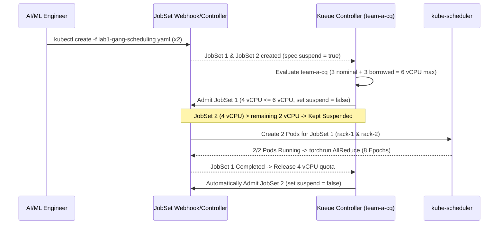
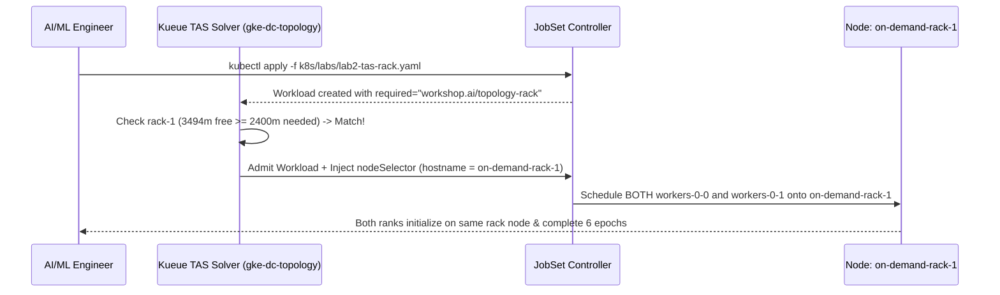
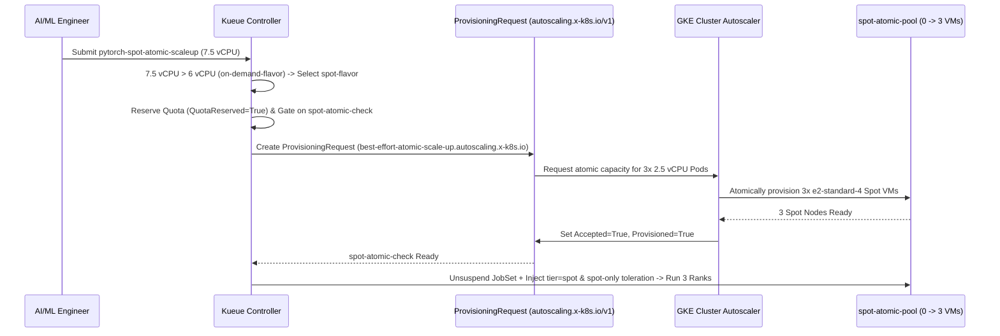
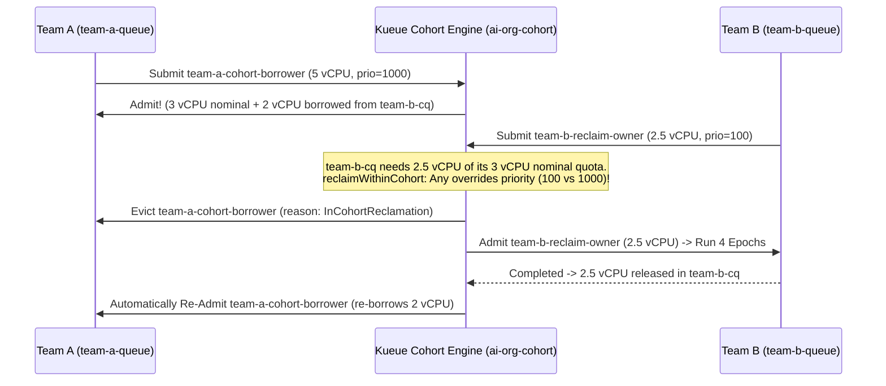
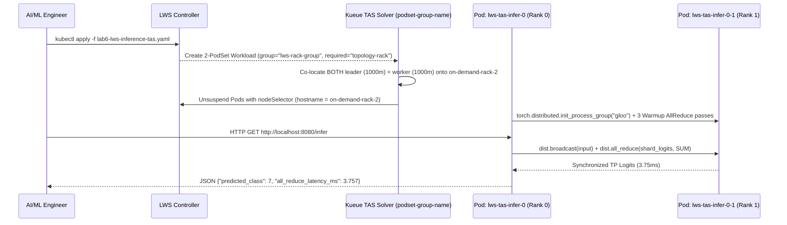
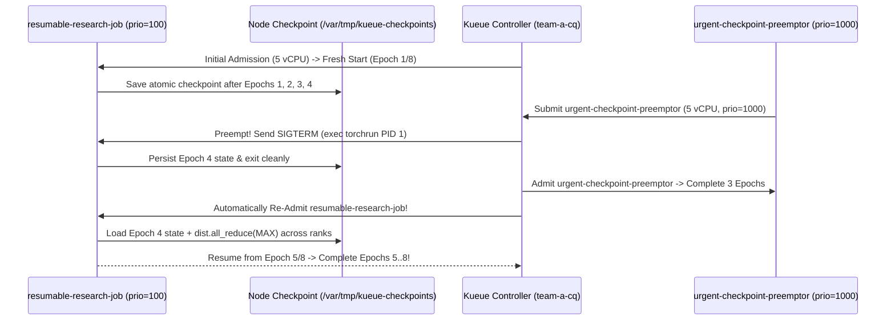
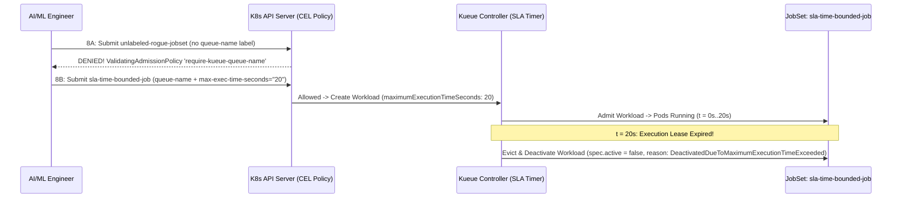
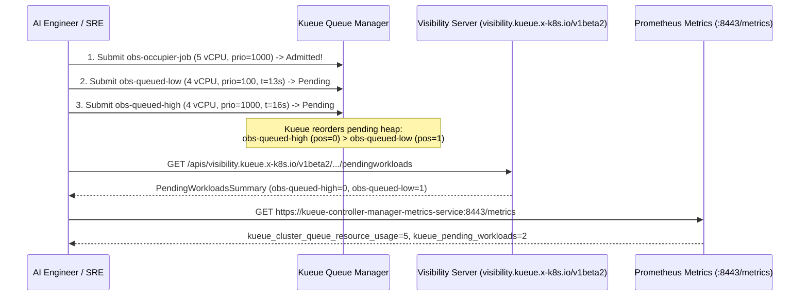
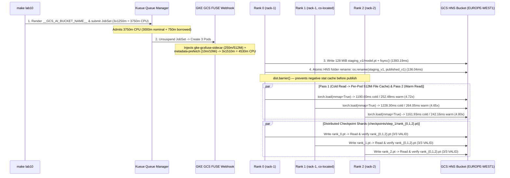

# 03 — Step-by-Step Labs Guide (Labs 1–10)

This guide walks through each of the ten hands-on labs in [`k8s/labs/`](../k8s/labs/), explaining the manifest design, internal control-plane flow, execution commands, and verified terminal outputs from GKE `v1.36.4-gke.1391002`.

---

## Lab 1: All-or-Nothing Gang Scheduling ([`k8s/labs/lab1-gang-scheduling.yaml`](../k8s/labs/lab1-gang-scheduling.yaml))

### 1. Scenario & Objective
Distributed PyTorch `torchrun` jobs require every rank (`0 .. WORLD_SIZE-1`) to initialize simultaneously. If two 2-Pod jobs (`4 vCPUs` each) are submitted against a `6 vCPU` effective On-Demand quota (`3 vCPU` nominal + `3 vCPU` borrowed in `ai-org-cohort`), default Kubernetes would partially schedule Pods and deadlock. Kueue guarantees **all-or-nothing gang admission**: Job 1 receives `2/2` Pods immediately, while Job 2 waits in `team-a-queue` with `SUSPENDED=true` (zero Pods created) until Job 1 completes.

### 2. Manifest Breakdown
- `generateName: pytorch-ddp-gang-`: Allows submitting multiple instances via `kubectl create -f`.
- `labels.kueue.x-k8s.io/queue-name: team-a-queue`: Routes the JobSet to `team-a-cq`.
- `annotations.kueue.x-k8s.io/podset-preferred-topology: "workshop.ai/topology-block"`: Targets the TAS-enabled `on-demand-flavor` (`block-1`), allowing the 2 Pods (`2 vCPU` each = `4 vCPU` total) to span across `on-demand-rack-1` and `on-demand-rack-2`.
- Dynamic `MASTER_ADDR` resolution for `generateName`:
  ```bash
  MASTER_ADDR="$(hostname | sed 's/-[0-9]*$/-0/').$(hostname -d)"
  ```

### 3. Under-the-Hood Sequence Diagram



### 4. Execution & Verification Commands
```bash
make lab1
kubectl get jobsets,workloads,pods -n team-a -o wide
kubectl logs -n team-a -l jobset.sigs.k8s.io/jobset-name --tail=50 -f
make labs-clean
```

### 5. Verified Live GKE Output
```text
NAME                                            TERMINALSTATE   RESTARTS   COMPLETED   SUSPENDED   AGE
jobset.jobset.x-k8s.io/pytorch-ddp-gang-n5bcl                   0                      false       16s
jobset.jobset.x-k8s.io/pytorch-ddp-gang-qcjpv                   0                      true        16s

NAME                                                          QUEUE          RESERVED IN   ADMITTED   FINISHED   AGE
workload.kueue.x-k8s.io/jobset-pytorch-ddp-gang-n5bcl-93343   team-a-queue   team-a-cq     True                  16s
workload.kueue.x-k8s.io/jobset-pytorch-ddp-gang-qcjpv-71d3d   team-a-queue                                       16s

[Rank 0/2] Initialized on Node: gke-gke-kueue-worksh-on-demand-rack-1-37786744-3n48
[Rank 1/2] Initialized on Node: gke-gke-kueue-worksh-on-demand-rack-2-c183e097-qm0n
Epoch [1/8] | World Size: 2 | Loss: 2.3555
...
Epoch [8/8] | World Size: 2 | Loss: 2.2805
Distributed Training Completed Successfully!

# Immediately after JobSet 1 finishes, JobSet 2 is automatically admitted:
NAME                                                          QUEUE          RESERVED IN   ADMITTED   FINISHED   AGE
workload.kueue.x-k8s.io/jobset-pytorch-ddp-gang-n5bcl-93343   team-a-queue   team-a-cq     True       True       96s
workload.kueue.x-k8s.io/jobset-pytorch-ddp-gang-qcjpv-71d3d   team-a-queue   team-a-cq     True                  96s
```

---

## Lab 2: Topology Aware Scheduling (TAS) — Same Rack ([`k8s/labs/lab2-tas-rack.yaml`](../k8s/labs/lab2-tas-rack.yaml))

### 1. Scenario & Objective
To minimize network hops during gradient `AllReduce`, we want both distributed PyTorch workers co-located on the **exact same rack** (`workshop.ai/topology-rack`), rather than split across `rack-1` and `rack-2`.

### 2. Manifest Breakdown
- `annotations.kueue.x-k8s.io/podset-required-topology: "workshop.ai/topology-rack"`: Instructs Kueue's TAS solver that all Pods in the PodSet **must** be placed within a single `workshop.ai/topology-rack` domain.
- `resources.requests.cpu: "1200m"` per Pod ($2 \times 1200\text{m} = 2400\text{m}$ total): Sized below a single `e2-standard-4` node's free allocatable CPU (`~3292m–3494m`) so both Pods fit onto one rack node.

### 3. Under-the-Hood Sequence Diagram



### 4. Execution & Verification Commands
```bash
make lab2
kubectl get pods -n team-a -o wide
kubectl logs -n team-a -l jobset.sigs.k8s.io/jobset-name=pytorch-tas-same-rack --prefix=true -f
make labs-clean
```

### 5. Verified Live GKE Output
```text
NAME                                      READY   STATUS      RESTARTS   AGE   IP           NODE
pytorch-tas-same-rack-workers-0-0-6xj5v   0/1     Completed   0          42s   10.20.2.9    gke-gke-kueue-worksh-on-demand-rack-1-37786744-3n48
pytorch-tas-same-rack-workers-0-1-bs9rg   0/1     Completed   0          42s   10.20.2.10   gke-gke-kueue-worksh-on-demand-rack-1-37786744-3n48

[pod/pytorch-tas-same-rack-workers-0-1-bs9rg/pytorch] [Rank 1/2] Initialized on Node: gke-gke-kueue-worksh-on-demand-rack-1-37786744-3n48
[pod/pytorch-tas-same-rack-workers-0-0-6xj5v/pytorch] [Rank 0/2] Initialized on Node: gke-gke-kueue-worksh-on-demand-rack-1-37786744-3n48
[pod/pytorch-tas-same-rack-workers-0-0-6xj5v/pytorch] Epoch [1/6] | World Size: 2 | Loss: 2.3051
...
[pod/pytorch-tas-same-rack-workers-0-0-6xj5v/pytorch] Epoch [6/6] | World Size: 2 | Loss: 2.3340
[pod/pytorch-tas-same-rack-workers-0-0-6xj5v/pytorch] Distributed Training Completed Successfully!
```

---

## Lab 3: Spot Spillover & Atomic `ProvisioningRequest` ([`k8s/labs/lab3-spot-atomic.yaml`](../k8s/labs/lab3-spot-atomic.yaml))

### 1. Scenario & Objective
When a 3-node training job (`3 Pods x 2.5 vCPU = 7.5 vCPU`) exceeds the `on-demand-flavor` max quota (`6 vCPU`), Kueue spills the workload over to `spot-flavor` (`9 vCPU` quota). Because `spot-atomic-pool` starts at `0` nodes, Kueue's `spot-atomic-check` `AdmissionCheck` creates a GKE `ProvisioningRequest` (`best-effort-atomic-scale-up.autoscaling.x-k8s.io`). GKE Cluster Autoscaler atomically scales `spot-atomic-pool` from `0 -> 3` Spot VMs before Kueue unsuspends the `JobSet`.

### 2. Manifest Breakdown
- `parallelism: 3`, `completions: 3`, `cpu: "2500m"` per Pod (`7500m` total $> 6000\text{m}$ `on-demand-flavor` quota).
- **No TAS annotations on Pod template:** Allows Kueue to skip TAS-only `on-demand-flavor` and route cleanly to non-TAS `spot-flavor`.
- Automatic taint toleration injection: `spot-flavor` injects `tier: spot` `nodeSelector` and `spot-only=true:NoSchedule` toleration upon admission.

### 3. Under-the-Hood Sequence Diagram



### 4. Execution & Verification Commands
```bash
make lab3
kubectl get provisioningrequests,workloads -n team-a -w
kubectl get nodes -L workload,tier -w
kubectl logs -n team-a -l jobset.sigs.k8s.io/jobset-name=pytorch-spot-atomic-scaleup --prefix=true -f
make labs-clean
```

### 5. Verified Live GKE Output
```text
NAME                                                                                                    ACCEPTED   PROVISIONED   FAILED   AGE
provisioningrequest.autoscaling.x-k8s.io/jobset-pytorch-spot-atomic-scaleup-6c1c9-spot-atomic-check-1   True       True                   13s

NAME                                                  STATUS   ROLES    AGE   VERSION               WORKLOAD   TIER        TOPOLOGY-BLOCK   TOPOLOGY-RACK
gke-gke-kueue-worksh-on-demand-rack-1-37786744-3n48   Ready    <none>   27m   v1.36.4-gke.1391002              on-demand   block-1          rack-1
gke-gke-kueue-worksh-on-demand-rack-2-c183e097-qm0n   Ready    <none>   27m   v1.36.4-gke.1391002              on-demand   block-1          rack-2
gke-gke-kueue-worksh-spot-atomic-pool-1101bc94-74j5   Ready    <none>   80s   v1.36.4-gke.1391002              spot                         
gke-gke-kueue-worksh-spot-atomic-pool-1101bc94-7gz5   Ready    <none>   78s   v1.36.4-gke.1391002              spot                         
gke-gke-kueue-worksh-spot-atomic-pool-1101bc94-km4r   Ready    <none>   77s   v1.36.4-gke.1391002              spot                         
gke-gke-kueue-workshop-system-pool-be3c118f-6cgc      Ready    <none>   27m   v1.36.4-gke.1391002   system                                  

[pod/pytorch-spot-atomic-scaleup-workers-0-0-ht4l6/pytorch] [Rank 0/3] Initialized on Node: gke-gke-kueue-worksh-spot-atomic-pool-1101bc94-74j5
[pod/pytorch-spot-atomic-scaleup-workers-0-1-wpz7r/pytorch] [Rank 1/3] Initialized on Node: gke-gke-kueue-worksh-spot-atomic-pool-1101bc94-7gz5
[pod/pytorch-spot-atomic-scaleup-workers-0-2-2xzwq/pytorch] [Rank 2/3] Initialized on Node: gke-gke-kueue-worksh-spot-atomic-pool-1101bc94-km4r
[pod/pytorch-spot-atomic-scaleup-workers-0-0-ht4l6/pytorch] Epoch [1/6] | World Size: 3 | Loss: 2.3637
...
[pod/pytorch-spot-atomic-scaleup-workers-0-0-ht4l6/pytorch] Epoch [6/6] | World Size: 3 | Loss: 2.3533
[pod/pytorch-spot-atomic-scaleup-workers-0-0-ht4l6/pytorch] Distributed Training Completed Successfully!
```

---

## Lab 4: Priority-Based Intra-Queue Preemption ([`k8s/labs/lab4-preemption.yaml`](../k8s/labs/lab4-preemption.yaml))

### 1. Scenario & Objective
When a long-running exploratory job (`research-long-training`, `low-research-priority: 100`, `5 vCPU`) is actively running in `team-a-cq` and an urgent production job (`urgent-prod-training`, `high-prod-priority: 1000`, `5 vCPU`) arrives in the same queue, Kueue immediately **preempts (evicts)** `research-long-training` (`withinClusterQueue: LowerPriority`), runs `urgent-prod-training` to completion, and then **automatically re-admits** `research-long-training`.

### 2. Execution & Verification Commands
```bash
make lab4
kubectl get workloads,jobsets,pods -n team-a -w
make labs-clean
```

### 3. Verified Live GKE Output
```text
NAME                                                          QUEUE          RESERVED IN   ADMITTED   FINISHED   AGE
workload.kueue.x-k8s.io/jobset-research-long-training-c88c3   team-a-queue                 False                 11s
workload.kueue.x-k8s.io/jobset-urgent-prod-training-3da6f     team-a-queue   team-a-cq     True                  4s

# Preemption Condition on jobset-research-long-training-c88c3:
type: Evicted, status: True, reason: Preempted, Preempted: InClusterQueue
message: "Preempted to accommodate a workload (UID: a2c95349-03f6-4b17-bcba-1273cb1d9e46) due to prioritization in the ClusterQueue; preemptor path: /ai-org-cohort/team-a-cq; preemptee path: /ai-org-cohort/team-a-cq"

# urgent-prod-training completes 4 epochs, then research-long-training automatically re-admits:
NAME                                                          QUEUE          RESERVED IN   ADMITTED   FINISHED   AGE
workload.kueue.x-k8s.io/jobset-research-long-training-c88c3   team-a-queue   team-a-cq     True                  43s
workload.kueue.x-k8s.io/jobset-urgent-prod-training-3da6f     team-a-queue   team-a-cq     True       True       36s
```

---

## Lab 5: Multi-Team Cohort Quota Borrowing & Reclamation ([`k8s/labs/lab5-cohort-borrowing.yaml`](../k8s/labs/lab5-cohort-borrowing.yaml))

### 1. Scenario & Objective
In a multi-tenant AI organization (`ai-org-cohort`), `team-a-cq` and `team-b-cq` each own `3 vCPU` of nominal On-Demand quota with `borrowingLimit: "3"`.
1. While `team-b` is idle, `team-a` submits `team-a-cohort-borrower` (`high-prod-priority: 1000`, requesting `5 vCPUs`). Kueue allocates `3 vCPUs` from `team-a-cq`'s nominal quota and **borrows `2 vCPUs`** from `team-b-cq`.
2. Next, `team-b` submits `team-b-reclaim-owner` (`low-research-priority: 100`, requesting `2.5 vCPUs`).
3. **Key Insight:** Even though `team-b`'s workload has **lower priority** (`100` vs. `1000`), `team-b-cq` is reclaiming its own guaranteed nominal quota (`reclaimWithinCohort: Any`). Kueue immediately preempts `team-a-cohort-borrower` (`reason: InCohortReclamation`), runs `team-b-reclaim-owner` to completion, and then automatically re-admits `team-a-cohort-borrower`!

### 2. Under-the-Hood Sequence Diagram



### 3. Execution & Verification Commands
```bash
make lab5
kubectl get workloads -A -w
make labs-clean
```

### 4. Verified Live GKE Output
```text
=== Team A ClusterQueue Quota Reservation (3 vCPU Nominal + 2 vCPU Borrowed = 5 vCPU) ===
[{"name":"on-demand-flavor","resources":[{"borrowed":"2","name":"cpu","total":"5"},{"borrowed":"0","name":"memory","total":"4Gi"}]}]

Submitting team-b-reclaim-owner (priority=100) in namespace team-b to reclaim nominal cohort quota...
NAMESPACE   NAME                                                          QUEUE          RESERVED IN   ADMITTED   FINISHED   AGE
team-a      workload.kueue.x-k8s.io/jobset-team-a-cohort-borrower-f56f7   team-a-queue                 False                 14s
team-b      workload.kueue.x-k8s.io/jobset-team-b-reclaim-owner-089bf     team-b-queue   team-b-cq     True                  6s

# Preemption Condition on team-a/jobset-team-a-cohort-borrower-f56f7:
type: Preempted, status: True, reason: InCohortReclamation
message: "Preempted to accommodate a workload (UID: d3a84e9b-3a0c-450a-a339-eda42f5931f0) due to reclamation within the cohort; preemptor path: /ai-org-cohort/team-b-cq; preemptee path: /ai-org-cohort/team-a-cq"

# Once team-b-reclaim-owner finishes its 4 epochs, team-a-cohort-borrower automatically re-borrows and resumes:
NAMESPACE   NAME                                  QUEUE          RESERVED IN   ADMITTED   FINISHED   AGE
team-a      jobset-team-a-cohort-borrower-c7d66   team-a-queue   team-a-cq     True                  41s
team-b      jobset-team-b-reclaim-owner-524bb     team-b-queue   team-b-cq     True       True       32s
```

---

## Lab 6: Distributed Multi-Pod Inference with `LeaderWorkerSet` & Cross-PodSet TAS ([`k8s/labs/lab6-lws-inference-tas.yaml`](../k8s/labs/lab6-lws-inference-tas.yaml))

### 1. Scenario & Objective
Large Language Models (LLMs) that exceed a single node or socket require multi-pod **Tensor-Parallel (TP)** serving using **LeaderWorkerSet (`leaderworkerset.x-k8s.io/v1`)**, where a Leader Pod (`Rank 0`, serving HTTP `/infer`) and Worker Pod(s) (`Rank 1`, holding model tensor shards) execute synchronous `dist.broadcast` and `dist.all_reduce` operations on every forward pass.
Because LWS creates **two distinct PodSets** (`leader` and `worker`), we use Kueue's **Cross-PodSet TAS grouping** (`kueue.x-k8s.io/podset-group-name: "lws-rack-group"` + `kueue.x-k8s.io/podset-required-topology: "workshop.ai/topology-rack"`) to guarantee both the Leader Pod and Worker Pod are co-located on the **exact same physical rack node**.

### 2. Under-the-Hood Sequence Diagram



### 3. Execution & Verification Commands
```bash
make lab6
kubectl wait --for=condition=Ready pod/lws-tas-infer-0 -n team-a --timeout=90s
kubectl get pods -n team-a -o wide
kubectl exec -n team-a lws-tas-infer-0 -- python3 -c "import urllib.request; print(urllib.request.urlopen('http://localhost:8080/infer').read().decode())"
make labs-clean
```

### 4. Verified Live GKE Output
```text
NAME                READY   STATUS    RESTARTS   AGE   IP           NODE
lws-tas-infer-0     1/1     Running   0          9s    10.20.0.25   gke-gke-kueue-worksh-on-demand-rack-2-c183e097-qm0n
lws-tas-infer-0-1   1/1     Running   0          9s    10.20.0.26   gke-gke-kueue-worksh-on-demand-rack-2-c183e097-qm0n

# Live HTTP /infer response:
{"model": "pytorch-tp-mlp-2shard", "backend": "gloo", "world_size": 2, "leader_node": "gke-gke-kueue-worksh-on-demand-rack-2-c183e097-qm0n", "predicted_class": 7, "sample_logits": [0.5019, -0.2728, 0.2568, -0.2808], "all_reduce_latency_ms": 3.757}
```

---

## Lab 7: Stateful DDP Checkpointing & Graceful Preemption Resume ([`k8s/labs/lab7-checkpoint-resume.yaml`](../k8s/labs/lab7-checkpoint-resume.yaml))

### 1. Scenario & Objective
In **Lab 4** and **Lab 5**, preempted workloads restarted from Epoch 1 upon re-admission, losing their prior training compute ("badput"). **Lab 7** demonstrates **zero-goodput-loss stateful checkpointing**:
1. `resumable-research-job` (`priority=100`, `5 vCPUs`, `8` epochs) runs `exec torchrun ... /workspace/train_checkpoint.py` (`ConfigMap/pytorch-checkpoint-script`) and atomically saves `model_state_dict`, `optimizer_state_dict`, and `epoch` to `/var/tmp/kueue-checkpoints/lab7_ckpt.pt` after every epoch.
2. After completing **Epoch 4/8**, `urgent-checkpoint-preemptor` (`priority=1000`, `5 vCPUs`, `3` epochs) arrives and preempts `resumable-research-job`.
3. Once `urgent-checkpoint-preemptor` finishes its 3 epochs, Kueue automatically re-admits `resumable-research-job`. On startup, both ranks load the checkpoint, synchronize `synced_epoch = 4` via `dist.all_reduce(..., ReduceOp.MAX)`, and **resume directly at Epoch 5/8** (`Zero Goodput Lost!`).

### 2. Under-the-Hood Sequence Diagram



### 3. Execution & Verification Commands
```bash
# Starts resumable-research-job, waits for ~4 epochs, prints pre-preemption logs, and submits urgent-checkpoint-preemptor
make lab7

# Wait for urgent-checkpoint-preemptor to finish and resumable-research-job to be re-admitted
kubectl wait --for=condition=Completed jobset/urgent-checkpoint-preemptor -n team-a --timeout=120s
kubectl wait --for=condition=Ready pod -l jobset.sigs.k8s.io/jobset-name=resumable-research-job -n team-a --timeout=90s

# Inspect resumed logs proving training continued from Epoch 5/8!
kubectl logs -l jobset.sigs.k8s.io/jobset-name=resumable-research-job,batch.kubernetes.io/job-completion-index=0 -n team-a -f

# Clean up
make labs-clean
```

### 4. Verified Live GKE Output
```text
=== Pre-Preemption Logs (resumable-research-job Rank 0) ===
[Rank 0/2] Initialized on Node: gke-gke-kueue-worksh-on-demand-rack-1-37786744-3n48 | Checkpoint Path: /var/tmp/kueue-checkpoints/lab7_ckpt.pt
🆕 [FRESH START] No checkpoint found. Starting from Epoch 1/8
Epoch [1/8] | World Size: 2 | Loss: 2.3228 | 💾 Checkpoint saved (/var/tmp/kueue-checkpoints/lab7_ckpt.pt)
Epoch [2/8] | World Size: 2 | Loss: 2.3187 | 💾 Checkpoint saved (/var/tmp/kueue-checkpoints/lab7_ckpt.pt)
Epoch [3/8] | World Size: 2 | Loss: 2.3130 | 💾 Checkpoint saved (/var/tmp/kueue-checkpoints/lab7_ckpt.pt)
Epoch [4/8] | World Size: 2 | Loss: 2.3255 | 💾 Checkpoint saved (/var/tmp/kueue-checkpoints/lab7_ckpt.pt)

Submitting urgent-checkpoint-preemptor (priority=1000) to preempt resumable-research-job...
jobset.jobset.x-k8s.io/urgent-checkpoint-preemptor created

=== Final Completed Logs After Automatic Re-Admission (resumable-research-job Rank 0) ===
[Rank 0/2] Initialized on Node: gke-gke-kueue-worksh-on-demand-rack-1-37786744-3n48 | Checkpoint Path: /var/tmp/kueue-checkpoints/lab7_ckpt.pt
🔄 [RESUMED FROM CHECKPOINT] Found saved state at Epoch 4! Resuming training from Epoch 5/8 (Zero Goodput Lost!)
Epoch [5/8] | World Size: 2 | Loss: 2.3044 | 💾 Checkpoint saved (/var/tmp/kueue-checkpoints/lab7_ckpt.pt)
Epoch [6/8] | World Size: 2 | Loss: 2.3017 | 💾 Checkpoint saved (/var/tmp/kueue-checkpoints/lab7_ckpt.pt)
Epoch [7/8] | World Size: 2 | Loss: 2.2941 | 💾 Checkpoint saved (/var/tmp/kueue-checkpoints/lab7_ckpt.pt)
Epoch [8/8] | World Size: 2 | Loss: 2.3062 | 💾 Checkpoint saved (/var/tmp/kueue-checkpoints/lab7_ckpt.pt)
🎉 Distributed Training Completed All 8 Epochs Successfully! (Cleaned up /var/tmp/kueue-checkpoints/lab7_ckpt.pt)
```

---

## Lab 8: CEL `ValidatingAdmissionPolicy` Governance & `max-exec-time-seconds` SLA ([`k8s/labs/lab8-governance-and-max-exec.yaml`](../k8s/labs/lab8-governance-and-max-exec.yaml))

### 1. Scenario & Objective
Production multi-tenant AI platforms require two hard guardrails:
1. **Zero-Bypass Queue Governance (Step 8A):** Using a native Kubernetes `ValidatingAdmissionPolicy` (`require-kueue-queue-name` bound to namespaces with `kueue-governance: "enforced"`), any `JobSet` or `LeaderWorkerSet` that omits `kueue.x-k8s.io/queue-name` (`unlabeled-rogue-jobset`) is **synchronously rejected** by the Kubernetes API Server before a single Pod can be created.
2. **Maximum Execution Time SLA Enforcement (Step 8B):** By labeling `sla-time-bounded-job` with `kueue.x-k8s.io/max-exec-time-seconds: "20"`, Kueue sets `spec.maximumExecutionTimeSeconds: 20` on the `Workload`. When the job's runtime exceeds 20 seconds, Kueue automatically **evicts and deactivates** (`spec.active: false`) the runaway job with `reason: DeactivatedDueToMaximumExecutionTimeExceeded`.

### 2. Under-the-Hood Sequence Diagram



### 3. Execution & Verification Commands
```bash
make lab8
kubectl get workloads,jobsets,pods -n team-a
make labs-clean
```

### 4. Verified Live GKE Output
```text
=== Step 8A: Attempting to submit unlabeled-rogue-jobset (omits kueue.x-k8s.io/queue-name) ===
The jobsets "unlabeled-rogue-jobset" is invalid: : ValidatingAdmissionPolicy 'require-kueue-queue-name' with binding 'require-kueue-queue-name-binding' denied request: Platform Governance Policy Violation: All JobSet and LeaderWorkerSet workloads in Kueue-managed namespaces MUST specify a non-empty 'kueue.x-k8s.io/queue-name' label.
✅ CEL ValidatingAdmissionPolicy successfully blocked the unlabeled rogue workload!

=== Step 8B: Submitting sla-time-bounded-job (kueue.x-k8s.io/max-exec-time-seconds: 20) ===
jobset.jobset.x-k8s.io/sla-time-bounded-job created

=== Workload Admitted with spec.maximumExecutionTimeSeconds=20 ===
NAME                                QUEUE          MAX_EXEC_SEC   ACTIVE   ADMITTED
jobset-sla-time-bounded-job-c73ae   team-a-queue   20             true     True

Waiting ~25s for 20-second SLA lease to expire and Kueue to auto-evict the runaway job...

=== Workload Status After 20s SLA Expiration (MaximumExecutionTimeExceeded -> Active=false) ===
NAME                                ACTIVE   EVICTED_REASON                                 MESSAGE
jobset-sla-time-bounded-job-c73ae   false    DeactivatedDueToMaximumExecutionTimeExceeded   The workload is deactivated due to exceeding the maximum execution time
```

---

## Lab 9: Kueue Visibility API & Prometheus Metrics Observability ([`k8s/labs/lab9-visibility-and-metrics.yaml`](../k8s/labs/lab9-visibility-and-metrics.yaml))

### 1. Scenario & Objective
When multiple workloads are queued waiting for capacity, AI engineers ask *"Where is my job in the queue?"* and platform SREs ask *"What is our queue depth, admission rate, and quota utilization?"*
1. `obs-occupier-job` (`5 vCPU`, `priority=1000`) is admitted first, leaving only `1 vCPU` free in `team-a-cq`'s On-Demand quota.
2. `obs-queued-low` (`4 vCPU`, `priority=100`) is submitted at `t = 22:32:13Z` and enters the pending queue.
3. `obs-queued-high` (`4 vCPU`, `priority=1000`) is submitted 3 seconds later at `t = 22:32:16Z`.
4. Querying Kueue's **On-Demand Visibility API** (`/apis/visibility.kueue.x-k8s.io/v1beta2/namespaces/team-a/localqueues/team-a-queue/pendingworkloads`) proves that `obs-queued-high` jumped ahead of `obs-queued-low` to **`positionInClusterQueue: 0`** (`positionInLocalQueue: 0`).
5. Scraping Kueue's **Prometheus `/metrics` endpoint** (`:8443/metrics`) exports live `kueue_pending_workloads`, `kueue_admitted_workloads_total`, `kueue_cluster_queue_nominal_quota`, and `kueue_cluster_queue_resource_usage` metrics.

### 2. Under-the-Hood Sequence Diagram



### 3. Execution & Verification Commands
```bash
# Submits the 3 workloads, queries the Visibility API, and scrapes Prometheus metrics
make lab9

# Clean up
make labs-clean
```

### 4. Verified Live GKE Output
```text
=== Step 9C: Kueue Visibility API (v1beta2 PendingWorkloadsSummary on team-a-queue) ===
{
    "kind": "PendingWorkloadsSummary",
    "apiVersion": "visibility.kueue.x-k8s.io/v1beta2",
    "metadata": {},
    "items": [
        {
            "metadata": {
                "name": "jobset-obs-queued-high-9171b",
                "namespace": "team-a",
                "creationTimestamp": "2026-10-13T22:32:16Z",
                "ownerReferences": [
                    {
                        "apiVersion": "jobset.x-k8s.io/v1alpha2",
                        "kind": "JobSet",
                        "name": "obs-queued-high",
                        "uid": "d3698628-5a81-41de-99b6-875f17a532ed"
                    }
                ]
            },
            "priority": 1000,
            "localQueueName": "team-a-queue",
            "positionInClusterQueue": 0,
            "positionInLocalQueue": 0
        },
        {
            "metadata": {
                "name": "jobset-obs-queued-low-8378d",
                "namespace": "team-a",
                "creationTimestamp": "2026-10-13T22:32:13Z",
                "ownerReferences": [
                    {
                        "apiVersion": "jobset.x-k8s.io/v1alpha2",
                        "kind": "JobSet",
                        "name": "obs-queued-low",
                        "uid": "91fb9c6e-2786-437d-b1bd-4155d57712f3"
                    }
                ]
            },
            "priority": 100,
            "localQueueName": "team-a-queue",
            "positionInClusterQueue": 1,
            "positionInLocalQueue": 1
        }
    ]
}

=== Step 9D: Scraping Kueue Prometheus Metrics (/metrics on :8443) ===
kueue_admitted_workloads_total{cluster_queue="team-a-cq",priority_class="high-prod-priority",replica_role="leader"} 1
kueue_admitted_workloads_total{cluster_queue="team-a-cq",priority_class="low-research-priority",replica_role="leader"} 1
kueue_cluster_queue_nominal_quota{cluster_queue="team-a-cq",cohort="ai-org-cohort",flavor="on-demand-flavor",replica_role="leader",resource="cpu"} 3
kueue_cluster_queue_nominal_quota{cluster_queue="team-a-cq",cohort="ai-org-cohort",flavor="on-demand-flavor",replica_role="leader",resource="memory"} 8.589934592e+09
kueue_cluster_queue_nominal_quota{cluster_queue="team-a-cq",cohort="ai-org-cohort",flavor="spot-flavor",replica_role="leader",resource="cpu"} 9
kueue_cluster_queue_nominal_quota{cluster_queue="team-a-cq",cohort="ai-org-cohort",flavor="spot-flavor",replica_role="leader",resource="memory"} 2.5769803776e+10
kueue_cluster_queue_resource_usage{cluster_queue="team-a-cq",cohort="ai-org-cohort",flavor="on-demand-flavor",replica_role="leader",resource="cpu"} 5
kueue_cluster_queue_resource_usage{cluster_queue="team-a-cq",cohort="ai-org-cohort",flavor="on-demand-flavor",replica_role="leader",resource="memory"} 4.294967296e+09
kueue_cluster_queue_resource_usage{cluster_queue="team-a-cq",cohort="ai-org-cohort",flavor="spot-flavor",replica_role="leader",resource="cpu"} 0
kueue_cluster_queue_resource_usage{cluster_queue="team-a-cq",cohort="ai-org-cohort",flavor="spot-flavor",replica_role="leader",resource="memory"} 0
kueue_pending_workloads{cluster_queue="team-a-cq",replica_role="leader",status="active"} 0
kueue_pending_workloads{cluster_queue="team-a-cq",replica_role="leader",status="inadmissible"} 2
```

---

## Lab 10: Cloud Storage FUSE CSI, Hierarchical Namespace (HNS), Per-Pod File Cache & Distributed Checkpointing ([`k8s/labs/lab10-gcsfuse-ai-storage.yaml`](../k8s/labs/lab10-gcsfuse-ai-storage.yaml))

### 1. Scenario & Objective
Production multi-node AI training and inference jobs on GKE use **Google Cloud Storage (GCS)** with **Hierarchical Namespace (HNS)** and the **Cloud Storage FUSE CSI driver (`gcsfuse.csi.storage.gke.io`)** to stage and load model weights and save distributed checkpoints without managing POSIX NFS/Filestore clusters.
1. **Direct Workload Identity Federation (No GSA Hop):** `ServiceAccount/lab10-gcsfuse-sa` in `team-a` has no `iam.gke.io/gcp-service-account` annotation; Terraform binds `roles/storage.objectUser` on the regional HNS bucket directly to `principal://iam.googleapis.com/projects/697289276442/locations/global/workloadIdentityPools/enes-turan-demo.svc.id.goog/subject/ns/team-a/sa/lab10-gcsfuse-sa`.
2. **Kueue Admission vs. Post-Webhook GKE Sidecar Accounting:** Kueue evaluates the 3-Pod `JobSet` before Pods exist (`3 × 1250m = 3750m` CPU, `3000m` nominal + `750m` borrowed from `team-b-cq`). When Kueue unsuspends the `JobSet`, GKE's GCS FUSE mutating webhook injects `gke-gcsfuse-sidecar` (`250m` CPU, `512Mi` memory) and `gke-gcsfuse-metadata-prefetch` (`10m` CPU, `10Mi` memory) native sidecars into each Pod, raising actual `kube-scheduler` Pod requests to `3 × 1510m = 4530m` CPU (`+780m` CPU delta). Two Pods co-locate on `on-demand-rack-1` (`3020m` CPU) and one Pod runs on `on-demand-rack-2` (`1510m` CPU).
3. **Atomic HNS Directory Rename (`os.rename`):** Rank 0 writes an 8-tensor (`[2048, 2048]` `float32`, exact `134,217,728` bytes / `128 MiB` tensor payload) state dict into `/mnt/gcsfuse/runs/<run_id>/staging_v1/model.pt`, flushes/fsyncs, and executes `os.rename(staging_dir, published_dir)` — completing an atomic server-side HNS directory rename in `136.04 ms–142.43 ms`.
4. **Per-Pod File Cache & `mmap=True` Verification:** All 3 ranks load `published_v1/model.pt` with `torch.load(..., map_location="cpu", weights_only=True, mmap=True)` and touch every single page (`134,217,728` bytes) across Pass 1 (cold read from GCS into per-Pod `/gcsfuse-cache`) and Pass 2 (warm read from local cache, achieving **`4.65x–7.18x` speedup**), proving that even co-located Pods on `rack-1` maintain isolated per-Pod file caches.
5. **Cross-Rank Distributed Checkpointing:** All 3 ranks write `checkpoints/step_1/rank_{0,1,2}.pt` (`263,772` bytes each), synchronize via `dist.barrier()`, and independently read and cryptographically verify all 3 shards ($3 \times 3 = 9$ validations).

### 2. Manifest & CSI Volume Configuration Breakdown

| Setting / Annotation | Value in [`lab10-gcsfuse-ai-storage.yaml`](../k8s/labs/lab10-gcsfuse-ai-storage.yaml) | Engineering Purpose |
| :--- | :--- | :--- |
| `gke-gcsfuse/volumes` | `"true"` | Triggers GKE's mutating admission webhook to inject `gke-gcsfuse-sidecar` and `gke-gcsfuse-metadata-prefetch` as native sidecars (`initContainers` with `restartPolicy: Always`). |
| `gke-gcsfuse/cpu-request` & `memory-request` | `"250m"` / `"512Mi"` | Right-sizes the `gcsfuse` sidecar so 2 co-located Pods ($2 \times 1510\text{m} = 3020\text{m}$ CPU) fit within a 4-vCPU `e2-standard-4` rack node's `~3198m–3372m` free allocatable CPU. |
| `gke-gcsfuse/metadata-prefetch-*` | `10m` CPU / `10Mi` Mem / `10Mi` Ephemeral | Right-sizes the metadata prefetch native sidecar (`gke-gcsfuse-metadata-prefetch`). |
| `csi.driver` | `gcsfuse.csi.storage.gke.io` | Ephemeral inline CSI volume mounted at `/mnt/gcsfuse`. |
| `volumeAttributes.bucketName` | `"__GCS_AI_BUCKET_NAME__"` | Project-independent placeholder rendered dynamically by `make lab10` from `terraform -chdir=terraform output -raw gcs_ai_bucket_name`. |
| `volumeAttributes.fileCacheCapacity` | `"512Mi"` | Allocates a `512 MiB` per-Pod file cache in `emptyDir` (`gke-gcsfuse-cache`) inside each Pod's sidecar container (`128 MiB` model fits completely). |
| `volumeAttributes.fileCacheForRangeRead` | `"true"` | Enables caching for random/range reads triggered by PyTorch `torch.load(..., mmap=True)`. |
| `volumeAttributes.gcsfuseMetadataPrefetchOnMount` | `"true"` | Prefetches bucket directory/object metadata upon mount. |
| `volumeAttributes.skipCSIBucketAccessCheck` | `"true"` | Bypasses the CSI node driver's pre-mount `storage.buckets.get` check so least-privilege `roles/storage.objectUser` works without extra bucket-reader roles. |
| `volumeAttributes.mountOptions` | `implicit-dirs,uid=1000,gid=1000,file-mode=0664,dir-mode=0775,file-cache:enable-parallel-downloads:true` | Mounts files owned by UID/GID `1000` (`model-server`) and enables parallel multi-worker downloads into the per-Pod file cache. |

### 3. Under-the-Hood Sequence Diagram



### 4. Detailed Live GKE Benchmark Test Results

#### A. Model Staging & HNS Atomic Directory Rename (`Rank 0`)

| Metric | Run 1 (`run_20261019_200043_ad58cb19`) | Run 2 (`run_20261019_202022_3334db8a` in `make test-all`) | Verification Status |
| :--- | :--- | :--- | :--- |
| **Raw Tensor Payload (`8 × [2048, 2048]` `float32`)** | `134,217,728` bytes (`128.00 MiB`) | `134,217,728` bytes (`128.00 MiB`) | Exact match |
| **Serialized PyTorch File (`model.pt`)** | `134,220,352` bytes | `134,220,352` bytes | Exact match |
| **Staging Write + `fsync()` Latency (`write_ms`)** | `1828.48 ms` | `1393.19 ms` | Flushed to GCS HNS |
| **HNS Atomic Folder Rename (`os.rename`) (`rename_ms`)** | **`142.43 ms`** | **`136.04 ms`** | `staging_exists=False`, `published_exists=True` |

#### B. Per-Pod File Cache Benchmark (`torch.load(..., mmap=True)` + Full Page Materialization)

| Rank & Pod | Physical GKE Node | Run 1 Cold / Warm (`Speedup`) | Run 2 Cold / Warm (`Speedup`) | `float64` Signature | Materialized `SHA-256` Digest (`134,217,728` Bytes) |
| :--- | :--- | :--- | :--- | :--- | :--- |
| **Rank 0** (`workers-0-0`) | `on-demand-rack-1` (`c61b6249-dzdf`, **co-located**) | `1512.97 ms` $\rightarrow$ `292.08 ms` (**`5.18x`**) | `1190.60 ms` $\rightarrow$ `252.48 ms` (**`4.72x`**) | `8474.860089` | `b95e5d8f83f0084ac554a4b4bd45a2f70202dc6d9b296965d848f5c9c05bdbe9` |
| **Rank 1** (`workers-0-1`) | `on-demand-rack-1` (`c61b6249-dzdf`, **co-located**) | `1784.02 ms` $\rightarrow$ `248.48 ms` (**`7.18x`**) | `1228.30 ms` $\rightarrow$ `264.05 ms` (**`4.65x`**) | `8474.860089` | `b95e5d8f83f0084ac554a4b4bd45a2f70202dc6d9b296965d848f5c9c05bdbe9` |
| **Rank 2** (`workers-0-2`) | `on-demand-rack-2` (`baf4d2e8-w3mc`, **sole pod**) | `1305.66 ms` $\rightarrow$ `234.80 ms` (**`5.56x`**) | `1161.93 ms` $\rightarrow$ `242.16 ms` (**`4.80x`**) | `8474.860089` | `b95e5d8f83f0084ac554a4b4bd45a2f70202dc6d9b296965d848f5c9c05bdbe9` |

#### C. Cross-Rank Distributed Checkpoint Shards (`checkpoints/step_1/rank_{0,1,2}.pt`)

| Checkpoint Shard | Writer Rank & Node | File Size | Write + `fsync()` Latency | Shard Tensor `SHA-256` Digest | Cross-Rank Readers Verified |
| :--- | :--- | :--- | :--- | :--- | :--- |
| `rank_0.pt` | Rank 0 (`on-demand-rack-1`) | `263,772` bytes | `127.04 ms` | `376a3ea2c1fc485ab30c3f8e5db5c453c8f8c64ebb11286ece8fdf8e52f50937` | Ranks `0, 1, 2` (`3/3 VALID`) |
| `rank_1.pt` | Rank 1 (`on-demand-rack-1`) | `263,772` bytes | `174.92 ms` | `b59808c851b91a1d095d9701fccfe0220de42031f25e74b632ae71deb03f6997` | Ranks `0, 1, 2` (`3/3 VALID`) |
| `rank_2.pt` | Rank 2 (`on-demand-rack-2`) | `263,772` bytes | `167.94 ms` | `af4546870c7bd41c1b5e80487f28e9b530efac6bbe3cc038ef46307186f61de1` | Ranks `0, 1, 2` (`3/3 VALID`) |

### 5. Execution & Verification Commands
```bash
# Resolves Terraform HNS bucket output, renders manifest, audits Kueue vs. sidecar CPU/Mem, and verifies logs
make lab10

# Inspect GCSFuse sidecar logs (verifies gcsfuse/3.11.2-gke.0 HNS auto-detection & 512 MB file cache)
kubectl logs -n team-a -l jobset.sigs.k8s.io/jobset-name=lab10-gcsfuse-ai-storage -c gke-gcsfuse-sidecar --prefix=true --tail=20

# Clean up transient Kubernetes JobSet
make labs-clean
```

### 6. Verified Live GKE Output

#### A. `make lab10` Complete Execution Output (`run_20261019_202022_3334db8a`)
```text
=== Step 10A: Resolving HNS Bucket Name from Terraform Output ===
Resolved Terraform HNS Bucket: gs://enes-turan-demo-kueue-ai-storage (Project: enes-turan-demo)
=== Step 10B: Applying Rendered Lab 10 Manifest (ServiceAccount + 3-Rank JobSet) ===
serviceaccount/lab10-gcsfuse-sa unchanged
jobset.jobset.x-k8s.io/lab10-gcsfuse-ai-storage created
=== Step 10C: Waiting for Kueue Workload Admission & Pod Creation ===
workload.kueue.x-k8s.io/jobset-lab10-gcsfuse-ai-storage-6ff21 condition met
=== Step 10D: Kueue Declared Quota vs. Post-Webhook GKE Sidecar Resource Audit ===
Kueue Workload (jobset-lab10-gcsfuse-ai-storage-6ff21): 3 pods x (1250m CPU, 1536Mi Mem) = 3750m CPU, 4608Mi Mem
ClusterQueue team-a-cq Reservation: [{"name": "on-demand-flavor", "resources": [{"borrowed": "750m", "name": "cpu", "total": "3750m"}, {"borrowed": "0", "name": "memory", "total": "4608Mi"}]}, {"name": "spot-flavor", "resources": [{"borrowed": "0", "name": "cpu", "total": "0"}, {"borrowed": "0", "name": "memory", "total": "0"}]}]
  Pod lab10-gcsfuse-ai-storage-workers-0-0-w9xdb on gke-gke-kueue-worksh-on-demand-rack-1-c61b6249-dzdf: effective=1510m CPU, 2058Mi Mem -> gke-gcsfuse-sidecar[init-sidecar](250m,512Mi), gke-gcsfuse-metadata-prefetch[init-sidecar](10m,10Mi), pytorch(1250m,1536Mi)
  Pod lab10-gcsfuse-ai-storage-workers-0-1-bjfff on gke-gke-kueue-worksh-on-demand-rack-1-c61b6249-dzdf: effective=1510m CPU, 2058Mi Mem -> gke-gcsfuse-sidecar[init-sidecar](250m,512Mi), gke-gcsfuse-metadata-prefetch[init-sidecar](10m,10Mi), pytorch(1250m,1536Mi)
  Pod lab10-gcsfuse-ai-storage-workers-0-2-spml2 on gke-gke-kueue-worksh-on-demand-rack-2-baf4d2e8-w3mc: effective=1510m CPU, 2058Mi Mem -> gke-gcsfuse-sidecar[init-sidecar](250m,512Mi), gke-gcsfuse-metadata-prefetch[init-sidecar](10m,10Mi), pytorch(1250m,1536Mi)
Post-Webhook Total Across 3 Pods: 4530m CPU, 6174Mi Mem (Delta: +780m CPU, +1566Mi Mem)
Physical Node Placement Distribution: {'gke-gke-kueue-worksh-on-demand-rack-1-c61b6249-dzdf': 2, 'gke-gke-kueue-worksh-on-demand-rack-2-baf4d2e8-w3mc': 1}
=== Step 10E: Waiting for 3-Rank Distributed Benchmark JobSet Completion ===
jobset.jobset.x-k8s.io/lab10-gcsfuse-ai-storage condition met
=== Step 10F: Distributed Benchmark Logs & Integrity Verification ===
[pod/lab10-gcsfuse-ai-storage-workers-0-0-w9xdb/pytorch] [INIT] rank=0/3 pod=lab10-gcsfuse-ai-storage-workers-0-0-w9xdb node=gke-gke-kueue-worksh-on-demand-rack-1-c61b6249-dzdf run_id=run_20261019_202022_3334db8a mount_path=/mnt/gcsfuse
[pod/lab10-gcsfuse-ai-storage-workers-0-0-w9xdb/pytorch] [HNS_RENAME] rank=0 pod=lab10-gcsfuse-ai-storage-workers-0-0-w9xdb node=gke-gke-kueue-worksh-on-demand-rack-1-c61b6249-dzdf write_ms=1393.19 rename_ms=136.04 staging_exists=False published_exists=True tensor_payload_bytes=134217728 serialized_bytes=134220352
[pod/lab10-gcsfuse-ai-storage-workers-0-0-w9xdb/pytorch] [CACHE_BENCH] rank=0 pod=lab10-gcsfuse-ai-storage-workers-0-0-w9xdb node=gke-gke-kueue-worksh-on-demand-rack-1-c61b6249-dzdf cold_ms=1190.60 warm_ms=252.48 speedup=4.72x tensor_payload_bytes=134217728 numeric_sig=8474.860089 sha256=b95e5d8f83f0084ac554a4b4bd45a2f70202dc6d9b296965d848f5c9c05bdbe9
[pod/lab10-gcsfuse-ai-storage-workers-0-0-w9xdb/pytorch] [MODEL_VERIFY] rank=0 all_ranks_sha256_match=True sha256=b95e5d8f83f0084ac554a4b4bd45a2f70202dc6d9b296965d848f5c9c05bdbe9 tensor_payload_bytes=134217728 verified_ranks=3
[pod/lab10-gcsfuse-ai-storage-workers-0-0-w9xdb/pytorch] [CKPT_WRITE] rank=0 pod=lab10-gcsfuse-ai-storage-workers-0-0-w9xdb node=gke-gke-kueue-worksh-on-demand-rack-1-c61b6249-dzdf path=/mnt/gcsfuse/runs/run_20261019_202022_3334db8a/checkpoints/step_1/rank_0.pt bytes=263772 write_ms=127.04 shard_sha256=376a3ea2c1fc485ab30c3f8e5db5c453c8f8c64ebb11286ece8fdf8e52f50937
[pod/lab10-gcsfuse-ai-storage-workers-0-0-w9xdb/pytorch] [CKPT_READ_VERIFY] reader_rank=0 reader_node=gke-gke-kueue-worksh-on-demand-rack-1-c61b6249-dzdf target_rank=0 writer_node=gke-gke-kueue-worksh-on-demand-rack-1-c61b6249-dzdf shard_sha256=376a3ea2c1fc485ab30c3f8e5db5c453c8f8c64ebb11286ece8fdf8e52f50937 status=VALID
[pod/lab10-gcsfuse-ai-storage-workers-0-0-w9xdb/pytorch] [CKPT_READ_VERIFY] reader_rank=0 reader_node=gke-gke-kueue-worksh-on-demand-rack-1-c61b6249-dzdf target_rank=1 writer_node=gke-gke-kueue-worksh-on-demand-rack-1-c61b6249-dzdf shard_sha256=b59808c851b91a1d095d9701fccfe0220de42031f25e74b632ae71deb03f6997 status=VALID
[pod/lab10-gcsfuse-ai-storage-workers-0-0-w9xdb/pytorch] [CKPT_READ_VERIFY] reader_rank=0 reader_node=gke-gke-kueue-worksh-on-demand-rack-1-c61b6249-dzdf target_rank=2 writer_node=gke-gke-kueue-worksh-on-demand-rack-2-baf4d2e8-w3mc shard_sha256=af4546870c7bd41c1b5e80487f28e9b530efac6bbe3cc038ef46307186f61de1 status=VALID
[pod/lab10-gcsfuse-ai-storage-workers-0-0-w9xdb/pytorch] [LAB10_SUMMARY_JSON] {"cross_rank_checkpoint_validations": 9, "hns_rename": {"error": "", "ok": true, "published_exists_after_rename": true, "rename_ms": 136.04, "serialized_bytes": 134220352, "staging_exists_after_rename": false, "tensor_payload_bytes": 134217728, "write_ms": 1393.19}, "model_sha256": "b95e5d8f83f0084ac554a4b4bd45a2f70202dc6d9b296965d848f5c9c05bdbe9", "model_tensor_payload_bytes": 134217728, "mount_path": "/mnt/gcsfuse", "ranks": [{"cold_ms": 1190.6, "node_name": "gke-gke-kueue-worksh-on-demand-rack-1-c61b6249-dzdf", "numeric_signature": 8474.860089, "pod_name": "lab10-gcsfuse-ai-storage-workers-0-0-w9xdb", "rank": 0, "sha256": "b95e5d8f83f0084ac554a4b4bd45a2f70202dc6d9b296965d848f5c9c05bdbe9", "speedup": 4.72, "tensor_payload_bytes": 134217728, "warm_ms": 252.48}, {"cold_ms": 1228.3, "node_name": "gke-gke-kueue-worksh-on-demand-rack-1-c61b6249-dzdf", "numeric_signature": 8474.860089, "pod_name": "lab10-gcsfuse-ai-storage-workers-0-1-bjfff", "rank": 1, "sha256": "b95e5d8f83f0084ac554a4b4bd45a2f70202dc6d9b296965d848f5c9c05bdbe9", "speedup": 4.65, "tensor_payload_bytes": 134217728, "warm_ms": 264.05}, {"cold_ms": 1161.93, "node_name": "gke-gke-kueue-worksh-on-demand-rack-2-baf4d2e8-w3mc", "numeric_signature": 8474.860089, "pod_name": "lab10-gcsfuse-ai-storage-workers-0-2-spml2", "rank": 2, "sha256": "b95e5d8f83f0084ac554a4b4bd45a2f70202dc6d9b296965d848f5c9c05bdbe9", "speedup": 4.8, "tensor_payload_bytes": 134217728, "warm_ms": 242.16}], "run_id": "run_20261019_202022_3334db8a", "unique_nodes": ["gke-gke-kueue-worksh-on-demand-rack-1-c61b6249-dzdf", "gke-gke-kueue-worksh-on-demand-rack-2-baf4d2e8-w3mc"], "world_size": 3}
[pod/lab10-gcsfuse-ai-storage-workers-0-0-w9xdb/pytorch] [LAB10_SUCCESS] rank=0 pod=lab10-gcsfuse-ai-storage-workers-0-0-w9xdb node=gke-gke-kueue-worksh-on-demand-rack-1-c61b6249-dzdf run_id=run_20261019_202022_3334db8a model_sha256=b95e5d8f83f0084ac554a4b4bd45a2f70202dc6d9b296965d848f5c9c05bdbe9 cross_rank_shards_verified=3/3 cluster_nodes=gke-gke-kueue-worksh-on-demand-rack-1-c61b6249-dzdf,gke-gke-kueue-worksh-on-demand-rack-2-baf4d2e8-w3mc
[pod/lab10-gcsfuse-ai-storage-workers-0-0-w9xdb/pytorch] Lab 10 GCS FUSE + HNS + File Cache + Distributed Checkpoint Benchmark Completed Successfully!
[pod/lab10-gcsfuse-ai-storage-workers-0-1-bjfff/pytorch] [INIT] rank=1/3 pod=lab10-gcsfuse-ai-storage-workers-0-1-bjfff node=gke-gke-kueue-worksh-on-demand-rack-1-c61b6249-dzdf run_id=run_20261019_202022_3334db8a mount_path=/mnt/gcsfuse
[pod/lab10-gcsfuse-ai-storage-workers-0-1-bjfff/pytorch] [CACHE_BENCH] rank=1 pod=lab10-gcsfuse-ai-storage-workers-0-1-bjfff node=gke-gke-kueue-worksh-on-demand-rack-1-c61b6249-dzdf cold_ms=1228.30 warm_ms=264.05 speedup=4.65x tensor_payload_bytes=134217728 numeric_sig=8474.860089 sha256=b95e5d8f83f0084ac554a4b4bd45a2f70202dc6d9b296965d848f5c9c05bdbe9
[pod/lab10-gcsfuse-ai-storage-workers-0-1-bjfff/pytorch] [MODEL_VERIFY] rank=1 all_ranks_sha256_match=True sha256=b95e5d8f83f0084ac554a4b4bd45a2f70202dc6d9b296965d848f5c9c05bdbe9 tensor_payload_bytes=134217728 verified_ranks=3
[pod/lab10-gcsfuse-ai-storage-workers-0-1-bjfff/pytorch] [CKPT_WRITE] rank=1 pod=lab10-gcsfuse-ai-storage-workers-0-1-bjfff node=gke-gke-kueue-worksh-on-demand-rack-1-c61b6249-dzdf path=/mnt/gcsfuse/runs/run_20261019_202022_3334db8a/checkpoints/step_1/rank_1.pt bytes=263772 write_ms=174.92 shard_sha256=b59808c851b91a1d095d9701fccfe0220de42031f25e74b632ae71deb03f6997
[pod/lab10-gcsfuse-ai-storage-workers-0-1-bjfff/pytorch] [CKPT_READ_VERIFY] reader_rank=1 reader_node=gke-gke-kueue-worksh-on-demand-rack-1-c61b6249-dzdf target_rank=0 writer_node=gke-gke-kueue-worksh-on-demand-rack-1-c61b6249-dzdf shard_sha256=376a3ea2c1fc485ab30c3f8e5db5c453c8f8c64ebb11286ece8fdf8e52f50937 status=VALID
[pod/lab10-gcsfuse-ai-storage-workers-0-1-bjfff/pytorch] [CKPT_READ_VERIFY] reader_rank=1 reader_node=gke-gke-kueue-worksh-on-demand-rack-1-c61b6249-dzdf target_rank=1 writer_node=gke-gke-kueue-worksh-on-demand-rack-1-c61b6249-dzdf shard_sha256=b59808c851b91a1d095d9701fccfe0220de42031f25e74b632ae71deb03f6997 status=VALID
[pod/lab10-gcsfuse-ai-storage-workers-0-1-bjfff/pytorch] [CKPT_READ_VERIFY] reader_rank=1 reader_node=gke-gke-kueue-worksh-on-demand-rack-1-c61b6249-dzdf target_rank=2 writer_node=gke-gke-kueue-worksh-on-demand-rack-2-baf4d2e8-w3mc shard_sha256=af4546870c7bd41c1b5e80487f28e9b530efac6bbe3cc038ef46307186f61de1 status=VALID
[pod/lab10-gcsfuse-ai-storage-workers-0-1-bjfff/pytorch] [LAB10_SUCCESS] rank=1 pod=lab10-gcsfuse-ai-storage-workers-0-1-bjfff node=gke-gke-kueue-worksh-on-demand-rack-1-c61b6249-dzdf run_id=run_20261019_202022_3334db8a model_sha256=b95e5d8f83f0084ac554a4b4bd45a2f70202dc6d9b296965d848f5c9c05bdbe9 cross_rank_shards_verified=3/3 cluster_nodes=gke-gke-kueue-worksh-on-demand-rack-1-c61b6249-dzdf,gke-gke-kueue-worksh-on-demand-rack-2-baf4d2e8-w3mc
[pod/lab10-gcsfuse-ai-storage-workers-0-2-spml2/pytorch] [INIT] rank=2/3 pod=lab10-gcsfuse-ai-storage-workers-0-2-spml2 node=gke-gke-kueue-worksh-on-demand-rack-2-baf4d2e8-w3mc run_id=run_20261019_202022_3334db8a mount_path=/mnt/gcsfuse
[pod/lab10-gcsfuse-ai-storage-workers-0-2-spml2/pytorch] [CACHE_BENCH] rank=2 pod=lab10-gcsfuse-ai-storage-workers-0-2-spml2 node=gke-gke-kueue-worksh-on-demand-rack-2-baf4d2e8-w3mc cold_ms=1161.93 warm_ms=242.16 speedup=4.80x tensor_payload_bytes=134217728 numeric_sig=8474.860089 sha256=b95e5d8f83f0084ac554a4b4bd45a2f70202dc6d9b296965d848f5c9c05bdbe9
[pod/lab10-gcsfuse-ai-storage-workers-0-2-spml2/pytorch] [MODEL_VERIFY] rank=2 all_ranks_sha256_match=True sha256=b95e5d8f83f0084ac554a4b4bd45a2f70202dc6d9b296965d848f5c9c05bdbe9 tensor_payload_bytes=134217728 verified_ranks=3
[pod/lab10-gcsfuse-ai-storage-workers-0-2-spml2/pytorch] [CKPT_WRITE] rank=2 pod=lab10-gcsfuse-ai-storage-workers-0-2-spml2 node=gke-gke-kueue-worksh-on-demand-rack-2-baf4d2e8-w3mc path=/mnt/gcsfuse/runs/run_20261019_202022_3334db8a/checkpoints/step_1/rank_2.pt bytes=263772 write_ms=167.94 shard_sha256=af4546870c7bd41c1b5e80487f28e9b530efac6bbe3cc038ef46307186f61de1
[pod/lab10-gcsfuse-ai-storage-workers-0-2-spml2/pytorch] [CKPT_READ_VERIFY] reader_rank=2 reader_node=gke-gke-kueue-worksh-on-demand-rack-2-baf4d2e8-w3mc target_rank=0 writer_node=gke-gke-kueue-worksh-on-demand-rack-1-c61b6249-dzdf shard_sha256=376a3ea2c1fc485ab30c3f8e5db5c453c8f8c64ebb11286ece8fdf8e52f50937 status=VALID
[pod/lab10-gcsfuse-ai-storage-workers-0-2-spml2/pytorch] [CKPT_READ_VERIFY] reader_rank=2 reader_node=gke-gke-kueue-worksh-on-demand-rack-2-baf4d2e8-w3mc target_rank=1 writer_node=gke-gke-kueue-worksh-on-demand-rack-1-c61b6249-dzdf shard_sha256=b59808c851b91a1d095d9701fccfe0220de42031f25e74b632ae71deb03f6997 status=VALID
[pod/lab10-gcsfuse-ai-storage-workers-0-2-spml2/pytorch] [CKPT_READ_VERIFY] reader_rank=2 reader_node=gke-gke-kueue-worksh-on-demand-rack-2-baf4d2e8-w3mc target_rank=2 writer_node=gke-gke-kueue-worksh-on-demand-rack-2-baf4d2e8-w3mc shard_sha256=af4546870c7bd41c1b5e80487f28e9b530efac6bbe3cc038ef46307186f61de1 status=VALID
[pod/lab10-gcsfuse-ai-storage-workers-0-2-spml2/pytorch] [LAB10_SUCCESS] rank=2 pod=lab10-gcsfuse-ai-storage-workers-0-2-spml2 node=gke-gke-kueue-worksh-on-demand-rack-2-baf4d2e8-w3mc run_id=run_20261019_202022_3334db8a model_sha256=b95e5d8f83f0084ac554a4b4bd45a2f70202dc6d9b296965d848f5c9c05bdbe9 cross_rank_shards_verified=3/3 cluster_nodes=gke-gke-kueue-worksh-on-demand-rack-1-c61b6249-dzdf,gke-gke-kueue-worksh-on-demand-rack-2-baf4d2e8-w3mc
✅ Verified: HNS atomic rename, 128 MiB mmap checksum across 3 ranks, cold/warm benchmark, and 3x3 cross-rank checkpoint shards!
```

#### B. Verified `gke-gcsfuse-sidecar` Mount & HNS Auto-Optimization Logs
```text
{"severity":"INFO","message":"UserAgent = gcsfuse/3.11.2-gke.0 (Go version go1.26.5) (GPN:gcsfuse-gke-gcs-fuse-csi) (Cfg:1:1:1:1:0:0)"}
{"severity":"INFO","message":"File Cache: Regular cache size: 512 MB (536870912 bytes)"}
{"severity":"INFO","message":"MRD cache (LRU-based) enabled with maxSize=1000 (pools closed-file MRDs)"}
{"severity":"INFO","message":"Calling GetStorageLayout for \"projects/_/buckets/enes-turan-demo-kueue-ai-storage/storageLayout\": Attempt: 1, with deadline=30s"}
{"severity":"INFO","message":"GetStorageLayout -> (enes-turan-demo-kueue-ai-storage) 363 msec"}
{"severity":"INFO","message":"GCSFuse Config","Applied optimizations for bucket-type: ":"hierarchical","Full Config":{"file-system.congestion-threshold":{"final_value":9,"optimization_reason":"bucket-type \"hierarchical\""},"file-system.fuse-max-request-size-kb":{"final_value":16384,"optimization_reason":"bucket-type \"hierarchical\""},"file-system.max-background":{"final_value":12,"optimization_reason":"bucket-type \"hierarchical\""},"file-system.max-read-ahead-kb":{"final_value":131072,"optimization_reason":"bucket-type \"hierarchical\""}}}
{"severity":"INFO","message":"Mounting file system \"enes-turan-demo-kueue-ai-storage\"..."}
{"severity":"INFO","message":"File system has been successfully mounted."}
```

#### C. Verified GCS HNS Bucket Objects (`gs://enes-turan-demo-kueue-ai-storage`)
```text
runs/run_20261019_202022_3334db8a/published_v1/model.pt        134220352 bytes
runs/run_20261019_202022_3334db8a/checkpoints/step_1/rank_0.pt    263772 bytes
runs/run_20261019_202022_3334db8a/checkpoints/step_1/rank_1.pt    263772 bytes
runs/run_20261019_202022_3334db8a/checkpoints/step_1/rank_2.pt    263772 bytes
```


