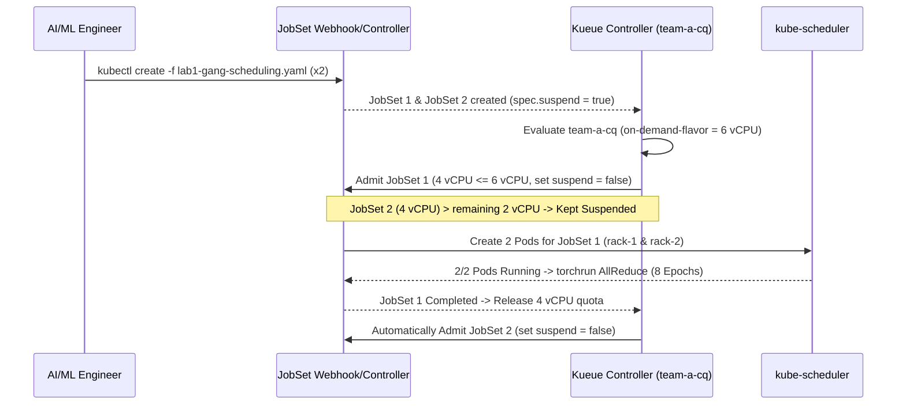
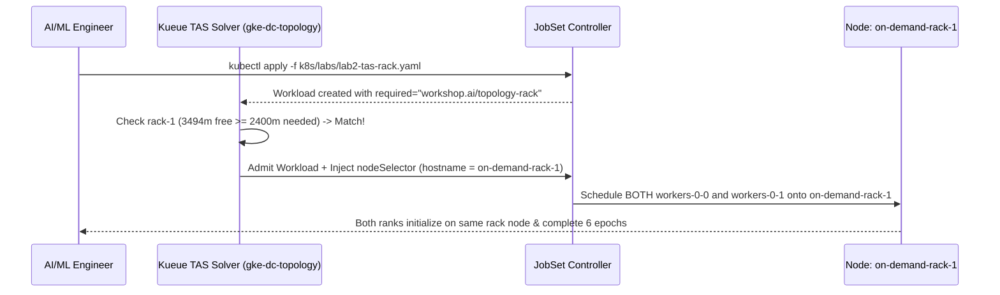
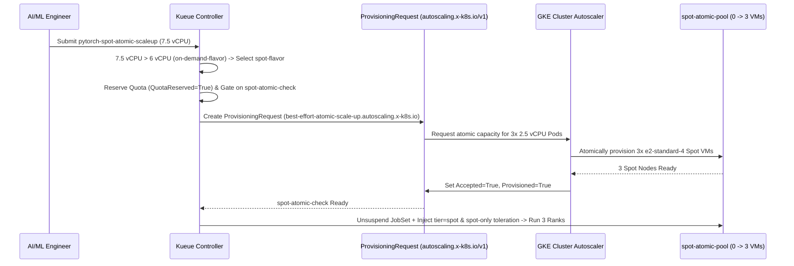

# 03 — Step-by-Step Labs Guide (Labs 1–4)

This guide walks through each of the four hands-on labs in [`k8s/labs/`](../k8s/labs/), explaining the manifest design, internal control-plane flow, execution commands, and verified terminal outputs from GKE `v1.36.4-gke.1391002`.

---

## Lab 1: All-or-Nothing Gang Scheduling ([`k8s/labs/lab1-gang-scheduling.yaml`](../k8s/labs/lab1-gang-scheduling.yaml))

### 1. Scenario & Objective
Distributed PyTorch `torchrun` jobs require every rank (`0 .. WORLD_SIZE-1`) to initialize simultaneously. If two 2-Pod jobs (`4 vCPUs` each) are submitted against a `6 vCPU` `on-demand-flavor` quota, default Kubernetes would schedule 2 Pods for Job 1 and 1 Pod for Job 2 (or deadlock if interleaved). Kueue guarantees **all-or-nothing gang admission**: Job 1 receives `2/2` Pods immediately, while Job 2 waits in `team-a-queue` with `SUSPENDED=true` (zero Pods created) until Job 1 completes and releases its quota.

### 2. Manifest Breakdown
- `generateName: pytorch-ddp-gang-`: Allows submitting multiple instances via `kubectl create -f`.
- `labels.kueue.x-k8s.io/queue-name: team-a-queue`: Routes the JobSet to `team-a-cq`.
- `annotations.kueue.x-k8s.io/podset-preferred-topology: "workshop.ai/topology-block"`: Targets the TAS-enabled `on-demand-flavor` (`block-1`), allowing the 2 Pods (`2 vCPU` each = `4 vCPU` total) to span across `on-demand-rack-1` and `on-demand-rack-2`.
- Dynamic `MASTER_ADDR` resolution for `generateName`:
  ```bash
  MASTER_ADDR="$(hostname | sed 's/-[0-9]*$/-0/').$(hostname -d)"
  ```

### 3. Under-the-Hood Sequence Diagram



### 4. Execution & Verification Commands
```bash
# Submit two gang-scheduled JobSets back-to-back
make lab1

# Inspect JobSets, Kueue Workloads, and Pod placement
kubectl get jobsets,workloads,pods -n team-a -o wide

# Stream Rank 0 distributed training logs
kubectl logs -n team-a -l jobset.sigs.k8s.io/jobset-name --tail=50 -f

# Clean up before Lab 2
make labs-clean
```

### 5. Verified Live GKE Output
```text
NAME                                            TERMINALSTATE   RESTARTS   COMPLETED   SUSPENDED   AGE
jobset.jobset.x-k8s.io/pytorch-ddp-gang-n5bcl                   0                      false       16s
jobset.jobset.x-k8s.io/pytorch-ddp-gang-qcjpv                   0                      true        16s

NAME                                                          QUEUE          RESERVED IN   ADMITTED   FINISHED   AGE
workload.kueue.x-k8s.io/jobset-pytorch-ddp-gang-n5bcl-93343   team-a-queue   team-a-cq     True                  16s
workload.kueue.x-k8s.io/jobset-pytorch-ddp-gang-qcjpv-71d3d   team-a-queue                                       16s

[Rank 0/2] Initialized on Node: gke-gke-kueue-worksh-on-demand-rack-1-37786744-3n48
[Rank 1/2] Initialized on Node: gke-gke-kueue-worksh-on-demand-rack-2-c183e097-qm0n
Epoch [1/8] | World Size: 2 | Loss: 2.3555
...
Epoch [8/8] | World Size: 2 | Loss: 2.2805
Distributed Training Completed Successfully!

# Immediately after JobSet 1 finishes, JobSet 2 is automatically admitted:
NAME                                                          QUEUE          RESERVED IN   ADMITTED   FINISHED   AGE
workload.kueue.x-k8s.io/jobset-pytorch-ddp-gang-n5bcl-93343   team-a-queue   team-a-cq     True       True       96s
workload.kueue.x-k8s.io/jobset-pytorch-ddp-gang-qcjpv-71d3d   team-a-queue   team-a-cq     True                  96s
```

---

## Lab 2: Topology Aware Scheduling (TAS) — Same Rack ([`k8s/labs/lab2-tas-rack.yaml`](../k8s/labs/lab2-tas-rack.yaml))

### 1. Scenario & Objective
To minimize network hops during gradient `AllReduce`, we want both distributed PyTorch workers co-located on the **exact same rack** (`workshop.ai/topology-rack`), rather than split across `rack-1` and `rack-2`.

### 2. Manifest Breakdown
- `annotations.kueue.x-k8s.io/podset-required-topology: "workshop.ai/topology-rack"`: Instructs Kueue's TAS solver that all Pods in the PodSet **must** be placed within a single `workshop.ai/topology-rack` domain.
- `resources.requests.cpu: "1200m"` per Pod ($2 \times 1200\text{m} = 2400\text{m}$ total): Sized below a single `e2-standard-4` node's free allocatable CPU (`~3292m–3494m`) so both Pods fit onto one rack node.

### 3. Under-the-Hood Sequence Diagram



### 4. Execution & Verification Commands
```bash
# Submit the TAS same-rack JobSet
make lab2

# Verify both Pods land on the exact same rack node
kubectl get pods -n team-a -o wide

# Stream logs from both ranks
kubectl logs -n team-a -l jobset.sigs.k8s.io/jobset-name=pytorch-tas-same-rack --prefix=true -f

# Clean up before Lab 3
make labs-clean
```

### 5. Verified Live GKE Output
```text
NAME                                      READY   STATUS      RESTARTS   AGE   IP           NODE
pytorch-tas-same-rack-workers-0-0-6xj5v   0/1     Completed   0          42s   10.20.2.9    gke-gke-kueue-worksh-on-demand-rack-1-37786744-3n48
pytorch-tas-same-rack-workers-0-1-bs9rg   0/1     Completed   0          42s   10.20.2.10   gke-gke-kueue-worksh-on-demand-rack-1-37786744-3n48

[pod/pytorch-tas-same-rack-workers-0-1-bs9rg/pytorch] [Rank 1/2] Initialized on Node: gke-gke-kueue-worksh-on-demand-rack-1-37786744-3n48
[pod/pytorch-tas-same-rack-workers-0-0-6xj5v/pytorch] [Rank 0/2] Initialized on Node: gke-gke-kueue-worksh-on-demand-rack-1-37786744-3n48
[pod/pytorch-tas-same-rack-workers-0-0-6xj5v/pytorch] Epoch [1/6] | World Size: 2 | Loss: 2.3051
...
[pod/pytorch-tas-same-rack-workers-0-0-6xj5v/pytorch] Epoch [6/6] | World Size: 2 | Loss: 2.3340
[pod/pytorch-tas-same-rack-workers-0-0-6xj5v/pytorch] Distributed Training Completed Successfully!
```

---

## Lab 3: Spot Spillover & Atomic `ProvisioningRequest` ([`k8s/labs/lab3-spot-atomic.yaml`](../k8s/labs/lab3-spot-atomic.yaml))

### 1. Scenario & Objective
When a 3-node training job (`3 Pods x 2.5 vCPU = 7.5 vCPU`) exceeds the `on-demand-flavor` quota (`6 vCPU`), Kueue spills the workload over to `spot-flavor` (`9 vCPU` quota). Because `spot-atomic-pool` starts at `0` nodes, Kueue's `spot-atomic-check` `AdmissionCheck` creates a GKE `ProvisioningRequest` (`best-effort-atomic-scale-up.autoscaling.x-k8s.io`). GKE Cluster Autoscaler atomically scales `spot-atomic-pool` from `0 -> 3` Spot VMs before Kueue unsuspends the `JobSet`.

### 2. Manifest Breakdown
- `parallelism: 3`, `completions: 3`, `cpu: "2500m"` per Pod (`7500m` total $> 6000\text{m}$ `on-demand-flavor` quota).
- **No TAS annotations on Pod template:** Allows Kueue to evaluate `on-demand-flavor` first (`NoFit`) and fall back cleanly to non-TAS `spot-flavor`.
- Automatic taint toleration injection: `spot-flavor` automatically injects `tier: spot` `nodeSelector` and `spot-only=true:NoSchedule` toleration when admitting the workload.

### 3. Under-the-Hood Sequence Diagram



### 4. Execution & Verification Commands
```bash
# Submit the 3-node Spot atomic JobSet
make lab3

# Watch ProvisioningRequest and Workload status
kubectl get provisioningrequests,workloads -n team-a -w

# Watch 3 Spot nodes join the cluster
kubectl get nodes -L workload,tier -w

# Stream 3-node distributed training logs
kubectl logs -n team-a -l jobset.sigs.k8s.io/jobset-name=pytorch-spot-atomic-scaleup --prefix=true -f

# Clean up before Lab 4
make labs-clean
```

### 5. Verified Live GKE Output
```text
NAME                                                                                                    ACCEPTED   PROVISIONED   FAILED   AGE
provisioningrequest.autoscaling.x-k8s.io/jobset-pytorch-spot-atomic-scaleup-6c1c9-spot-atomic-check-1   True       True                   13s

NAME                                                  STATUS   ROLES    AGE   VERSION               WORKLOAD   TIER        TOPOLOGY-BLOCK   TOPOLOGY-RACK
gke-gke-kueue-worksh-on-demand-rack-1-37786744-3n48   Ready    <none>   27m   v1.36.4-gke.1391002              on-demand   block-1          rack-1
gke-gke-kueue-worksh-on-demand-rack-2-c183e097-qm0n   Ready    <none>   27m   v1.36.4-gke.1391002              on-demand   block-1          rack-2
gke-gke-kueue-worksh-spot-atomic-pool-1101bc94-74j5   Ready    <none>   80s   v1.36.4-gke.1391002              spot                         
gke-gke-kueue-worksh-spot-atomic-pool-1101bc94-7gz5   Ready    <none>   78s   v1.36.4-gke.1391002              spot                         
gke-gke-kueue-worksh-spot-atomic-pool-1101bc94-km4r   Ready    <none>   77s   v1.36.4-gke.1391002              spot                         
gke-gke-kueue-workshop-system-pool-be3c118f-6cgc      Ready    <none>   27m   v1.36.4-gke.1391002   system                                  

[pod/pytorch-spot-atomic-scaleup-workers-0-0-ht4l6/pytorch] [Rank 0/3] Initialized on Node: gke-gke-kueue-worksh-spot-atomic-pool-1101bc94-74j5
[pod/pytorch-spot-atomic-scaleup-workers-0-1-wpz7r/pytorch] [Rank 1/3] Initialized on Node: gke-gke-kueue-worksh-spot-atomic-pool-1101bc94-7gz5
[pod/pytorch-spot-atomic-scaleup-workers-0-2-2xzwq/pytorch] [Rank 2/3] Initialized on Node: gke-gke-kueue-worksh-spot-atomic-pool-1101bc94-km4r
[pod/pytorch-spot-atomic-scaleup-workers-0-0-ht4l6/pytorch] Epoch [1/6] | World Size: 3 | Loss: 2.3637
...
[pod/pytorch-spot-atomic-scaleup-workers-0-0-ht4l6/pytorch] Epoch [6/6] | World Size: 3 | Loss: 2.3533
[pod/pytorch-spot-atomic-scaleup-workers-0-0-ht4l6/pytorch] Distributed Training Completed Successfully!
```

---

## Lab 4: Priority-Based Workload Preemption ([`k8s/labs/lab4-preemption.yaml`](../k8s/labs/lab4-preemption.yaml))

### 1. Scenario & Objective
When a long-running exploratory job (`research-long-training`, `low-research-priority: 100`, `5 vCPU`) is actively running on the `on-demand-flavor` pool and an urgent production job (`urgent-prod-training`, `high-prod-priority: 1000`, `5 vCPU`) arrives requiring `on-demand-flavor` (`podset-required-topology: workshop.ai/topology-block`), Kueue immediately **preempts (evicts)** `research-long-training`, runs `urgent-prod-training` to completion, and then **automatically re-admits** `research-long-training`.

### 2. Manifest Breakdown
- `research-long-training`: `kueue.x-k8s.io/priority-class: low-research-priority` (`value: 100`), `EPOCHS: "50"`, $2 \times 2500\text{m} = 5000\text{m}$ CPU.
- `urgent-prod-training`: `kueue.x-k8s.io/priority-class: high-prod-priority` (`value: 1000`), `EPOCHS: "4"`, $2 \times 2500\text{m} = 5000\text{m}$ CPU, `kueue.x-k8s.io/podset-required-topology: "workshop.ai/topology-block"`.

### 3. Under-the-Hood Sequence Diagram

```mermaid
sequenceDiagram
    participant User as AI/ML Engineer
    participant Kueue as Kueue Preemption Engine
    participant Low as JobSet: research-long-training (prio=100)
    participant High as JobSet: urgent-prod-training (prio=1000)

    User->>Low: Submit research-long-training (5 vCPU)
    Kueue->>Low: Admit onto on-demand-flavor (5/6 vCPU used) -> Pods Running
    User->>High: Submit urgent-prod-training (5 vCPU, required-topology=block)
    Kueue->>Kueue: Need 5 vCPU on on-demand-flavor; withinClusterQueue=LowerPriority
    Kueue->>Low: Preempt! Set Evicted=True (reason=Preempted) & Suspend JobSet
    Low-->>Kueue: Pods terminated -> 5 vCPU reclaimed
    Kueue->>High: Admit urgent-prod-training -> Run 4 Epochs (~20s)
    High-->>Kueue: Completed -> Release 5 vCPU
    Kueue->>Low: Automatically Re-Admit research-long-training!
```

### 4. Execution & Verification Commands
```bash
# Starts research-long-training, waits for Ready pods, then submits urgent-prod-training
make lab4

# Watch preemption and automatic re-admission
kubectl get workloads,jobsets,pods -n team-a -w

# Clean up Lab 4
make labs-clean
```

### 5. Verified Live GKE Output
```text
NAME                                                          QUEUE          RESERVED IN   ADMITTED   FINISHED   AGE
workload.kueue.x-k8s.io/jobset-research-long-training-c88c3   team-a-queue                 False                 11s
workload.kueue.x-k8s.io/jobset-urgent-prod-training-3da6f     team-a-queue   team-a-cq     True                  4s

# Preemption Condition on jobset-research-long-training-c88c3:
type: Evicted, status: True, reason: Preempted
message: "Preempted to accommodate a workload (UID: a2c95349-03f6-4b17-bcba-1273cb1d9e46) due to prioritization in the ClusterQueue; preemptor path: /ai-org-cohort/team-a-cq; preemptee path: /ai-org-cohort/team-a-cq"

# urgent-prod-training completes 4 epochs:
[pod/urgent-prod-training-workers-0-1-72hfp/pytorch] [Rank 1/2] Initialized on Node: gke-gke-kueue-worksh-on-demand-rack-2-c183e097-qm0n
[pod/urgent-prod-training-workers-0-0-h74vd/pytorch] [Rank 0/2] Initialized on Node: gke-gke-kueue-worksh-on-demand-rack-1-37786744-3n48
[pod/urgent-prod-training-workers-0-0-h74vd/pytorch] Epoch [1/4] | World Size: 2 | Loss: 2.3383
...
[pod/urgent-prod-training-workers-0-0-h74vd/pytorch] Epoch [4/4] | World Size: 2 | Loss: 2.3069
[pod/urgent-prod-training-workers-0-0-h74vd/pytorch] Distributed Training Completed Successfully!

# research-long-training automatically re-admitted once urgent-prod-training finishes:
NAME                                                          QUEUE          RESERVED IN   ADMITTED   FINISHED   AGE
workload.kueue.x-k8s.io/jobset-research-long-training-c88c3   team-a-queue   team-a-cq     True                  43s
workload.kueue.x-k8s.io/jobset-urgent-prod-training-3da6f     team-a-queue   team-a-cq     True       True       36s
```
